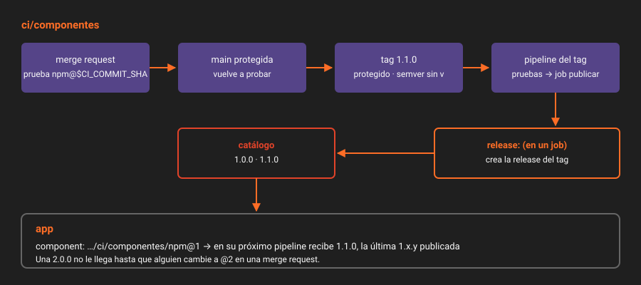

# Versionar y probar un componente

> Un componente con tres consumidores es una API. Cambiar un input es cambiar una firma; publicar una versión rota es romper tres pipelines a la vez. La versión semántica dice a cada consumidor qué cambios le llegan solos, y el pipeline del propio componente es la última oportunidad de que no le llegue uno roto.

---

## 🎯 Objetivos

- Decidir si un cambio en un componente es *major*, *minor* o *patch*
- Elegir con qué versión consume cada proyecto, y saber cómo se resuelve
- Probar un componente en su propio pipeline antes de publicarlo
- Publicar desde el pipeline del tag, con el tag protegido

---

## 1. Qué problema resuelve

`app` incluye `npm@1`. Alguien renombra el input `build` a `comando` y publica `1.3.0`. En el siguiente pipeline de `app`, `include` falla con `unknown input arguments: build`, y lo mismo en cualquier otro proyecto con `@1`. Nadie tocó `app`. El cambio era *major* y se publicó como *minor*.

O al revés: `app` incluye `npm@1.0.0` para estar "segura", y un año después sigue con un componente al que se le corrigieron cinco errores que nunca recibió.

---

## 2. Cómo funciona

### 2.1 Qué rompe a un consumidor

| Cambio en el componente | Tipo | Por qué |
|---|---|---|
| Quitar o renombrar un input | **major** | `unknown input arguments` en todos los que lo pasaban |
| Añadir un input **sin** `default` | **major** | `required value has not been provided` en todos |
| Renombrar un job | **major** | Rompe el `needs` del consumidor y cualquier sobrescritura |
| Cambiar el `stage` de un job | **major** | El consumidor puede no tener ese stage |
| Cambiar un `default` de forma que cambia el resultado | **major**, casi siempre | El consumidor no cambió nada y su pipeline hace otra cosa |
| Añadir un input con `default` que conserva lo de antes | minor | Nadie lo nota hasta que lo usa |
| Corregir un error sin cambiar el contrato | patch | |

El contrato no es solo `spec:inputs`: son también los **nombres de los jobs**, porque el consumidor los usa en `needs` (`package` tiene `needs: [build, test]`).

### 2.2 Cómo se resuelve una versión

| Escribes | Resuelve a | Necesita catálogo |
|---|---|:--:|
| `@e3262fdd…` (SHA) | Ese commit | No |
| `@1.2.0` | Ese tag | No |
| `@main` | La punta de esa rama al crear el pipeline | No |
| `@1.2` | La última `1.2.x` **publicada** | Sí |
| `@1` | La última `1.x.y` **publicada** | Sí |
| `@~latest` | La última publicada, de cualquier *major* | Sí |

Si un nombre es a la vez SHA y tag, gana el SHA; si es tag y rama, el tag. Las prerreleases (`1.3.0-rc.1`) nunca se resuelven por versión parcial ni por `~latest`: hay que pedirlas enteras.

### 2.3 La `v` delante

Los tags `v1.3.0` y `1.3.0` publican igual en el catálogo. Pero las versiones parciales solo encuentran los tags **sin** `v`. Probado en 19.2.4, con `v1.3.0` publicada:

```text
…/npm@1.3    ✅ resuelve
…/npm@v1     ❌ content not found
```

Por eso aquí los tags de componentes son `1.0.0`, sin `v`, aunque las releases de `app` de la Semana 08 lleven `v`. Son dos convenciones distintas para dos cosas distintas, y `checks.json` comprueba esta.

### 2.4 Qué versión pide cada consumidor

| Consumidor | Pide | Razón |
|---|---|---|
| Un proyecto tuyo, de un componente tuyo | `@1` | Confías en quien publica; recibes correcciones sin tocar nada |
| Un componente de otra organización | El SHA, con el tag en un comentario | La documentación lo recomienda: un tag se puede mover |
| Una prueba de una rama del componente | `@<rama>` o `@<SHA>` | Solo temporal, nunca en `main` |
| Cualquiera | Nunca `@~latest` | Te llega un *major* sin avisar |

### 2.5 Probar en su propio pipeline

El proyecto de componentes se incluye a sí mismo en el commit que se está probando:

```yaml
include:
  - component: $CI_SERVER_FQDN/$CI_PROJECT_PATH/npm@$CI_COMMIT_SHA
    inputs:
      directorio: tests/npm
      build: node --check index.test.js
      rutas: [templates/npm.yml, tests/npm/**/*]
```

Tres cosas se prueban a la vez:

- **El YAML y sus inputs**: si `templates/npm.yml` no se puede leer o un input no casa, el pipeline ni siquiera se crea.
- **El comportamiento**: los jobs `build` y `test` del componente se ejecutan de verdad contra `tests/npm/`, un proyecto mínimo que vive en el repositorio de componentes.
- **El contrato**: `directorio` y `build` no son los valores por defecto; si un cambio rompe esos inputs, falla aquí y no en `app`.

`tests/npm/` no necesita dependencias: un `package.json` con `test:ci`, un `package-lock.json` vacío y un archivo de test de `node --test`. Lo que se prueba es el componente, no npm.

### 2.6 El pipeline del tag

```yaml
stages: [build, test, release]
```

El tag `1.1.0` crea un pipeline que vuelve a ejecutar `build` y `test` y, solo si pasan, `publicar` (teoría 05, apartado 2.3). Un tag en un commit que no pasa las pruebas deja la release sin crear: la versión no se publica. Eso sí, el tag queda creado: si el error era del componente, la siguiente versión es `1.1.1`. Un tag publicado no se reutiliza.



Para que nadie se salte este camino, los tags del proyecto se **protegen** (Semana 07): solo Maintainer crea tags. Un Developer puede proponer un cambio, pero no publicarlo.

### 2.7 La trampa del laboratorio

`release:` lo ejecuta el runner con `glab`: primero `glab auth login --hostname $CI_SERVER_FQDN`, después crea la release contra `$CI_SERVER_URL`. En el laboratorio, la Semana 09 cambió `CI_SERVER_URL` a `http://gitlab:8888` para que los jobs lleguen a la API, pero `CI_SERVER_FQDN` sigue en `localhost:8888`. `glab` entra en un host y escribe en otro, cae en `https`, y el job falla con `Get "https://gitlab:8888/api/v4/…": http: server gave HTTP response to HTTPS client`.

Sobrescribir `CI_SERVER_FQDN` en la instancia rompe todos los componentes (teoría 04, apartado 2.2). Se sobrescribe **solo en el job de publicar**:

```yaml
publicar:
  variables:
    CI_SERVER_FQDN: gitlab:8888     # solo laboratorio: el mismo host que CI_SERVER_URL
```

Un `include` ya se resolvió al crear el pipeline: cambiar la variable dentro de un job no afecta a ningún componente. En una instancia con un nombre que resuelve igual dentro y fuera de los contenedores, esta línea sobra.

---

## 3. Cómo se configura

Qué versión recibió de verdad `app` cuando pide `@1`:

```bash
curl -s -H "$H" "$API/projects/$P/ci/lint?ref=main" \
  | jq -r '.includes[] | select(.type == "component") | "\(.location) → \(.blob | capture("/blob/(?<sha>[0-9a-f]{8})").sha)"'
# localhost:8888/plataforma-<tu-dominio>/ci/componentes/npm@1 → 3f2a9c1e
```

Y a qué tag corresponde ese SHA:

```bash
curl -s -H "$H" "$API/projects/$PC/repository/tags" | jq -r '.[] | "\(.name) \(.commit.short_id)"'
```

---

## 4. Antipatrones

| Antipatrón | Por qué duele | Qué hacer en su lugar |
|---|---|---|
| Renombrar un input en una *minor* | Rompe a todos los `@1` en su siguiente pipeline | *major*, o mantener el nombre viejo como alias un tiempo |
| `@~latest` en un consumidor | Le llega una *major* sin que nadie lo decida | `@1` |
| `@1.0.0` "por seguridad" en un componente propio | No recibe correcciones nunca | `@1`, y confianza en el pipeline del componente |
| Tags con `v` en el proyecto de componentes | `@1` no los encuentra | Semver sin `v` |
| Reutilizar un tag tras un fallo | Dos consumidores pueden haber resuelto contenidos distintos con el mismo nombre | Siguiente *patch* |
| Publicar sin probar en el pipeline del tag | La versión rota llega a todos a la vez | `release` en el último stage |

---

## 5. Trucos

- **Probar un cambio del componente en `app` antes de publicarlo**: en una rama de `app`, cambia `@1` por `@<SHA del commit del componente>` y mira su pipeline. No la fusiones así.
- **Una prerrelease para un consumidor voluntario**: `1.3.0-rc.1` no le llega a ningún `@1`; quien quiera probarla la pide entera.

---

## 📚 Recursos Adicionales

- [Component versions](https://docs.gitlab.com/ci/components/#component-versions) — orden de resolución y versiones parciales
- [Test the component](https://docs.gitlab.com/ci/components/#test-the-component)
- [Semantic Versioning 2.0.0](https://semver.org/lang/es/)

---

## ✅ Checklist de Verificación

- [ ] Sabes por qué renombrar un job de un componente es un cambio *major*
- [ ] Sabes qué versión recibe un consumidor con `@1` y cuál con `@1.2.0`
- [ ] Sabes por qué los tags de componentes van sin `v`
- [ ] Sabes qué prueba el pipeline del propio componente y qué pasa si falla en el tag

---

[← Anterior: El catálogo](05-catalogo.md) · [Volver a la Semana 12](../README.md) · [Siguiente: Inputs de pipeline →](07-inputs-de-pipeline.md)
