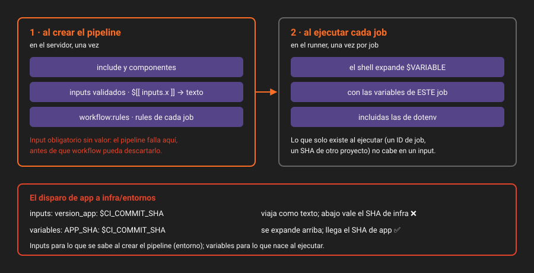

# Inputs de pipeline y `trigger:inputs`

> `spec:inputs` no es solo para componentes: el `.gitlab-ci.yml` de un proyecto también puede declararlos, y entonces quien lanza su pipeline (una persona, la API o el pipeline de otro proyecto) le pasa valores tipados y validados. Sustituyen a las variables de pipeline en todo lo que se sabe **antes** de crear el pipeline. Para lo que solo existe al ejecutar, siguen haciendo falta variables.

---

## 🎯 Objetivos

- Declarar inputs en el `.gitlab-ci.yml` de un proyecto que se lanza desde fuera
- Pasarlos con `trigger:inputs`, con la API y desde la UI
- Explicar por qué los inputs no están sujetos a la restricción de variables de pipeline
- Decidir qué dato va como input y cuál tiene que seguir como variable

---

## 1. Qué problema resuelve

En la Semana 11, `app` dispara `infra/entornos` con tres variables: `APP_SHA`, `APP_PROJECT_ID` y `APP_PACKAGE_JOB_ID`. Funciona, pero `infra/entornos` no declara en ningún sitio qué espera: lo descubre `registrar.sh` con `${APP_SHA:?...}` cuando el job ya está en marcha. Y la Semana 11 anunciaba la siguiente pieza: saber **a qué entorno** va la versión. Un dato con dos valores posibles, que hoy sería otra variable de texto libre donde un `stagin` mal escrito llega hasta el script.

---

## 2. Cómo funciona

### 2.1 Inputs en el `.gitlab-ci.yml`

```yaml
spec:
  inputs:
    entorno:
      description: Entorno al que va la versión de app
      options: [staging, production]
      default: staging
---
workflow:
  name: "app $APP_SHA → $[[ inputs.entorno ]]"
  rules:
    - if: $CI_PIPELINE_SOURCE == "pipeline"

registrar:
  variables:
    ENTORNO: $[[ inputs.entorno ]]
  # …
```

Mismas reglas que en un componente (teoría 03): se validan y se sustituyen al crear el pipeline. Hasta 20 inputs por pipeline, y solo los del archivo principal: un `include` no puede declarar inputs de pipeline.

### 2.2 El `default` no es opcional

Los inputs se validan **antes** que `workflow:rules`. Un input obligatorio hace que cualquier pipeline creado sin él, por ejemplo el de un push a `main` de `infra/entornos`, falle en la creación:

```text
`.gitlab-ci.yml`: `entorno` input: required value has not been provided
```

Aunque el `workflow` solo acepte `pipeline` y ese push no fuera a crear nada. Con `default`, el push vuelve a no crear ningún pipeline. La documentación lo recomienda para todos los inputs de pipeline; elige como `default` el valor **menos peligroso**: `staging`, nunca `production`.

### 2.3 Tres formas de pasarlos

```yaml
# Desde otro pipeline
infra:
  trigger:
    project: plataforma-<tu-dominio>/infra/entornos
    branch: main
    strategy: mirror
    inputs:
      entorno: staging
```

```bash
# Por API
curl -s --request POST "$API/projects/$PI/pipeline" -H "$H" -H "Content-Type: application/json" \
  -d '{"ref": "main", "inputs": {"entorno": "production"}}'
```

Y en la UI, `Build → Pipelines → Run pipeline` dibuja un formulario con un desplegable para cada input con `options`. También se pueden pasar en un programado y como opción de `git push`.

### 2.4 Los inputs no son variables de pipeline

La Semana 11 fijó `infra/entornos` en `ci_pipeline_variables_minimum_override_role=maintainer`. Esa restricción se aplica a las **variables** de pipeline. Los inputs no cuentan. Probado en 19.2.4 con `no_one_allowed`, incluso como administrador:

| Petición a `infra/entornos` | Resultado |
|---|---|
| `inputs: {entorno: production}` | ✅ pipeline creado |
| `variables: [{key: X, value: "1"}]` | ❌ `Insufficient permissions to set pipeline variables` |
| `inputs: {entorno: desarrollo}` | ❌ `` `desarrollo` cannot be used because it is not in the list of allowed options `` |

No es un agujero: un input solo puede tomar los valores que el propio YAML declara. Una variable de pipeline puede ser cualquier cosa, con cualquier nombre, incluido uno que cambie el comportamiento de otro job. Por eso la documentación recomienda desactivar las variables de pipeline en los proyectos que usan inputs. En `infra/entornos` todavía no se puede: apartado 2.5.

### 2.5 Lo que un input no puede llevar

```yaml
# ❌ Lo que parece natural
infra:
  trigger:
    project: plataforma-<tu-dominio>/infra/entornos
    inputs:
      entorno: staging
      app_sha: $CI_COMMIT_SHA
```

`trigger:inputs` **no expande variables**. El valor viaja como el texto `$CI_COMMIT_SHA`. Abajo, si `$[[ inputs.app_sha ]]` acaba en un `script`, el shell de `infra/entornos` lo expande con **sus** variables: llega el SHA de `infra/entornos`, no el de `app`. Ningún error, un dato falso. Probado en 19.2.4: con comillas simples en el script, el job escribe literalmente `${CI_COMMIT_SHA}-$CI_PROJECT_ID`.



Es la misma regla de la teoría 03, apartado 2.4: un input existe antes de que se ejecute nada. El SHA de `app` existe arriba, pero el ID del job de `package` solo existe cuando `package` se ejecuta, y llega por `dotenv`. Ninguno de los dos cabe en un input. En cambio `variables:` del job de disparo sí se expande arriba, con las variables de ese job.

| Dato | Se conoce | Va como |
|---|---|---|
| `entorno` | Al escribir el YAML | **input**, con `options` |
| `APP_SHA` | Al ejecutar arriba | variable |
| `APP_PROJECT_ID` | Al ejecutar arriba | variable |
| `APP_PACKAGE_JOB_ID` | Cuando termina `package` | variable, desde `dotenv` |

Por eso `infra/entornos` **mantiene** `maintainer` en la restricción de variables: el disparo sigue pasando tres. Lo que cambia es que el dato que decide **qué hace** el pipeline, el entorno, ya no es texto libre.

### 2.6 Pipeline de abajo, mismas reglas de permisos

Con inputs o con variables, el pipeline de abajo lo crea el usuario que creó el de arriba (Semana 11, teoría 05, apartado 2.2). Los inputs no cambian quién puede disparar; cambian **qué** se puede pedir.

---

## 3. Cómo se configura

Qué inputs recibió un pipeline: el nombre lo dice si `workflow:name` los usa. Por API, la lista de pipelines lo trae en `name`:

```bash
curl -s -H "$H" "$API/projects/$PI/pipelines?source=pipeline&per_page=3" \
  | jq -r '.[] | "\(.id) \(.status) \(.name)"'
# 812 success app 43bf46c76dcfd00e787d79e5cd67a20cb0cbdde6 → staging
```

---

## 4. Antipatrones

| Antipatrón | Por qué duele | Qué hacer en su lugar |
|---|---|---|
| Input de pipeline sin `default` | Cada push crea un pipeline fallido | `default` con el valor menos peligroso |
| `default: production` | Un lanzamiento sin parámetros despliega a producción | `staging` |
| `$CI_COMMIT_SHA` o una variable de `dotenv` en `trigger:inputs` | Llega el texto y se expande abajo con otros valores | `variables:` del job de disparo |
| Pasar a `no_one_allowed` porque "ya hay inputs" sin mirar qué variables viajan | El disparo falla en cuanto lleve una | Inventario de lo que viaja (apartado 2.5) |
| Un input de texto libre para el entorno | Vuelve el `stagin` | `options` |

---

## 5. Trucos

- **Lanzar con inputs desde `git push`**: `git push -o ci.input='entorno=production'` crea el pipeline con ese input, sin tocar la UI.
- **Ver qué acepta un proyecto antes de lanzarlo**: la pantalla `Run pipeline` enseña cada input con su descripción y sus opciones; es la documentación más corta posible de lo que el pipeline espera.

---

## 📚 Recursos Adicionales

- [CI/CD inputs — For a pipeline](https://docs.gitlab.com/ci/inputs/#for-a-pipeline)
- [Pass inputs to a downstream pipeline](https://docs.gitlab.com/ci/pipelines/downstream_pipelines/#pass-inputs-to-a-downstream-pipeline)
- [`trigger:inputs`](https://docs.gitlab.com/ci/yaml/#triggerinputs)

---

## ✅ Checklist de Verificación

- [ ] Sabes por qué un input de pipeline necesita `default` aunque el `workflow` filtre el origen
- [ ] Sabes por qué un input pasa con `no_one_allowed` y una variable no
- [ ] Sabes qué llega abajo si pones `$CI_COMMIT_SHA` en `trigger:inputs`
- [ ] Sabes qué datos del disparo de `app` pueden ser inputs y cuáles no

---

[← Anterior: Versionar y probar un componente](06-versionar-y-probar.md) · [Volver a la Semana 12](../README.md) · [Siguiente: Gobernar el CI compartido →](08-gobernar-el-ci-compartido.md)
