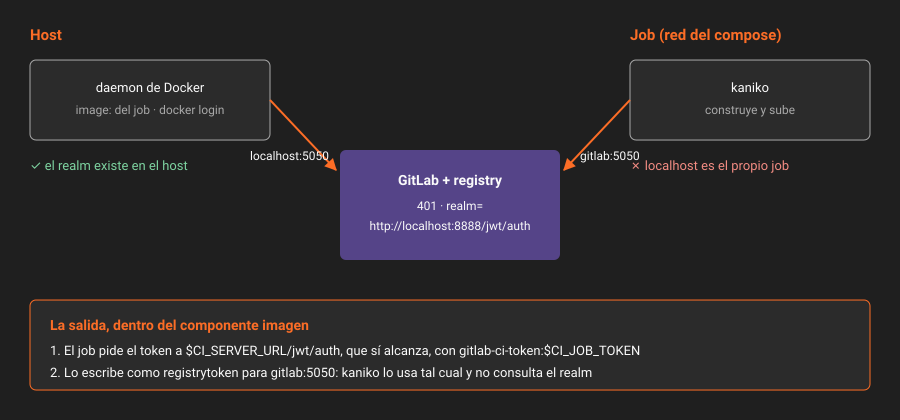

# Construir imágenes sin privilegios

> `docker build` necesita un daemon de Docker, y un daemon dentro de un job necesita un contenedor privilegiado: root en el host para cualquiera que pueda escribir un `.gitlab-ci.yml`. Tu runner de la Semana 09 tiene `privileged = false`, y así se queda. Kaniko construye la imagen desde dentro de un contenedor normal, sin daemon. Esta teoría cuenta cómo, y la trampa que tiene en el laboratorio.

---

## 🎯 Objetivos

- Explicar por qué *Docker-in-Docker* exige un runner privilegiado y qué riesgo supone
- Comparar kaniko, Buildah y Docker-in-Docker para un runner sin privilegios
- Escribir un `Dockerfile` pequeño y reproducible para `app`
- Explicar la trampa del realm y cómo la resuelve `registrytoken`

---

## 1. Qué problema resuelve

El job que construye una imagen recibe el código de cualquiera que abra una merge request. Con *Docker-in-Docker* (`services: [docker:dind]`), ese job tiene un daemon de Docker que solo arranca con `privileged = true`. Un contenedor privilegiado puede montar el disco del host, cargar módulos del kernel y salir del contenedor. Es decir: quien escribe el YAML es root en la máquina del runner.

La Semana 15 creará un runner `dind` aparte, etiquetado y aislado, para los casos que lo necesiten de verdad. Para construir la imagen de `app` no hace falta.

---

## 2. Cómo funciona

### 2.1 Tres formas de construir en un job

| Herramienta | Cómo construye | ¿Funciona con `privileged = false`? |
|---|---|---|
| Docker-in-Docker | Un daemon de Docker en un servicio del job | ❌ No arranca |
| Buildah | Espacios de nombres de usuario del kernel | ❌ En el runner por defecto: `Error during unshare(CLONE_NEWUSER): Operation not permitted` |
| **kaniko** | Ejecuta cada instrucción del `Dockerfile` en su propio sistema de archivos y saca una capa con cada cambio | ✅ |

Probado en el laboratorio, con el runner de la Semana 09. Buildah funciona si el runner relaja `seccomp` o da capacidades extra: otra forma de pedir privilegios.

### 2.2 Qué kaniko

El proyecto original de Google, `GoogleContainerTools/kaniko`, se **archivó el 3 de junio de 2025**: no recibe correcciones de seguridad. La comunidad mantiene un fork, `osscontainertools/kaniko`, con versiones regulares y la misma interfaz:

```yaml
image:
  name: ghcr.io/osscontainertools/kaniko:v1.29.0-debug
  entrypoint: [""]
```

- La variante `-debug` incluye un shell (`busybox`): sin ella, el job no puede ejecutar `script`.
- `entrypoint: [""]` anula el de la imagen, que lanzaría kaniko directamente.
- Una herramienta archivada es una decisión que se revisa: está en la lista de lo que el ADR-010 tiene que justificar.

### 2.3 Un `Dockerfile` para `app`

`app` no compila: Node ejecuta el TypeScript quitando los tipos (Semana 09). La imagen solo necesita el código y Node:

```dockerfile
FROM node:22.23.3-alpine3.24
WORKDIR /app
COPY package.json ./
COPY src/ ./src/
USER node
CMD ["node", "--experimental-strip-types", "--input-type=module", "-e", "import { readdirSync } from 'node:fs'; for (const f of readdirSync('src')) console.log(f, Object.keys(await import('./src/' + f)))"]
```

Y un `.dockerignore` que lo deja fuera todo salvo lo necesario:

```text
*
!package.json
!src/
src/*.test.ts
```

| Decisión | Por qué |
|---|---|
| Imagen base con versión completa | Nunca `:latest` ni `node:22`: cada `pull` sería otra imagen |
| Sin `RUN npm ci` | `app` no tiene dependencias en ejecución: `typescript` solo comprueba tipos |
| `.dockerignore` que empieza por `*` | Lo que no nombras no entra: ni `.git`, ni `assets/` con LFS, ni los tests |
| `USER node` | La imagen oficial ya trae ese usuario; el proceso no corre como root |
| El `CMD` importa cada módulo | Una prueba de humo: si un archivo no carga, la imagen no arranca |

`app` es una librería, así que "arrancar" significa que sus módulos se cargan. En la Semana 14 la imagen se despliega; si tu dominio tiene un servidor, el `CMD` lo arrancará entonces.

### 2.4 La trampa del realm



Kaniko sube la imagen desde el job, que vive en la red del compose. Allí la instancia se llama `gitlab`, no `localhost`. Si le das usuario y contraseña, kaniko pregunta al registry, recibe el realm de la teoría 01 (`http://localhost:8888/jwt/auth`) e intenta pedir el token **dentro del job**:

```text
Get "http://localhost:8888/jwt/auth?scope=…": dial tcp [::1]:8888: connect: connection refused
```

Es el mismo problema que la Semana 09 resolvió para la API con `CI_SERVER_URL`, y que la Semana 12 encontró con `glab`. Cambiar el realm a `gitlab:8888` lo arreglaría en el job y lo rompería en el host, que ya no podría descargar las imágenes de los jobs. La salida es pedir el token tú:

```bash
TOKEN=$(wget -qO- --header "Authorization: Basic $(printf 'gitlab-ci-token:%s' "$CI_JOB_TOKEN" | base64 | tr -d '\n')" \
  "$CI_SERVER_URL/jwt/auth?service=container_registry&scope=repository:$RUTA:push,pull" \
  | sed -E 's/.*"token":"([^"]+)".*/\1/')
printf '{"auths":{"%s":{"registrytoken":"%s"}}}' "gitlab:5050" "$TOKEN" > /kaniko/.docker/config.json
```

`registrytoken` es un campo del `config.json` de Docker: un token que se envía tal cual, sin pasar por el realm. `$CI_SERVER_URL` sí llega a GitLab desde el job (Semana 09). Y el token es el del propio job: caduca en minutos, y solo sirve para ese repositorio.

Fuera del laboratorio, con un nombre que resuelve igual dentro y fuera, el mismo código funciona: el componente `imagen` no tiene una rama para el laboratorio, solo un input `registro` que allí vale `gitlab:5050`.

---

## 3. Cómo se configura

Lo esencial del job, que la práctica 02 convierte en el componente `imagen`:

```yaml
imagen:
  stage: package
  image:
    name: ghcr.io/osscontainertools/kaniko:v1.29.0-debug
    entrypoint: [""]
  rules:
    - if: $CI_COMMIT_BRANCH == $CI_DEFAULT_BRANCH
  script:
    - RUTA="${CI_REGISTRY_IMAGE#"$CI_REGISTRY"/}"
    # … el token y el config.json, como en el apartado 2.4
    - >-
      /kaniko/executor --context "$CI_PROJECT_DIR"
      --destination "gitlab:5050/$RUTA:$CI_COMMIT_SHORT_SHA"
      --digest-file imagen.digest --insecure
```

| Opción | Qué hace |
|---|---|
| `--context` | Carpeta que se envía al build; el `.dockerignore` se lee de ahí |
| `--destination` | Dónde se sube. Se puede repetir: varios tags, una sola construcción |
| `--digest-file` | Escribe el digest de lo subido |
| `--no-push` | Construye y no sube nada: para merge requests |
| `--insecure` | Registry por HTTP. **Solo laboratorio** |
| `--label` | Etiquetas OCI, como `org.opencontainers.image.revision` |

`RUTA` sale de `CI_REGISTRY_IMAGE` y no de `CI_PROJECT_PATH` porque el registry exige minúsculas, y la ruta del proyecto puede no tenerlas.

---

## 4. Antipatrones

| Antipatrón | Por qué duele | Qué hacer en su lugar |
|---|---|---|
| `privileged = true` en el runner de todos | Quien escribe el YAML es root en el host | kaniko; un runner `dind` aparte y etiquetado (Semana 15) |
| Montar `/var/run/docker.sock` en los jobs | El mismo riesgo que `privileged`, sin que lo parezca | kaniko |
| `FROM node:22` o `FROM node:latest` | Cada build puede usar otra base | La versión completa |
| `COPY . .` sin `.dockerignore` | Entran `.git`, los tests y cualquier secreto local | `.dockerignore` que empieza por `*` |
| Cambiar el realm para que funcione el job | Deja de funcionar el host | `registrytoken` |
| Usar el kaniko archivado sin decirlo | Sin parches de seguridad, sin que nadie lo sepa | El fork mantenido, y el ADR que lo explica |

---

## 5. Trucos

- **Construir sin subir, en local**: `docker run --rm -v "$PWD:/w" ghcr.io/osscontainertools/kaniko:v1.29.0-debug --context /w --no-push`. Es la misma herramienta que el job, y no necesita runner.
- **Ver qué entra en el contexto** antes de construir: un `Dockerfile` temporal con `FROM alpine:3.24.2` y `COPY . /c`, y luego `find /c`.
- **El token se puede inspeccionar**: es un JWT. `cut -d. -f2 | base64 -d` enseña su `access` y su caducidad.

---

## 📚 Recursos Adicionales

- [Use Docker to build Docker images](https://docs.gitlab.com/ci/docker/using_docker_build/) — por qué Docker-in-Docker necesita `privileged`
- [osscontainertools/kaniko](https://github.com/osscontainertools/kaniko) — el fork mantenido
- [Dockerfile reference](https://docs.docker.com/reference/dockerfile/) y [`.dockerignore`](https://docs.docker.com/build/concepts/context/#dockerignore-files)
- [`docker login`](https://docs.docker.com/reference/cli/docker/login/) — dónde se guardan las credenciales

---

## ✅ Checklist de Verificación

- [ ] Sabes por qué *Docker-in-Docker* no entra en el runner de `app`
- [ ] Sabes qué hace cada línea del `Dockerfile` y del `.dockerignore` de `app`
- [ ] Sabes por qué kaniko falla con usuario y contraseña en el laboratorio
- [ ] Sabes qué es `registrytoken` y de dónde sale el token

---

[← Anterior: El container registry](01-el-container-registry.md) · [Volver a la Semana 13](../README.md) · [Siguiente: Etiquetas, digests y protección →](03-etiquetas-y-proteccion.md)
