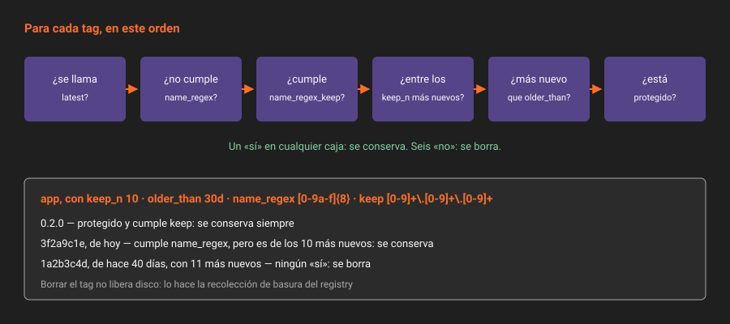

# La limpieza

> Cada commit de `main` sube una imagen de unos 60 MB. Con diez fusiones por semana son 30 GB al año, de imágenes que nadie va a volver a desplegar. La política de limpieza borra los tags que ya no sirven, y la recolección de basura recupera el disco. Las dos son gratis en CE, y ninguna está activa hasta que tú la enciendes.

---

## 🎯 Objetivos

- Explicar en qué orden decide la política qué tags borrar
- Escribir una política que borre las imágenes por SHA y no toque nunca las versiones
- Probar una política sin esperar un día, con el borrado masivo por API
- Explicar por qué borrar un tag no libera disco en el momento

---

## 1. Qué problema resuelve

El registry no borra nada solo. Sin política, el disco de la instancia crece con cada pipeline hasta que se llena, y entonces GitLab deja de escribir: la Semana 01 lo puso en la lista de los fallos caros. Borrar a mano no escala, y borrar mal (la versión que está en producción) es peor que no borrar.

---

## 2. Cómo funciona

### 2.1 Cómo decide



Para cada repositorio de imágenes del proyecto, en este orden:

1. Reúne todos los tags.
2. Quita de la lista `latest`. Siempre.
3. Quita los que **no** cumplen `name_regex`: solo se borra lo que la expresión nombra.
4. Quita los que cumplen `name_regex_keep`: lo que se conserva gana a lo que se borra.
5. Ordena los que quedan por fecha y quita los `keep_n` más recientes.
6. Quita los más nuevos que `older_than`.
7. Quita los protegidos (teoría 03).
8. Borra lo que queda.

Un tag se salva con un solo motivo. Para borrarse tiene que no tener ninguno.

### 2.2 Los valores

| Campo | Valores admitidos | En `app` |
|---|---|---|
| `enabled` | `true`, `false` (por defecto, `false`) | `true` |
| `cadence` | `1d`, `7d`, `14d`, `1month`, `3month` | `1d` |
| `name_regex` | Expresión: qué tags **pueden** borrarse | `[0-9a-f]{8}` |
| `name_regex_keep` | Expresión: qué tags no se borran nunca | `[0-9]+\.[0-9]+\.[0-9]+` |
| `keep_n` | `1`, `5`, `10`, `25`, `50`, `100` | `10` |
| `older_than` | `1d`, `3d`, `7d`, `14d`, `30d`, `60d`, `90d`, `180d`, `365d`, `730d`, `1095d` | `30d` |

Las expresiones se **anclan solas** (`\A…\Z`): `[0-9a-f]{8}` es "exactamente ocho caracteres hexadecimales", no "contiene ocho". La política por defecto, si la activas sin más, tiene `name_regex: .*`: todo es candidato, y solo te salvan `keep_n: 10` y `older_than: 90d`.

### 2.3 Cuándo corre

La política la ejecuta un proceso de fondo de GitLab, como mucho una vez cada `cadence`, a partir de `next_run_at`. No hay botón para lanzarla ahora. Lo más parecido es el borrado masivo por API: acepta los mismos criterios y actúa ya.

> [!WARNING]
> No es un simulacro: borra de verdad y no se puede deshacer. Antes, lista lo que cumple la expresión con `grep -xE` (apartado 5), y ensáyalo donde equivocarse no cueste nada, como `ci/componentes/prueba` en la práctica 03.

```bash
curl -s --request DELETE "$API/projects/$P/registry/repositories/<id>/tags" -H "$H" \
  --data-urlencode 'name_regex_delete=[0-9a-f]{8}' \
  --data-urlencode 'name_regex_keep=[0-9]+\.[0-9]+\.[0-9]+' \
  --data 'keep_n=10' --data 'older_than=30d' \
  -o /dev/null -w '%{http_code}\n'      # 202
```

- `202` significa **aceptado**: el borrado ocurre en segundo plano, segundos después.
- Como mucho **una vez por hora** por repositorio de imágenes.
- Tampoco borra nunca `latest`.

### 2.4 Borrar un tag no libera disco

Un tag apunta a un manifiesto, y el manifiesto a capas. Las capas se comparten: la base `node:22.23.3-alpine3.24` está una sola vez aunque tengas cien imágenes. Al borrar un tag, las capas que ya no usa nadie quedan huérfanas, y las recoge la **recolección de basura**:

| Con la base de metadatos (19.2.4, por defecto) | Sin ella |
|---|---|
| En línea y automática: lo que lleva 24 h sin referencias se borra solo | `gitlab-ctl registry-garbage-collect`, con el registry en solo lectura |

En tu laboratorio es la primera: no hay nada que programar. El comando de la segunda columna se niega a ejecutarse si la base está activa.

### 2.5 Los paquetes también se limpian, de otra manera

La política de paquetes **no** borra versiones: solo los archivos repetidos dentro de una misma versión (teoría 05). Es otra mutación, otra lógica, y no sustituye a esta.

---

## 3. Cómo se configura

```bash
curl -s --request PUT "$API/projects/$P" -H "$H" -H "Content-Type: application/json" \
  -d '{"container_expiration_policy_attributes": {
        "enabled": true, "cadence": "1d", "keep_n": 10, "older_than": "30d",
        "name_regex": "[0-9a-f]{8}", "name_regex_keep": "[0-9]+\\.[0-9]+\\.[0-9]+"}}' \
  | jq .container_expiration_policy
```

En la interfaz: `Settings → Packages and registries → Cleanup policies`.

---

## 4. Antipatrones

| Antipatrón | Por qué duele | Qué hacer en su lugar |
|---|---|---|
| Activar la política por defecto sin mirarla | `name_regex: .*`: tus versiones antiguas también son candidatas | `name_regex` y `name_regex_keep` explícitos |
| Confiar solo en `name_regex_keep` para las versiones | Un error en la expresión y la versión desaparece | Además, tags protegidos: la limpieza no los toca |
| `keep_n: 1` | Si el último build está roto, no hay a qué volver | `10` |
| Ver que el disco no baja y borrar a mano en el volumen | Corrompes el registry | Esperar a la recolección en línea |
| Usar `latest` y esperar que la limpieza lo gestione | Nunca lo borra | No usar `latest` (teoría 03) |

---

## 5. Trucos

- **Cuándo correrá**: `GET /projects/:id | jq .container_expiration_policy.next_run_at`.
- **Ensayar la expresión** con los tags reales antes de guardarla: `curl … /registry/repositories/<id>/tags | jq -r '.[].name' | grep -xE '[0-9a-f]{8}'`. La `-x` de `grep` hace lo mismo que el anclaje de GitLab.
- **El tamaño antes y después**: `GET /registry/repositories/<id>?size=true`. Baja cuando pasa la recolección, no cuando borras.

---

## 📚 Recursos Adicionales

- [Reduce container registry storage](https://docs.gitlab.com/user/packages/container_registry/reduce_container_registry_storage/) — el orden exacto y los valores
- [Delete registry repository tags in bulk](https://docs.gitlab.com/api/container_registry/#delete-registry-repository-tags-in-bulk)
- [Container registry garbage collection](https://docs.gitlab.com/administration/packages/container_registry/#container-registry-garbage-collection)

---

## ✅ Checklist de Verificación

- [ ] Sabes por qué un tag protegido sobrevive a cualquier política
- [ ] Sabes qué hace la política por defecto si la activas sin tocarla
- [ ] Sabes probar una política sin esperar a `next_run_at`
- [ ] Sabes por qué el tamaño del registry no baja en cuanto borras

---

[← Anterior: Etiquetas, digests y protección](03-etiquetas-y-proteccion.md) · [Volver a la Semana 13](../README.md) · [Siguiente: El registro de paquetes →](05-el-registro-de-paquetes.md)
