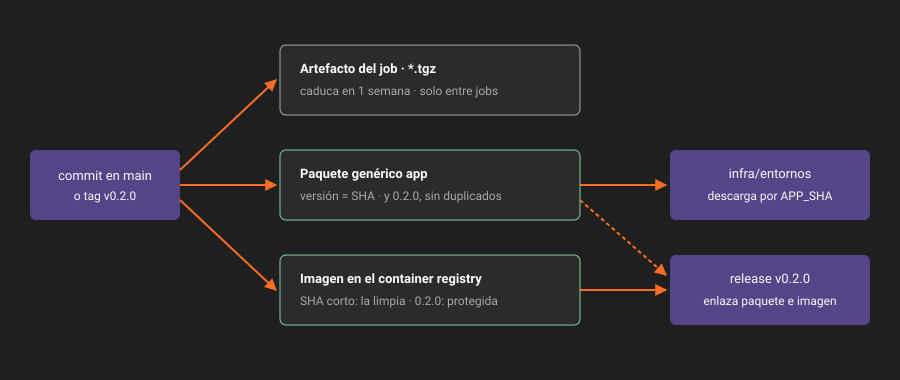

# El dependency proxy

> Cada job de `app` empieza descargando `node:22.23.3-alpine3.24` de Docker Hub. Docker Hub limita las descargas anónimas por dirección IP, y todos tus jobs salen por la misma. La Semana 09 dejó apuntado el error, `toomanyrequests`, y su remedio para hoy: el dependency proxy, una caché de imágenes de Docker Hub dentro de tu grupo. Es gratis en CE.

---

## 🎯 Objetivos

- Explicar qué guarda el dependency proxy, dónde y para quién
- Usar las variables `CI_DEPENDENCY_PROXY_*` en un `image:` y en un input de componente
- Configurar la caducidad de la caché
- Saber qué no pasa por el proxy y por qué

---

## 1. Qué problema resuelve

| Sin proxy | Con proxy |
|---|---|
| Cada job descarga de Internet | La primera descarga va a Docker Hub; las siguientes, a tu instancia |
| El límite de Docker Hub cuenta todos tus jobs | Cuenta una descarga por imagen y versión |
| Si Docker Hub cae, tus pipelines no arrancan | Lo que ya está en la caché sigue funcionando |
| Nadie sabe qué imágenes externas usa el grupo | La caché lo lista |

---

## 2. Cómo funciona

### 2.1 Una caché por grupo raíz

El proxy vive en el **grupo**, no en el proyecto. Cuando un job pide

```text
localhost:8888/plataforma-biblioteca/dependency_proxy/containers/node:22.23.3-alpine3.24
```

GitLab mira si tiene esa imagen en la caché del grupo. Si no, la descarga de Docker Hub, la guarda y la sirve. Lo sirve la propia instancia, en el puerto de la web (`8888`), no en el del registry.

- Solo Docker Hub. Para imágenes de `ghcr.io` o `quay.io` no hay proxy en CE.
- Viene activado por defecto en cada grupo. Está en `Settings → Packages and registries → Dependency Proxy` del grupo.
- Solo pueden usarlo los miembros del grupo, desde Guest: el runner se autentica con el job.

### 2.2 Las variables

| Variable | Valor en el laboratorio |
|---|---|
| `CI_DEPENDENCY_PROXY_SERVER` | `localhost:8888` |
| `CI_DEPENDENCY_PROXY_GROUP_IMAGE_PREFIX` | `localhost:8888/plataforma-<tu-dominio>/dependency_proxy/containers` |
| `CI_DEPENDENCY_PROXY_DIRECT_GROUP_IMAGE_PREFIX` | Lo mismo, con el subgrupo del proyecto en lugar del grupo raíz |
| `CI_DEPENDENCY_PROXY_USER` / `_PASSWORD` | Credenciales del job |

```yaml
default:
  image: ${CI_DEPENDENCY_PROXY_GROUP_IMAGE_PREFIX}/node:22.23.3-alpine3.24
```

El runner reconoce el prefijo y se autentica solo con las credenciales del job. Usa `GROUP` y no `DIRECT_GROUP`: una sola caché para todo el grupo raíz, que es lo que la Semana 03 decidió que se configura arriba y se usa abajo.

### 2.3 Con componentes

El componente `npm` tiene un input `imagen`. `app` le pasa el prefijo:

```yaml
include:
  - component: $CI_SERVER_FQDN/plataforma-<tu-dominio>/ci/componentes/npm@1
    inputs:
      imagen: ${CI_DEPENDENCY_PROXY_GROUP_IMAGE_PREFIX}/node:22.23.3-alpine3.24
```

El input se sustituye como texto al crear el pipeline (Semana 12), y `image:` expande la variable después, con el valor del proyecto que consume. Por eso el **valor por defecto** del componente no lleva el prefijo: un consumidor fuera de un grupo, en un espacio personal, no tiene dependency proxy y se quedaría sin imagen.

### 2.4 Qué no pasa por el proxy



| Descarga | ¿Proxy? | Por qué |
|---|:--:|---|
| `image:` y `services:` de un job | ✅ | Las descarga el daemon del host, que llega a `localhost:8888` |
| El `FROM` del `Dockerfile` dentro de kaniko | ❌ en el laboratorio | Kaniko está en la red del compose: `localhost:8888` es el propio job (teoría 02, apartado 2.4) |
| Imágenes de tu propio registry | — | Ya están en tu instancia |
| Imágenes que no son de Docker Hub | ❌ | El proxy de CE solo sabe de Docker Hub |

El `FROM` de kaniko sigue yendo a Docker Hub, una vez por construcción. Fuera del laboratorio, con un nombre que resuelve igual en todas partes, el `FROM` también podría usar el prefijo.

### 2.5 La caducidad

Sin política, la caché crece para siempre. La política de caducidad borra lo que lleva N días **sin usarse**: lo que se usa a diario se queda.

```bash
curl -s -H "Authorization: Bearer $GITLAB_TOKEN" -H "Content-Type: application/json" \
  "$GITLAB_URL/api/graphql" -d '{"query":"mutation { updateDependencyProxyImageTtlGroupPolicy(input: {
    groupPath: \"plataforma-<tu-dominio>\", enabled: true, ttl: 30 }) { errors dependencyProxyImageTtlPolicy { enabled ttl } } }"}'
```

Por defecto: desactivada, con `ttl: 90`. Es GraphQL; la REST solo sabe vaciar la caché entera (`DELETE /groups/:id/dependency_proxy/cache`).

---

## 3. Cómo se configura

Lo que hay en la caché del grupo:

```bash
curl -s -H "Authorization: Bearer $GITLAB_TOKEN" -H "Content-Type: application/json" "$GITLAB_URL/api/graphql" \
  -d '{"query":"{ group(fullPath: \"plataforma-<tu-dominio>\") { dependencyProxySetting { enabled }
       dependencyProxyImageTtlPolicy { enabled ttl } dependencyProxyTotalSize
       dependencyProxyManifests { nodes { imageName } } } }"}' | jq .data.group
```

Y en el log del job, la prueba de que pasó por el proxy:

```text
Pulling docker image localhost:8888/plataforma-biblioteca/dependency_proxy/containers/node:22.23.3-alpine3.24 ...
```

---

## 4. Antipatrones

| Antipatrón | Por qué duele | Qué hacer en su lugar |
|---|---|---|
| Escribir el prefijo a mano (`localhost:8888/…`) | Se rompe al cambiar de grupo o de instancia | `${CI_DEPENDENCY_PROXY_GROUP_IMAGE_PREFIX}` |
| El prefijo en el `default` de un componente | El consumidor sin grupo no tiene proxy | Que lo pase el consumidor por input |
| Caché sin caducidad | Crece con cada versión que alguien probó una vez | `ttl` de 30 días |
| `node:22` a través del proxy | El proxy guarda lo que hoy sea `22`: mañana es otra imagen | Versión completa, también aquí |
| Contar con el proxy si Docker Hub cae | Solo sirve lo que ya está en caché | Las imágenes críticas, en tu registry |

---

## 5. Trucos

- **¿Viene de la caché?** Un `docker pull` del prefijo desde tu terminal, con `docker login localhost:8888` y un PAT con `read_registry` y `write_registry` (los dos: lo exige el proxy), enseña la misma imagen que usan los jobs.
- **Qué imágenes externas usa el grupo**: `dependencyProxyManifests { nodes { imageName } }`. Es un inventario gratis para la Semana 19.

---

## 📚 Recursos Adicionales

- [Dependency proxy](https://docs.gitlab.com/user/packages/dependency_proxy/)
- [Reduce dependency proxy storage](https://docs.gitlab.com/user/packages/dependency_proxy/reduce_dependency_proxy_storage/)
- [Docker Hub usage and limits](https://docs.docker.com/docker-hub/usage/)

---

## ✅ Checklist de Verificación

- [ ] Sabes por qué el proxy está en el grupo y no en el proyecto
- [ ] Sabes qué variable usar en un `image:` y por qué esa
- [ ] Sabes por qué el `FROM` de kaniko no pasa por el proxy en el laboratorio
- [ ] Sabes qué borra la política de caducidad

---

[← Anterior: El registro de paquetes](05-el-registro-de-paquetes.md) · [Volver a la Semana 13](../README.md) · [Siguiente: Permisos y job token →](07-permisos-y-job-token.md)
