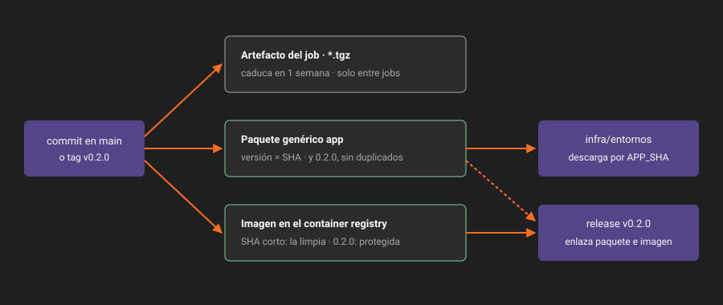

# Qué binario va dónde

> GitLab tiene seis sitios para guardar un archivo que no es código: el repositorio, LFS, los artefactos de un job, el registro de paquetes, el container registry y los enlaces de una release. Los seis funcionan para casi todo, y por eso se usan mal. Esta teoría decide, para cada cosa que produce `app`, dónde vive, cuánto vive y quién la borra.

---

## 🎯 Objetivos

- Elegir el sitio de un binario por su vida, no por la comodidad
- Explicar qué aporta una release que no aportan el paquete ni la imagen
- Enlazar desde una release a un paquete y a una imagen con URL estables
- Saber cuánto ocupa cada sitio y quién lo limpia

---

## 1. Qué problema resuelve

La Semana 04 dejó una regla: lo que se deriva del código no se versiona en el repositorio. La Semana 09 dejó otra: un artefacto caduca. Faltaba la tercera parte: dónde va lo que **no** caduca y **no** es código.

---

## 2. Cómo funciona

### 2.1 Los seis sitios

| Sitio | Para qué | Vive | Lo limpia |
|---|---|---|---|
| Repositorio | Código y lo que se revisa en una merge request | Siempre | Nadie: es historia |
| Git LFS | Binarios **de entrada** que se versionan con el código (Semana 04) | Siempre | Nadie |
| Artefacto de job | Pasar archivos entre jobs; informes | `expire_in` | La caducidad |
| Registro de paquetes | Binarios **de salida** con nombre y versión | Siempre | A mano, o la Semana 17 |
| Container registry | Imágenes | Hasta la limpieza | La política (teoría 04) |
| Release | La versión **para las personas**: notas, evidencia, enlaces | Siempre | Nadie |

### 2.2 Lo que produce `app`



| Qué | Dónde | Versión | Por qué |
|---|---|---|---|
| `junit.xml`, cobertura | Artefacto | — | Solo interesan a esta merge request |
| El `.tgz` de `npm pack` | Artefacto, 1 semana | — | Para que el job siguiente lo suba |
| El mismo `.tgz` | Paquete `app` | SHA, y `0.2.0` en el tag | Lo que `infra/entornos` descarga |
| La imagen | Registry de `app` | SHA corto, y `0.2.0` en el tag | Lo que la Semana 25 despliega en un clúster |
| `v0.2.0` | Release | La del tag | Lo que lee quien usa `app` |

El artefacto del `.tgz` sigue existiendo: es como el job de subida recibe el archivo. Lo que desaparece es que **otro proyecto** dependa de él.

### 2.3 La release enlaza, no guarda

Una release no almacena archivos: guarda **enlaces**, cada uno con un tipo:

| `link_type` | Para |
|---|---|
| `package` | Un paquete del registro |
| `image` | Una imagen del registry |
| `runbook` | Instrucciones de operación |
| `other` | Lo demás |

Y `direct_asset_path` le da al enlace una URL estable bajo la release (Semana 08):

```text
http://localhost:8888/plataforma-<tu-dominio>/app/-/releases/v0.2.0/downloads/paquete/app.tgz
```

Quien tenga esa URL no necesita saber que el archivo vive en el registro de paquetes, ni su ID. Si mañana cambias de sitio el binario, cambias el destino del enlace y la URL sigue igual.

Para la imagen, el enlace no es una descarga. La `url` tiene que ser `http`, `https` o `ftp` (`localhost:5050/…` se rechaza con `Url is blocked: Only allowed schemes are http, https, ftp`), así que apunta a la página del repositorio de imágenes, y el **nombre** del enlace lleva la referencia para `docker pull` con el **digest**, porque la release dice qué es `0.2.0` para siempre:

```text
nombre: imagen localhost:5050/plataforma-<tu-dominio>/app@sha256:42dc…
url:    http://localhost:8888/plataforma-<tu-dominio>/app/container_registry/<id>
```

### 2.4 Cuánto ocupa cada cosa

```bash
curl -s -H "$H" "$API/projects/$P?statistics=true" \
  | jq '.statistics | {repository_size, lfs_objects_size, job_artifacts_size, packages_size, container_registry_size}'
```

`container_registry_size` y `packages_size` se recalculan en segundo plano: tras subir algo pueden tardar en moverse. Para una imagen concreta, `GET /registry/repositories/<id>?size=true` (teoría 01).

---

## 3. Cómo se configura

Un enlace a una release que ya existe:

```bash
curl -s --request POST "$API/projects/$P/releases/v0.2.0/assets/links" -H "$H" \
  --data-urlencode "name=app.tgz" \
  --data-urlencode "url=$GITLAB_URL/api/v4/projects/$P/packages/generic/app/0.2.0/app.tgz" \
  --data-urlencode "direct_asset_path=/paquete/app.tgz" \
  --data-urlencode "link_type=package" | jq '{name, link_type, direct_asset_url}'
```

---

## 4. Antipatrones

| Antipatrón | Por qué duele | Qué hacer en su lugar |
|---|---|---|
| Subir el `.tgz` al repositorio, o a LFS | Lo derivado versionado: crece y se desincroniza | Paquete |
| Un artefacto con `expire_in: never` como "la versión" | Sin nombre, sin versión, atado a un job | Paquete y release |
| Enlazar desde la release al artefacto de un job | Caduca; el enlace se rompe (Semana 08) | Al paquete, con `direct_asset_path` |
| Enlazar la imagen por tag en la release | El tag se puede mover; la release no | El digest, en el nombre del enlace |
| Una release sin enlaces | Dice qué cambió, no dónde está | `package` e `image` |

---

## 5. Trucos

- **Los enlaces de una release, de un vistazo**: `GET /projects/:id/releases/v0.2.0 | jq '.assets.links[] | {name, link_type, direct_asset_url}'`.
- **Corregir un enlace sin borrar la release**: `PUT /projects/:id/releases/v0.2.0/assets/links/<link_id>` con la nueva `url`.

---

## 📚 Recursos Adicionales

- [Release links](https://docs.gitlab.com/user/project/releases/release_fields/#links)
- [Release links API](https://docs.gitlab.com/api/releases/links/)
- [Storage usage](https://docs.gitlab.com/user/storage_usage_quotas/)

---

## ✅ Checklist de Verificación

- [ ] Sabes dónde va el `.tgz` de `app` y por qué no es el artefacto
- [ ] Sabes qué aporta `direct_asset_path`
- [ ] Sabes por qué la release enlaza la imagen por digest
- [ ] Sabes quién limpia cada uno de los seis sitios

---

[← Anterior: Permisos y job token](07-permisos-y-job-token.md) · [Volver a la Semana 13](../README.md)
