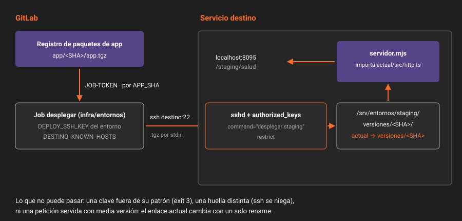

# El destino

> Un despliegue necesita un sitio al que llegar. En el laboratorio ese sitio es `destino`, un servicio del `docker-compose.yml` que hace lo que hace un servidor pequeño de verdad: acepta conexiones SSH de quien tiene una clave, guarda cada versión en su directorio y sirve la que toque por HTTP. Lo que importa no es el servicio, que es de juguete, sino las tres decisiones que lleva dentro y que vas a encontrar en cualquier destino real.

---

## 🎯 Objetivos

- Explicar el recorrido de un `.tgz` desde el job hasta la respuesta HTTP
- Limitar lo que puede hacer cada clave SSH con un comando forzado
- Fijar la huella del servidor en vez de aceptar la primera que llegue
- Cambiar de versión de forma atómica, y volver a una anterior sin descargar nada

---

## 1. Qué problema resuelve

La Semana 10 dejó en `app` una `DEPLOY_SSH_KEY` que no abría ninguna máquina. Para que abra una, la máquina tiene que existir, y tiene que responder a tres preguntas que cualquier equipo de operaciones haría antes de darte acceso:

| Pregunta | Mala respuesta | La de `destino` |
|---|---|---|
| ¿Qué puede hacer quien tenga esta clave? | Todo lo que pueda el usuario `deploy` | Una orden, en los entornos que diga su línea de `authorized_keys` |
| ¿Cómo sabe el job que habla con el destino y no con otro? | `StrictHostKeyChecking=no` | La huella del destino, guardada en una variable |
| ¿Qué ve un usuario a mitad de un despliegue? | Media versión vieja y media nueva | La vieja, hasta que la nueva está entera |

---

## 2. Cómo funciona



### 2.1 Las piezas

| Pieza | Archivo | Qué hace |
|---|---|---|
| La imagen | [`destino/Dockerfile`](../../../destino/Dockerfile) | Node 22 sobre Alpine, más `sshd`. El usuario `deploy` no tiene contraseña |
| El arranque | [`destino/arranque.sh`](../../../destino/arranque.sh) | Crea la clave de host la primera vez, en un volumen, y arranca `sshd` y el servidor |
| La orden de despliegue | [`destino/desplegar.sh`](../../../destino/desplegar.sh) | La única orden que acepta SSH: `desplegar`, `parar` o `estado` |
| El servidor | [`destino/servidor.mjs`](../../../destino/servidor.mjs) | Atiende `/<entorno>/…` con la versión a la que apunta `actual` |

Gasta unos 20 MB de memoria. Escucha en `localhost:8095` desde tu máquina y en `destino:22` desde los jobs, que comparten red con él.

### 2.2 El comando forzado

En `authorized_keys`, cada clave puede llevar delante opciones. Dos cambian todo:

```text
command="/usr/local/bin/desplegar staging",restrict ssh-ed25519 AAAA… staging
command="/usr/local/bin/desplegar review-*",restrict ssh-ed25519 AAAA… review
```

- **`command=`**: da igual lo que pida el cliente; `sshd` ejecuta esa orden. Lo pedido llega en `SSH_ORIGINAL_COMMAND`, y `desplegar` decide si lo acepta.
- **`restrict`**: sin terminal, sin reenvío de puertos, sin agente. Si mañana OpenSSH añade una capacidad nueva, `restrict` también la quita.

El argumento es el **patrón de entornos** de esa clave. La de `staging` solo despliega en `staging`; la de las review apps, en cualquier `review-*` y en nada más:

```bash
ssh -i review deploy@destino desplegar staging <sha> staging < app.tgz
# esta clave no despliega en 'staging'
ssh -i staging deploy@destino 'sh -c id'
# uso: desplegar <slug> <sha> <entorno> | parar <slug> | estado
```

Esto es lo que hace aceptable que la clave de las review apps viva en una variable **no protegida** (teoría 04): quien la robe solo puede crear y borrar review apps.

### 2.3 La huella

La primera vez que `ssh` habla con un servidor, pregunta si fiarse de su huella. Un job no puede contestar, y la tentación es `-o StrictHostKeyChecking=no`, que acepta cualquiera: también la de quien se haya puesto en medio.

La huella se copia **una vez**, por un camino que ya es de confianza (el `docker exec` de tu máquina), y viaja al job como variable de tipo archivo:

```bash
docker compose exec destino cat /etc/ssh/claves/ssh_host_ed25519_key.pub \
  | awk '{print "destino", $1, $2}'
# destino ssh-ed25519 AAAA…
```

```bash
ssh -i "$DEPLOY_SSH_KEY" -o UserKnownHostsFile="$DESTINO_KNOWN_HOSTS" deploy@destino …
```

`StrictHostKeyChecking` se queda en su valor por defecto: con la huella en el archivo, conecta; con otra, se niega. La clave de host vive en un volumen, así que reconstruir la imagen no la cambia.

### 2.4 El paquete por la entrada estándar

No hay `scp`. El `.tgz` entra por la entrada estándar de la misma conexión que da la orden:

```bash
ssh … deploy@destino desplegar "$CI_ENVIRONMENT_SLUG" "$APP_SHA" "$CI_ENVIRONMENT_NAME" < app.tgz
```

Una conexión, una orden, un paquete. Con `scp` habría que permitir además escribir archivos donde el cliente quiera, que es justo lo que el comando forzado impide.

### 2.5 El cambio atómico

`desplegar` deja cada versión en su directorio, `/srv/entornos/<slug>/versiones/<sha>`, y mueve un enlace:

```text
/srv/entornos/staging/
├── actual -> versiones/3ba2960a…     ← lo que se sirve
└── versiones/
    ├── 0d3643f5…/
    └── 3ba2960a…/
```

El enlace nuevo se crea con otro nombre y se renombra encima del viejo (`mv -T`), que es una sola llamada al sistema: no hay un instante en que `actual` no exista o apunte a medias. Se guardan las cinco últimas versiones.

### 2.6 El servidor

`servidor.mjs` lee el entorno del primer trozo de la ruta, sigue `actual` e importa `src/http.ts` **por su ruta real**, que lleva el SHA. Una versión nueva es un módulo nuevo; volver a una anterior reutiliza el que ya estaba cargado. No hay procesos que reiniciar.

A `src/http.ts` le pasa el entorno, el SHA, la fecha del despliegue y la ruta. Lo que haga con ellos es cosa de `app`: la práctica 01 escribe `/salud`, y la 04, `/multa` con un feature flag.

---

## 3. Cómo se configura

Las claves públicas se instalan desde tu máquina, que es quien administra el destino:

```bash
{ echo "command=\"/usr/local/bin/desplegar staging\",restrict $(cat ~/.ssh/destino-staging.pub)"
  echo "command=\"/usr/local/bin/desplegar production\",restrict $(cat ~/.ssh/destino-production.pub)"
} | docker compose exec -T destino sh -c 'cat > /home/deploy/.ssh/authorized_keys'
```

Y lo que hay desplegado se ve sin GitLab:

```bash
curl -s localhost:8095/ | jq -c 'to_entries[] | {entorno: .key, sha: .value.sha[0:8]}'
# {"entorno":"staging","sha":"3ba2960a"}
```

---

## 4. Antipatrones

| Antipatrón | Por qué duele | Qué hacer en su lugar |
|---|---|---|
| `StrictHostKeyChecking=no` | Acepta a cualquiera que responda en `destino:22` | La huella en `DESTINO_KNOWN_HOSTS` |
| Una clave sin `command=` | Quien la tenga abre una shell como `deploy` | Comando forzado y `restrict` |
| La misma clave para todos los entornos | Robar la de las review apps es robar `production` | Una clave por entorno, cada una con su patrón |
| Descomprimir encima de la versión que se está sirviendo | Durante unos segundos se sirve una mezcla | Un directorio por versión y un enlace atómico |
| Borrar las versiones viejas al desplegar | Volver atrás obliga a descargar otra vez | Guardar unas cuantas, borrar el resto |

---

## 5. Trucos

- `docker compose exec destino ls -l /srv/entornos/staging` enseña a qué versión apunta `actual` sin pasar por HTTP.
- `ssh-keygen -lf <archivo>` da la huella corta de una clave, la que se compara a ojo.
- En un destino real, lo mismo con `systemd` en vez de `servidor.mjs`: el enlace `actual` y un `systemctl reload`.

---

## 📚 Recursos Adicionales

- [`authorized_keys`: formato y opciones](https://man.openbsd.org/sshd#AUTHORIZED_KEYS_FILE_FORMAT)
- [`known_hosts` y `StrictHostKeyChecking`](https://man.openbsd.org/ssh_config#StrictHostKeyChecking)
- [Using SSH keys with GitLab CI/CD](https://docs.gitlab.com/ci/jobs/ssh_keys/)

---

## ✅ Checklist de Verificación

- [ ] Sé qué hace `command=` y qué añade `restrict`
- [ ] Sé por qué la huella se copia con `docker compose exec` y no con `ssh-keyscan` desde el job
- [ ] Sé por qué no hay `scp`
- [ ] Sé qué pasa con `actual` durante un despliegue
