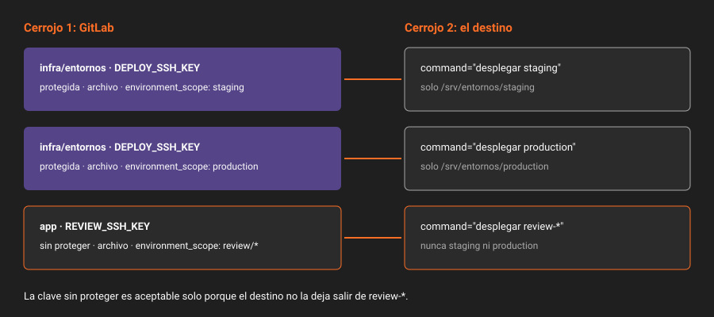

# Los secretos viven en `infra`

> En la Semana 11 se cortó el pipeline en dos: `app` construye y `infra/entornos` sabe qué va a cada entorno. Se dejó escrito que cuando hubiera entornos de verdad, sus secretos se irían a `infra/entornos` y `app` dejaría de necesitarlos. Ese momento es esta semana. Mudar un secreto es fácil; lo difícil es decidir quién puede usarlo, y en CE eso se resuelve sin la feature de pago que lo haría en un clic.

---

## 🎯 Objetivos

- Explicar por qué las credenciales de `staging` y `production` no deben estar en `app`
- Limitar una credencial por los dos lados: en GitLab y en el destino
- Mudar un secreto sin dejar la copia vieja viva
- Decidir quién despliega en `production` con lo que da CE, y saber qué añade Premium

---

## 1. Qué problema resuelve

Hoy `app` tiene `DEPLOY_TOKEN` y `DEPLOY_SSH_KEY`, protegidas y con su `environment_scope` (Semana 10). Están bien guardadas, pero en el sitio equivocado:

| Quién | Qué puede hacer en `app` | Qué podría hacer con la clave de `production` |
|---|---|---|
| Un Developer de `app` | Escribir un job en su rama | Nada: la variable está protegida y su rama no |
| Un Maintainer de `app` | Fusionar en `main`, que **sí** está protegida | Desplegar en `production` lo que quiera |
| El código de `app` | Ejecutarse en cada job de `main` | Leer la clave, si el job tiene `environment: production` |

El problema es la segunda fila. Mantener el producto y operar `production` son dos responsabilidades, y en `app` vienen en el mismo rol. En `infra/entornos`, quien es Maintainer es quien opera la plataforma.

---

## 2. Cómo funciona



### 2.1 Una credencial, dos cerrojos

Cada clave queda limitada **dos veces**, por sitios que no dependen el uno del otro:

| Clave | En GitLab | En el destino |
|---|---|---|
| `DEPLOY_SSH_KEY` de `staging` | `infra/entornos`, protegida, archivo, `environment_scope: staging` | `desplegar staging` |
| `DEPLOY_SSH_KEY` de `production` | `infra/entornos`, protegida, archivo, `environment_scope: production` | `desplegar production` |
| `REVIEW_SSH_KEY` | `app`, **sin proteger**, archivo, `environment_scope: review/*` | `desplegar review-*` |

Si alguien se equivoca en GitLab (un `environment_scope` en `*`, por ejemplo), el destino sigue sin dejar que la clave de `staging` toque `production`. Si alguien se equivoca en el destino, GitLab sigue sin dar la clave de `production` a un job de `staging`.

La tercera fila no está protegida a propósito: las review apps salen de ramas de merge request, que no son ramas protegidas, y una variable protegida no les llegaría. Es aceptable **solo porque** el destino no deja que esa clave haga nada fuera de `review-*` (teoría 02).

### 2.2 `DEPLOY_TOKEN` desaparece

La Semana 10 dijo que `DEPLOY_TOKEN` sería "la credencial que te dé el sistema donde despliegues". El destino de este laboratorio solo pide una clave SSH, así que no hay token que dar: `DEPLOY_TOKEN` se borra y no se sustituye. Es lo correcto: una credencial que nadie usa es una credencial que nadie vigila.

### 2.3 Mudar es crear y borrar

Copiar `DEPLOY_SSH_KEY` de `app` a `infra/entornos` deja la clave en dos sitios. Lo correcto es:

1. Generar claves **nuevas**, una por entorno, y darlas de alta en el destino y en `infra/entornos`.
2. Borrar `DEPLOY_SSH_KEY` y `DEPLOY_TOKEN` de `app`.
3. Borrar del disco la privada de la Semana 10, si aún existe.

Las claves de la Semana 10 nunca se instalaron en ningún destino, así que no hay nada que revocar al otro lado. En un sistema real, el paso 2 lleva al lado un paso más: quitar la pública vieja de `authorized_keys`.

### 2.4 Quién despliega en `production`

En `app`, `infra-production` es un job `trigger` manual: crea un pipeline de `infra/entornos` con `entorno: production`. Que el botón esté ahí no significa que cualquiera pueda pulsarlo. Hay **dos** comprobaciones:

| Comprobación | Dónde | Quién la pasa |
|---|---|---|
| Lanzar un job manual de `main` | `main` de `app`, protegida (Semana 07) | Quien puede fusionar en `main` de `app` |
| Que un job `trigger` cree el pipeline de abajo | `main` de `infra/entornos`, protegida | Quien puede **actualizar** `main` de `infra/entornos` |

La segunda está en el código de GitLab (`app/policies/ci/bridge_policy.rb`): un job `trigger` no se puede lanzar si quien lo lanza no puede hacer push o fusionar en la rama de destino. Un Developer que puede fusionar en `app` recibe `403 Forbidden` al pulsar `infra-production`, porque en `infra/entornos` no es Maintainer.

> [!NOTE]
> El disparo automático a `staging` (`infra`) corre como quien fusionó en `app`. Si mañana fusiona alguien que no puede actualizar `main` de `infra/entornos`, el job `infra` fallará con *insufficient permissions to create a downstream pipeline* (`failure_reason: insufficient_bridge_permissions`, comprobado en `19.2.4`). Para `staging` puede que quieras abrir `main` de `infra/entornos` a más gente; para `production`, no.

### 2.5 Lo que es de pago

| Feature | Tier | Qué resuelve | Sustituto en este bootcamp |
|---|---|---|---|
| Entornos protegidos | Premium | Quién despliega en un entorno, independientemente de la rama | La rama protegida de `infra/entornos` y el job `trigger` manual |
| Aprobaciones de despliegue | Premium | N personas aprueban un despliegue concreto antes de que corra | Aprobaciones de la merge request que llega a `main` (Semanas 07 y 12) |
| Reglas de aprobación por entorno | Premium | Seguridad aprueba `production`, nadie aprueba `staging` | Proyectos distintos con Maintainers distintos |

¿Cuándo compensa pagar? Cuando hay varios equipos que despliegan en el mismo entorno desde proyectos distintos y no puedes resolverlo con quién es Maintainer de qué. Con un solo `infra/entornos`, el sustituto cubre lo mismo.

---

## 3. Cómo se configura

```bash
# Las variables de infra/entornos: una DEPLOY_SSH_KEY por entorno, ninguna en *
glab api "projects/plataforma-<tu-dominio>%2Finfra%2Fentornos/variables" \
  | jq -c '.[] | {key, environment_scope, protected, variable_type}'
# {"key":"DEPLOY_SSH_KEY","environment_scope":"staging","protected":true,"variable_type":"file"}
# {"key":"DEPLOY_SSH_KEY","environment_scope":"production","protected":true,"variable_type":"file"}
# {"key":"DESTINO_KNOWN_HOSTS","environment_scope":"*","protected":false,"variable_type":"file"}

# app, sin credenciales de staging ni de production
glab api "projects/plataforma-<tu-dominio>%2Fapp/variables" | jq -r '.[].key'
# GOBERNANZA_TOKEN
# REVIEW_SSH_KEY
# DESTINO_KNOWN_HOSTS
```

`DESTINO_KNOWN_HOSTS` no es secreto: es la huella pública del destino. Va como archivo porque `ssh` la quiere en un archivo.

Una variable de tipo archivo llega al job con permisos `0666`, y `ssh` rechaza una clave privada que otros pueden leer (`UNPROTECTED PRIVATE KEY FILE!`). El job empieza por `chmod 600 "$DEPLOY_SSH_KEY"`.

---

## 4. Antipatrones

| Antipatrón | Por qué duele | Qué hacer en su lugar |
|---|---|---|
| Copiar la variable a `infra/entornos` y dejar la de `app` | Dos sitios que vigilar, y el viejo sigue funcionando | Claves nuevas en `infra/entornos`, borrar las de `app` |
| Una sola `DEPLOY_SSH_KEY` con `environment_scope: *` | El job de `staging` recibe la de `production` | Una por entorno |
| Proteger `REVIEW_SSH_KEY` | No llega a los jobs de merge request y las review apps no despliegan | Sin proteger, y limitada en el destino |
| Abrir `main` de `infra/entornos` a Developer "para que funcione el disparo" | Cualquier Developer de `infra` despliega en `production` | Que fusione en `app` quien opera `infra`, o un usuario de servicio (Semana 17) |

---

## 5. Trucos

- Un job con `environment: production` y `action: verify` lee la clave de `production` sin crear un despliegue (teoría 01): sirve para una comprobación tras el despliegue.
- El `403 Forbidden` al lanzar un job `trigger` casi nunca es del proyecto en el que estás: es la rama protegida del proyecto de abajo.

---

## 📚 Recursos Adicionales

- [Protected environments (Premium)](https://docs.gitlab.com/ci/environments/protected_environments/)
- [Deployment approvals (Premium)](https://docs.gitlab.com/ci/environments/deployment_approvals/)
- [Downstream pipelines: permisos](https://docs.gitlab.com/ci/pipelines/downstream_pipelines/)

---

## ✅ Checklist de Verificación

- [ ] Sé por qué cada clave está limitada en GitLab y en el destino
- [ ] Sé por qué `REVIEW_SSH_KEY` no está protegida y por qué eso es aceptable
- [ ] Sé qué dos ramas protegidas tiene que pasar quien pulsa `infra-production`
- [ ] Sé qué daría Premium que CE no da, y cuándo compensaría
