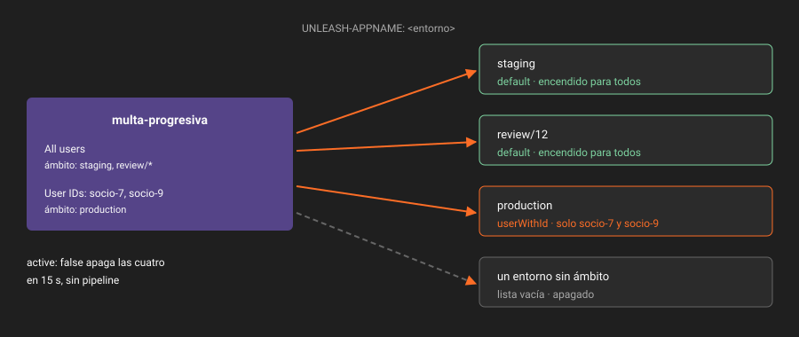

# Feature flags

> La Semana 08 dijo que en *trunk-based development* lo que no está listo se esconde detrás de un feature flag en vez de quedarse en una rama. Un flag separa dos cosas que hasta hoy iban juntas: **desplegar** (el código llega al entorno) y **activar** (alguien lo usa). GitLab trae un servidor de flags compatible con Unleash en cada proyecto, gratis, y `app` solo necesita una función de veinte líneas para preguntarle.

---

## 🎯 Objetivos

- Explicar qué separa un flag que no separa una rama
- Crear un flag con estrategias distintas por entorno, por la UI y por API
- Leer los flags desde `app` con la API Unleash, sin dependencias
- Decidir cuándo un flag sobra y cuándo hay que borrarlo

---

## 1. Qué problema resuelve

Quieres cambiar cómo se calcula la multa: una tarifa que sube a partir del séptimo día. Sin flags, hay dos caminos y los dos son malos:

| Camino | Qué pasa |
|---|---|
| Una rama larga hasta que esté lista | Diverge de `main` cada día que pasa; la fusión final es una revisión de mil líneas |
| Fusionar y desplegar | En cuanto llega a `production`, todos los socios pagan la tarifa nueva, esté validada o no |

Con un flag, el código nuevo entra en `main` en merge requests pequeñas, se despliega **apagado**, se enciende en `staging` para probarlo, luego para dos socios en `production`, y luego para todos. Si algo va mal, se apaga en un clic, sin pipeline. Cuando ya nadie lo apaga, se borra el flag y la rama de código vieja.

---

## 2. Cómo funciona



### 2.1 Las piezas

| Pieza | Dónde | Qué es |
|---|---|---|
| El flag | `Deploy → Feature flags` de `app` | Un nombre, activo o no, y una lista de estrategias |
| La estrategia | Dentro del flag | Para quién está encendido: todos, una lista de usuarios… |
| El ámbito | Dentro de cada estrategia | En qué entornos vale esa estrategia: `staging`, `review/*`, `production` |
| El cliente | `src/flags.ts` en `app` | Pregunta a GitLab y decide |

### 2.2 Las estrategias

| Estrategia | API (`name`) | Encendido para |
|---|---|---|
| *All users* | `default` | Todos |
| *User IDs* | `userWithId` | Los identificadores de `userIds`, separados por comas |
| *User list* | `gitlabUserList` | Una lista guardada aparte, reutilizable entre flags |
| *Percent rollout* | `flexibleRollout` | Un porcentaje, estable por usuario o por sesión |

Las cuatro son Free. `app` usa las dos primeras; el porcentaje llega con la entrega progresiva de la Semana 25.

### 2.3 La API Unleash

Cada proyecto expone un servidor compatible con Unleash:

```text
GET /api/v4/feature_flags/unleash/<id del proyecto>/client/features
    UNLEASH-INSTANCEID: <identificador de instancia del proyecto>
    UNLEASH-APPNAME:    <nombre del entorno>
```

Lo importante es la segunda cabecera. **`UNLEASH-APPNAME` es el entorno**, y GitLab devuelve solo las estrategias cuyo ámbito encaja con él:

```bash
for e in staging production review/3 otro; do
  curl -s -H "UNLEASH-INSTANCEID: $UNLEASH_INSTANCE_ID" -H "UNLEASH-APPNAME: $e" \
    "$GITLAB_URL/api/v4/feature_flags/unleash/<id>/client/features" \
    | jq -c --arg e "$e" '{entorno: $e, estrategias: [.features[].strategies[].name]}'
done
# {"entorno":"staging","estrategias":["default"]}
# {"entorno":"production","estrategias":["userWithId"]}
# {"entorno":"review/3","estrategias":["default"]}
# {"entorno":"otro","estrategias":[]}
```

Un entorno que ningún ámbito nombra recibe la lista vacía: el flag está **apagado**. Es el valor seguro.

El identificador de instancia (*Instance ID*) **solo se ve en la UI**: `Deploy → Feature flags → Configure`. No hay endpoint de la API v4 que lo devuelva; el único que lo toca es el que lo regenera. No es una credencial de escritura (solo lee flags), pero tampoco algo que publicar: va en la configuración del destino, no en el repositorio.

### 2.4 El cliente

Unleash tiene SDK para casi cualquier lenguaje. Para dos estrategias, un SDK es más código del que ahorra. `src/flags.ts` hace tres cosas:

1. Pide los flags del entorno, con las dos cabeceras.
2. Guarda la respuesta 15 segundos, para no preguntar en cada petición.
3. Si GitLab no responde, sigue con la última respuesta buena; si nunca la hubo, todo apagado.

```typescript
export async function activo(nombre: string, entorno: string, usuario?: string): Promise<boolean> {
  const flag = (await flags(entorno)).find((f) => f.name === nombre);
  if (!flag?.enabled) return false;
  return flag.strategies.some((e) =>
    e.name === 'default' ||
    (e.name === 'userWithId' && usuario !== undefined && e.parameters.userIds.split(',').includes(usuario)));
}
```

¿De dónde saca `flags.ts` la URL y el identificador? De `UNLEASH_URL` y `UNLEASH_INSTANCE_ID`, variables del **proceso del destino**, que vienen del `.env` del compose. La URL usa `gitlab:8888`, no `localhost:8888`: el destino es un contenedor, y para él `localhost` es él mismo. Es la misma trampa que el realm del registry (Semana 13).

### 2.5 El ciclo de vida

| Fase | Estado del flag | Código |
|---|---|---|
| Desarrollo | No existe, o apagado | Las dos ramas del `if` en `main` |
| Prueba | `default` en `staging` y `review/*` | Igual |
| Lanzamiento | `userWithId` en `production`, luego `default` | Igual |
| Limpieza | Se borra | Se borra la rama vieja del `if` |

La última fila es la que nadie hace. Un flag encendido para todos durante seis meses es una rama de código muerta con una dependencia de red. Cada flag nace con su issue de limpieza.

---

## 3. Cómo se configura

Con la UI: `Deploy → Feature flags → New feature flag`. Cada estrategia tiene su lista de entornos.

Con `glab`, el flag de `app` con dos estrategias:

```bash
glab api --method POST "projects/plataforma-<tu-dominio>%2Fapp/feature_flags" \
  -H "Content-Type: application/json" --input - <<'EOF' | jq -c '{name, active}'
{"name": "multa-progresiva", "version": "new_version_flag", "active": true,
 "description": "Tarifa que sube desde el séptimo día de retraso. Issue de limpieza: #<n>",
 "strategies": [
   {"name": "default", "parameters": {},
    "scopes": [{"environment_scope": "staging"}, {"environment_scope": "review/*"}]},
   {"name": "userWithId", "parameters": {"userIds": "socio-7,socio-9"},
    "scopes": [{"environment_scope": "production"}]}]}
EOF
```

Y apagarlo, sin pipeline:

```bash
glab api --method PUT "projects/plataforma-<tu-dominio>%2Fapp/feature_flags/multa-progresiva" -F active=false
```

---

## 4. Antipatrones

| Antipatrón | Por qué duele | Qué hacer en su lugar |
|---|---|---|
| Un flag por variable de CI y redesplegar para cambiarlo | Activar vuelve a ser desplegar | Un flag que se lee en ejecución |
| Flags que nunca se borran | Cada uno es un `if` que nadie entiende dentro de un año | Un issue de limpieza al crearlo |
| Usar un flag como configuración (URL, límites) | Cambia sin revisión, sin historial en el repositorio | Configuración en el repositorio o en variables |
| Que `app` falle si GitLab no responde | Un problema de GitLab tumba `production` | Última respuesta buena, o apagado |
| `UNLEASH_URL` con `localhost` | Desde el destino, `localhost` es el destino | `gitlab:8888` |

---

## 5. Trucos

- `curl` con `UNLEASH-APPNAME` es la forma más rápida de saber qué ve un entorno, sin desplegar nada.
- Un flag con `active: false` se queda con sus estrategias: encenderlo otra vez las recupera tal cual.
- `GET /projects/:id/feature_flags` no enseña el identificador de instancia, pero sí todo lo demás: es lo que mira el autograding.

---

## 📚 Recursos Adicionales

- [Feature flags](https://docs.gitlab.com/operations/feature_flags/)
- [API de feature flags](https://docs.gitlab.com/api/feature_flags/)
- [Unleash: client specification](https://docs.getunleash.io/reference/sdks)

---

## ✅ Checklist de Verificación

- [ ] Sé qué hace `UNLEASH-APPNAME`, y qué recibe un entorno que no está en ningún ámbito
- [ ] Sé dónde se ve el identificador de instancia y por qué no está en el repositorio
- [ ] Sé qué hace `flags.ts` si GitLab no responde
- [ ] Sé cuándo hay que borrar un flag
