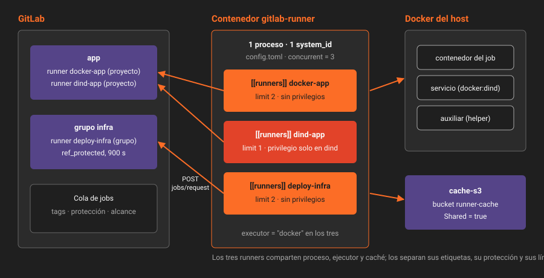

# Anatomía del runner

> "El runner" son tres cosas distintas que se llaman igual: un **proceso** que corre en una máquina, una o varias **identidades** registradas en GitLab y un **ejecutor** que crea el sitio donde corre cada job. Cuando un job no arranca, la pregunta útil es cuál de las tres falla. Esta semana un mismo proceso atiende a tres runners, y eso solo se entiende con las tres piezas separadas.

---

## 🎯 Objetivos

- Separar el proceso `gitlab-runner`, el runner registrado y el ejecutor
- Explicar qué es un gestor de runner (*runner manager*) y qué identifica el `system_id`
- Saber cómo pide trabajo un runner y por qué GitLab nunca le empuja un job
- Diagnosticar un job en `pending` mirando la pieza correcta

---

## 1. Qué problema resuelve

En la Semana 09 registraste `docker-app` y "el runner" funcionó. Ahora quieres un segundo runner con Docker privilegiado para un solo job, y un tercero que solo atienda despliegues. Hay dos caminos:

| Camino | Qué cuesta | Qué enseña |
|---|---|---|
| Tres contenedores `gitlab-runner` | Tres procesos, tres `config.toml`, ~60 MB más de RAM | Que cada runner es una máquina |
| **Un contenedor con tres `[[runners]]`** | Un `config.toml` más largo | Que un proceso puede ser varias identidades |

Este bootcamp hace lo segundo. Funciona porque en GitLab el runner **no es** el proceso: es la identidad con la que el proceso pide trabajo.

---

## 2. Cómo funciona

### 2.1 Las tres piezas



| Pieza | Dónde vive | Qué la identifica | Ejemplo de esta semana |
|---|---|---|---|
| **Proceso** (`gitlab-runner run`) | El contenedor `gitlab-runner` del compose | Su `system_id` | `r_TFVn9WLkimzE` |
| **Runner** | En GitLab, como fila de la tabla de runners; en el proceso, como un bloque `[[runners]]` | Su `id` y su token `glrt-…` | `docker-app`, `dind-app`, `deploy-infra` |
| **Ejecutor** | Dentro de cada `[[runners]]` | `executor = "docker"` | Un contenedor por job, en el Docker del host |

El token del runner es la pieza que une las dos primeras: GitLab sabe qué runner pide trabajo porque el proceso presenta su token. Por eso el token vive en `config.toml` y por eso quien lee `config.toml` puede hacerse pasar por el runner (teoría 08).

### 2.2 El gestor y el `system_id`

Un mismo runner puede tener varios procesos detrás: si copias su token a dos máquinas, GitLab ve un runner con **dos gestores**. Cada gestor se identifica con un `system_id` que el proceso genera la primera vez y guarda junto a `config.toml` (`.runner_system_id`).

```bash
# Quién atiende al runner docker-app, con qué versión y desde dónde
glab api "runners/<id>/managers" | jq -c '.[] | {system_id, version, status, ip_address}'
# {"system_id":"r_TFVn9WLkimzE","version":"19.2.2","status":"online","ip_address":"192.168.64.7"}
```

La relación al revés es la que importa esta semana: **tres runners con el mismo `system_id` son un solo proceso**. La comprobación `una-gestora-para-app` lo mira por GraphQL:

```graphql
query { project(fullPath: "plataforma-<tu-dominio>/app") {
  runners(type: PROJECT_TYPE) { nodes { description managers { nodes { systemId version } } } }
} }
```

En la UI: `Settings → CI/CD → Runners`, el runner, y la pestaña con sus gestores.

### 2.3 El runner pide; GitLab no empuja

GitLab no abre conexiones hacia los runners. Cada runner pregunta, cada pocos segundos, si hay un job para él:

1. El proceso hace `POST /api/v4/jobs/request` con el token de cada `[[runners]]`, uno detrás de otro.
2. GitLab mantiene la petición abierta un rato (*long polling*) por si aparece un job.
3. Si hay uno que el runner puede coger (etiquetas, protección, alcance: teorías 04 y 05), se lo da. Si no, responde `204` y el runner vuelve a preguntar.
4. El runner crea el entorno del job con su ejecutor, ejecuta, y va enviando el log por `PATCH /api/v4/jobs/:id/trace`.

Dos consecuencias:

- **El runner puede estar detrás de un NAT o de un cortafuegos** que no deja entrar nada. Solo necesita salir hacia GitLab. Es lo que hace posible un runner en el portátil de alguien.
- **`online` no significa "listo para tu job"**. Significa que el runner ha preguntado hace menos de dos horas. Un runner `online` con la etiqueta equivocada deja tu job en `pending` para siempre.

### 2.4 El aviso del long polling

Con varios runners en un proceso, el runner 19.2.2 avisa al arrancar:

```
WARNING: CONFIGURATION: Long polling issues detected.
  - Request bottleneck: 3 runners have request_concurrency=1, causing job delays during long polling
```

Con `request_concurrency = 1`, cada runner tiene una sola petición abierta a la vez; si GitLab la retiene en long polling, el runner no pide otro job hasta que vuelva. En un laboratorio con una cola corta no se nota. En una flota con cola, `request_concurrency` sube junto a `limit` (teoría 02).

---

## 3. Cómo se configura

Lo que ves de cada pieza, y desde dónde:

```bash
# El proceso: sus runners configurados (OJO: imprime los tokens; no lo pegues en ningún sitio)
docker compose exec gitlab-runner gitlab-runner list 2>&1 | awk '{print $1, $2}'

# Los runners: lo que GitLab sabe de ellos
glab api "projects/plataforma-<tu-dominio>%2Fapp/runners?type=project_type" \
  | jq -c '.[] | {id, description, status}'

# El ejecutor: lo que corre ahora mismo por culpa de un job
docker ps --filter "name=runner-" --format '{{.Names}} {{.Image}}'
```

Los contenedores de los jobs se llaman `runner-<token corto>-project-<id>-concurrent-<n>-…`: el nombre ya te dice qué runner y qué proyecto los crearon.

---

## 4. Antipatrones

| Antipatrón | Por qué duele | Qué hacer en su lugar |
|---|---|---|
| Diagnosticar un job `pending` reiniciando el contenedor del runner | El proceso casi nunca es el problema; el emparejamiento sí | Comparar las etiquetas del job con las de los runners `online` del proyecto |
| Copiar el mismo token a dos máquinas "para tener más capacidad" sin saberlo | Dos gestores para un runner; los jobs saltan de una máquina a otra sin control | Si quieres dos máquinas, que sea a propósito, y mira sus gestores |
| Un contenedor `gitlab-runner` por runner, por defecto | Más RAM y más configuración que mantener sin ganar nada | Un proceso con varios `[[runners]]`, salvo que el aislamiento lo exija |
| Fiarse de `online` | Solo dice que pregunta, no que pueda coger tu job | `GET /projects/:id/runners?tag_list=<tag>&status=online` |

---

## 5. Trucos

- Los umbrales están en el código (`app/models/ci/runner.rb`): `ONLINE_CONTACT_TIMEOUT = 2.hours` para `online` y `STALE_TIMEOUT = 7.days` para `stale`. Un runner que lleva una semana sin preguntar no está "caído": está abandonado, y la teoría 08 enseña a retirarlo.
- `GET /runners/:id/jobs?per_page=5` enseña los últimos jobs de un runner, con su proyecto: es la forma rápida de saber si un runner hace lo que crees.

---

## 📚 Recursos Adicionales

- [GitLab Runner](https://docs.gitlab.com/runner/)
- [Runner managers](https://docs.gitlab.com/ci/runners/runners_scope/#view-runner-managers)
- [Long polling](https://docs.gitlab.com/runner/configuration/advanced-configuration/#long-polling-issues)

---

## ✅ Checklist de Verificación

- [ ] Sé decir qué es el proceso, qué es el runner y qué es el ejecutor en mi laboratorio
- [ ] Sé ver el `system_id` de los gestores de un runner por API
- [ ] Sé explicar por qué un runner detrás de un NAT funciona
- [ ] Sé por qué `online` no basta para que un job arranque
