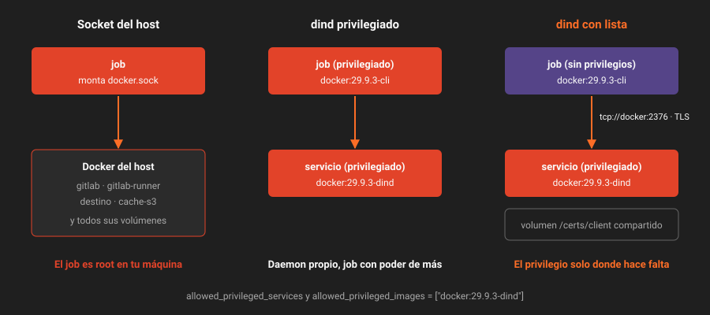

# Docker dentro de Docker

> Algunos jobs necesitan un daemon de Docker de verdad: arrancar la imagen que acaban de construir, levantar dos contenedores que hablen entre sí, ejecutar un `docker compose` de pruebas. Hay tres formas de dárselo y las tres tienen precio. La de este bootcamp es `dind` con TLS, en un runner propio, con el privilegio limitado al contenedor del daemon y no al job.

---

## 🎯 Objetivos

- Saber cuándo un job necesita un daemon de Docker y cuándo basta kaniko
- Comparar el socket del host, `dind` privilegiado y `dind` con lista de privilegiados
- Configurar `dind` con TLS: qué variables, qué volumen y qué puerto
- Evitar que cada job `dind` descargue sus imágenes de Docker Hub

---

## 1. Qué problema resuelve

En la Semana 13, kaniko construye la imagen de `app` sin privilegios y la sube al registry. Lo que kaniko **no** hace es ejecutarla: no hay daemon. Así que nadie comprueba, antes de publicar, que la imagen arranca. Un `CMD` mal escrito o un archivo que `.dockerignore` deja fuera llegan al registry y se descubren en `staging`.

El job `probar-imagen` de la práctica 02 construye la imagen y la ejecuta:

```bash
docker build -t app:prueba .
docker run --rm app:prueba | tee salida.txt
grep -q prestamos.ts salida.txt
```

Eso necesita un `dockerd`. La pregunta es de quién.

---

## 2. Cómo funciona

### 2.1 Tres formas de dar Docker a un job



| Forma | Cómo | Qué alcanza el job | Veredicto |
|---|---|---|---|
| **Socket del host** | `volumes = ["/var/run/docker.sock:/var/run/docker.sock"]` en el runner | El Docker del host: `docker run -v /:/host` y es root en tu máquina; ve y para GitLab | ❌ Nunca en un runner que ejecuta ramas |
| **`dind` privilegiado** | `privileged = true` y el servicio `docker:dind` | Su propio daemon, pero el contenedor del job **también** es privilegiado | ⚠️ Funciona, y deja el job con poder de más |
| **`dind` con lista** | `privileged = true` más `allowed_privileged_services` y `allowed_privileged_images` | Su propio daemon; el job, sin privilegios | ✅ El de este bootcamp |
| Sin daemon | kaniko, buildah | Nada: solo construye | ✅ Para construir y publicar (Semana 13) |

El socket del host merece la frase entera: **un job con el socket del host puede hacer cualquier cosa que puedas hacer tú con `docker`**, incluido leer los volúmenes de GitLab. El contenedor `gitlab-runner` lo tiene montado porque es quien crea los jobs; los jobs no deben heredarlo.

### 2.2 El privilegio, solo para el daemon

`dockerd` necesita privilegios para crear contenedores (cgroups, espacios de nombres, `iptables`). El cliente `docker` no necesita ninguno: habla con el daemon por TCP. Con `privileged = true` a secas, el runner da privilegios a **todos** los contenedores del job, el del daemon y el del `script`. Las dos listas lo afinan:

```toml
[runners.docker]
  privileged = true
  allowed_privileged_services = ["docker:29.9.3-dind"]   # solo el daemon es privilegiado
  allowed_privileged_images = ["docker:29.9.3-dind"]     # el job (docker:29.9.3-cli) no lo es
```

Comprobado en `19.2.4`, con `ip link add prueba0 type dummy` (que solo funciona con privilegios) en el `script`:

| Configuración | El job | El servicio `docker:29.9.3-dind` |
|---|---|---|
| `privileged = true`, sin listas | `JOB PRIVILEGIADO` | Arranca |
| Con las dos listas | `job sin privilegios` | Arranca |
| Con las listas, y el job pide `docker:29.9-dind` | — | No arranca: `Cannot connect to the Docker daemon at tcp://docker:2376` |

La tercera fila es la ventaja escondida: las listas fijan **la versión** del daemon que se permite, no solo la imagen.

### 2.3 TLS entre el job y el daemon

Desde Docker 19.03, la imagen `dind` genera certificados al arrancar si `DOCKER_TLS_CERTDIR` está definido, y escucha en `2376` con TLS. El cliente necesita los certificados de cliente, así que los dos contenedores tienen que compartir `/certs/client`:

| Pieza | Valor | Por qué |
|---|---|---|
| `[runners.docker] volumes` | `["/certs/client", "/cache"]` | El runner monta el mismo volumen en el servicio y en el job |
| `DOCKER_TLS_CERTDIR` | `/certs` | El daemon escribe ahí `ca`, `server` y `client` |
| `DOCKER_HOST` | `tcp://docker:2376` | `docker` es el alias del servicio en la red del job |
| `DOCKER_TLS_VERIFY`, `DOCKER_CERT_PATH` | `1`, `/certs/client` | El cliente verifica al daemon y se presenta con su certificado |

Sin TLS (`DOCKER_TLS_CERTDIR: ""` y `tcp://docker:2375`) también funciona, y cualquier contenedor de la misma red puede usar ese daemon sin credenciales. Con `network_mode = "bc-gitlab-network"`, eso es todo el laboratorio.

### 2.4 Un daemon vacío en cada job

Cada job `dind` arranca un daemon sin imágenes. `docker build` con `FROM node:22.23.3-alpine3.24` la descarga **cada vez**, y Docker Hub limita las descargas anónimas. El servicio `registry-cache` del perfil `base` es un espejo de Docker Hub (desde la Semana 01); el daemon lo usa si se le dice al arrancar:

```yaml
services:
  - name: docker:29.9.3-dind
    command: ["--registry-mirror=http://registry-cache:5000"]
```

`docker info --format '{{.RegistryConfig.Mirrors}}'` en el job lo confirma: `[http://registry-cache:5000/]`.

---

## 3. Cómo se configura

El job completo de la práctica 02:

```yaml
probar-imagen:
  stage: test
  tags: [dind]
  image: docker:29.9.3-cli
  services:
    - name: docker:29.9.3-dind
      command: ["--registry-mirror=http://registry-cache:5000"]
  variables:
    DOCKER_HOST: tcp://docker:2376
    DOCKER_TLS_CERTDIR: /certs
    DOCKER_TLS_VERIFY: "1"
    DOCKER_CERT_PATH: /certs/client
  script:
    - docker build -t app:prueba .
    - docker run --rm app:prueba | tee salida.txt
    - grep -q prestamos.ts salida.txt
  rules:
    - if: $CI_PIPELINE_SOURCE == "merge_request_event"
    - if: $CI_COMMIT_BRANCH == $CI_DEFAULT_BRANCH
```

`tags: [dind]` lo manda a `dind-app` (teoría 04). Ningún otro job de `app` pide esa etiqueta, y `dind-app` no acepta jobs sin ella.

---

## 4. Antipatrones

| Antipatrón | Por qué duele | Qué hacer en su lugar |
|---|---|---|
| Montar `/var/run/docker.sock` en los jobs | El job es root en el host | `dind` en un runner propio |
| `privileged = true` en el runner genérico | Todos los jobs de `app` son privilegiados | Un runner aparte con `run_untagged = false` |
| `privileged = true` sin las listas | El `script` del job también es privilegiado | `allowed_privileged_services` y `allowed_privileged_images` |
| `docker:dind` sin versión | Cada día un daemon distinto; las listas no lo pueden fijar | `docker:29.9.3-dind` y la misma versión en el cliente |
| `dind` para construir y publicar | Privilegios que kaniko no necesita | kaniko para publicar, `dind` solo para lo que necesita ejecutar |

---

## 5. Trucos

- La imagen `docker:29.9.3-dind-rootless` ejecuta el daemon sin root dentro del contenedor. Reduce lo que puede romper un fallo del daemon, pero sigue necesitando un contenedor privilegiado en la mayoría de hosts: no sustituye a las listas.
- Si un job `dind` falla con `Cannot connect to the Docker daemon` sin más, mira la sección de servicios del log: el daemon tarda unos segundos y el runner espera por él (`wait-for-service`). Si el servicio no aparece, no es la red: es que no se le dejó ser privilegiado.

---

## 📚 Recursos Adicionales

- [Use Docker to build Docker images](https://docs.gitlab.com/ci/docker/using_docker_build/)
- [Docker executor: privileged mode](https://docs.gitlab.com/runner/executors/docker/#use-docker-in-docker-with-privileged-mode)
- [Docker Hub: `docker`](https://hub.docker.com/_/docker) — las variantes `cli`, `dind` y `dind-rootless`

---

## ✅ Checklist de Verificación

- [ ] Sé por qué el socket del host no se monta en los jobs
- [ ] Sé qué hacen `allowed_privileged_services` y `allowed_privileged_images`, y qué pasa si el job pide otra versión de `dind`
- [ ] Sé qué cuatro variables y qué volumen necesita `dind` con TLS
- [ ] Sé cuándo basta kaniko y cuándo hace falta `dind`
