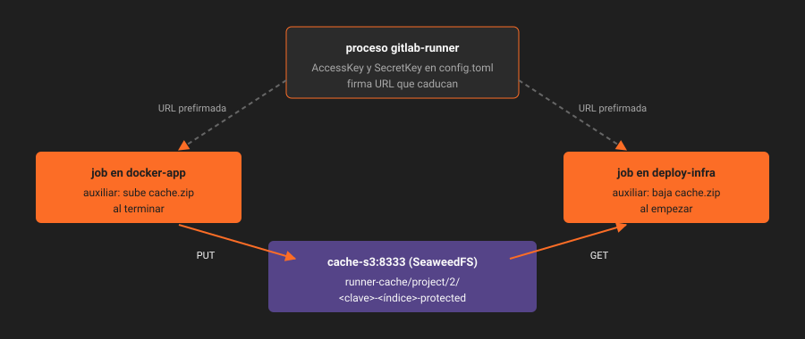

# La caché distribuida

> La caché de la Semana 09 vive en un volumen de Docker del runner que la creó. Con un runner, da igual. Con tres, cada uno tiene la suya, y un job que cae en `deploy-infra` no encuentra lo que `docker-app` guardó cinco minutos antes. Una caché en S3 la saca de los runners y la pone en un almacén que todos ven. En este laboratorio el almacén es SeaweedFS, en el servicio `cache-s3`.

---

## 🎯 Objetivos

- Explicar por qué la caché local deja de servir con más de un runner
- Configurar `[runners.cache]` contra un almacén S3 y saber qué hace `Shared`
- Leer en el almacén la ruta de cada clave y relacionarla con el `cache:` del job
- Vaciar la caché de un proyecto sin tocar el almacén

---

## 1. Qué problema resuelve

Recuerda la diferencia de la Semana 09: el **artefacto** es un resultado que el pipeline necesita y GitLab garantiza; la **caché** es un atajo que puede no estar. Un pipeline tiene que funcionar sin caché, solo que más lento. Eso no cambia esta semana. Lo que cambia es **dónde** está el atajo:

| Caché | Dónde vive | Quién la ve |
|---|---|---|
| Local (Semana 09) | Volumen `runner-…-cache-…` en el Docker del host | Solo el runner que la escribió |
| **Distribuida** | Un bucket S3 | Todos los runners configurados contra ese bucket |

Con la local, el primer job de cada runner empieza en frío, y si mañana mueves un runner a otra máquina, su caché se queda atrás. Con la distribuida, un runner nuevo hereda la caché el primer día.

---

## 2. Cómo funciona

### 2.1 El viaje de una caché



1. Al empezar el job, el contenedor auxiliar calcula la clave (la del `cache:key` del job, más el índice del proyecto y el sufijo de protección: teoría 05).
2. Pide al proceso `gitlab-runner` una **URL prefirmada** de descarga para esa clave y descarga `cache.zip` del almacén.
3. Al terminar, pide otra URL prefirmada, de subida, y sube el `cache.zip` nuevo.

El log lo cuenta paso a paso:

```
Checking cache for node-modules-protected...
Downloading cache from http://cache-s3:8333/runner-cache/project/2/node-modules-protected
Successfully extracted cache
...
Uploading cache.zip to http://cache-s3:8333/runner-cache/project/2/node-modules-protected
Created cache
```

Las URL prefirmadas son la razón de que **las credenciales S3 no lleguen nunca al job**: viven en `config.toml`, el proceso firma una URL que caduca, y el contenedor del job solo ve esa URL.

### 2.2 `Shared` y la ruta en el bucket

| `Shared` | Ruta del objeto | Consecuencia |
|---|---|---|
| `false` (por defecto) | Lleva un prefijo propio de cada runner | Cada runner tiene su parte del bucket: lo mismo que la caché local, pero en S3 |
| **`true`** | `runner-cache/project/<id>/<clave>` | Todos los runners comparten la caché de cada proyecto |

Con `Shared = true` y los tres runners contra el mismo bucket, lo que sube `docker-app` lo baja `deploy-infra`. Comprobado en `19.2.4`: un job en `docker-app` escribió `project/9/s15-protected` y el siguiente, en `deploy-infra`, la extrajo.

La separación entre proyectos la da la ruta (`project/<id>`); entre ramas protegidas y no protegidas, el sufijo de la clave. `Shared` no la rompe.

### 2.3 SeaweedFS como almacén

Un almacén S3 propio necesita tres cosas: la API de S3, un bucket y una identidad con clave. El servicio `cache-s3` es SeaweedFS `4.40` en modo `weed mini`, que levanta en un solo proceso el maestro, el volumen, el *filer* y la pasarela S3:

| En el compose | Qué hace |
|---|---|
| `command: ["mini", "-dir=/data", "-bucket=runner-cache", …]` | Datos en el volumen `bc-gitlab-cache-s3` y el bucket creado al arrancar |
| `AWS_ACCESS_KEY_ID`, `AWS_SECRET_ACCESS_KEY` | La identidad S3, desde `RUNNER_CACHE_ACCESS_KEY` y `RUNNER_CACHE_SECRET_KEY` de `.env` |
| Sin `ports:` | Solo se alcanza desde la red del laboratorio, como `cache-s3:8333` |
| `mem_limit: 256m` | Usa unos 100 MB |

¿Por qué no MinIO? Su edición comunitaria dejó de publicar versiones en octubre de 2025 y acumula avisos de seguridad sin corregir, dos de ellos de omisión de autenticación (`docs/stack-versions.md` tiene la auditoría de agosto de 2026). Para el runner da igual: habla S3, y cualquier almacén compatible vale.

### 2.4 Vaciar la caché

En `Build → Pipelines`, *Clear runner caches*. No borra nada del almacén: incrementa un índice del proyecto (`jobs_cache_index`) que se añade a todas las claves. Comprobado en `19.2.4`: tras vaciar, la clave `s15-protected` pasa a ser `s15-1-protected` y el primer job empieza en frío.

Por API es una mutación de GraphQL:

```graphql
mutation { runnerCacheClear(input: { projectId: "gid://gitlab/Project/<id>" }) { errors } }
```

Los objetos viejos se quedan en el bucket. En un laboratorio no importa; en una flota, el almacén necesita su propia política de caducidad.

---

## 3. Cómo se configura

En cada `[[runners]]`, el mismo bloque:

```toml
  [runners.cache]
    Type = "s3"
    Shared = true
    [runners.cache.s3]
      ServerAddress = "cache-s3:8333"
      AccessKey = "runnercache"
      SecretKey = "<la de RUNNER_CACHE_SECRET_KEY>"
      BucketName = "runner-cache"
      Insecure = true            # HTTP: el almacén no tiene TLS dentro del laboratorio
```

Con `register`, las mismas opciones con `--cache-type s3 --cache-shared --cache-s3-server-address … --cache-s3-insecure`. En el job, nada cambia: `cache:` sigue igual que en la Semana 09.

Para mirar dentro del almacén sin cliente S3, el *shell* de SeaweedFS:

```bash
docker compose exec cache-s3 sh -c 'echo "fs.ls -l /buckets/runner-cache/project" | weed shell'
```

---

## 4. Antipatrones

| Antipatrón | Por qué duele | Qué hacer en su lugar |
|---|---|---|
| Caché distribuida con `Shared = false` | Pagas el almacén y cada runner sigue con la suya | `Shared = true` |
| Las credenciales S3 como variable de CI | Llegan a cada job y a su log si alguien hace `env` | En `config.toml`; el job solo ve URL prefirmadas |
| Usar la caché para pasar el resultado de `build` a `deploy` | Si falta, el despliegue falla o despliega otra cosa | Artefactos (Semana 09) o paquetes (Semana 13) |
| Publicar el puerto 8333 en el host "para depurar" | Cualquiera en tu red lee y escribe la caché de todos los proyectos | `weed shell` desde dentro del contenedor |
| Vaciar la caché borrando el bucket | Rompe los jobs en curso a mitad de subida | *Clear runner caches* |

---

## 5. Trucos

- `cache: fallback_keys: [node-modules-main]` da a una rama nueva una caché de respaldo si la suya no existe. Ojo con la teoría 05: el respaldo recibe **el sufijo del job** (`cache_suffix_for` se aplica también a `fallback_keys`), así que una rama sin proteger busca `node-modules-main-non_protected`, que `main` nunca escribe. El respaldo solo sirve entre pipelines del mismo lado de la protección.
- `Uploading cache.zip … Created cache` y nada en `Downloading` del job siguiente casi siempre es una clave distinta: compara las dos líneas `Checking cache for` antes de culpar al almacén.

---

## 📚 Recursos Adicionales

- [Distributed runner caching](https://docs.gitlab.com/runner/configuration/speed_up_job_execution/#use-a-distributed-cache)
- [The `[runners.cache]` section](https://docs.gitlab.com/runner/configuration/advanced-configuration/#the-runnerscache-section)
- [SeaweedFS S3 API](https://github.com/seaweedfs/seaweedfs/wiki/Amazon-S3-API)

---

## ✅ Checklist de Verificación

- [ ] Sé por qué tres runners con caché local no comparten nada
- [ ] Sé qué cambia `Shared` en la ruta del bucket
- [ ] Sé por qué las credenciales S3 no llegan al job
- [ ] Sé vaciar la caché de un proyecto y qué le pasa a la clave
