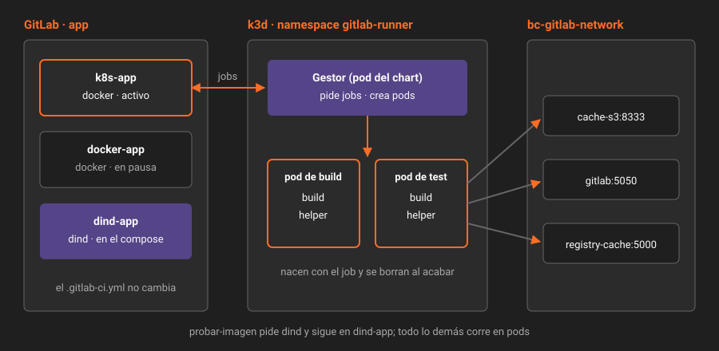

# Por qué un runner en Kubernetes

> La flota de la Semana 15 es una máquina con tres runners y un techo: `concurrent = 3`. Cuando llegan seis jobs a la vez, tres esperan aunque la máquina tenga memoria de sobra, y cuando no llega ninguno, el contenedor sigue ahí. El ejecutor Kubernetes cambia la unidad: cada job es un pod que nace cuando el job empieza y muere cuando termina. El techo deja de ser un número en `config.toml` y pasa a ser lo que quepa en el clúster.

---

## 🎯 Objetivos

- Explicar qué cambia entre el ejecutor `docker` y el ejecutor `kubernetes` para el mismo `.gitlab-ci.yml`
- Distinguir las tres piezas: el gestor del runner, el pod del job y el clúster
- Saber qué jobs de `app` pueden irse a Kubernetes y cuál se queda en `dind-app`
- Entender por qué "más rápido" no significa "más barato"

---

## 1. Qué problema resuelve

`docker-app` atiende como máximo dos jobs (`limit = 2`), en una sola máquina. `app` lanza en `test` cuatro jobs en paralelo:

| Con `docker-app` | Lo que pasa |
|---|---|
| Llegan 4 jobs de `test` | Dos corren y dos esperan en la cola de GitLab |
| La máquina tiene memoria para ocho | Da igual: el límite es `limit`, no la memoria |
| No llega ningún job en toda la noche | El contenedor `gitlab-runner` sigue reservando su sitio |
| Hacen falta más jobs a la vez | Subir `limit`, y si la máquina no da, otra máquina con otro runner a mano |

Con el ejecutor Kubernetes, el runner pide al clúster **un pod por job**. El clúster decide en qué nodo cabe, y si un clúster con autoescalado de nodos no tiene sitio, añade un nodo. La cola de GitLab se vacía al ritmo que el clúster aguante.

---

## 2. Cómo funciona

### 2.1 Tres piezas

| Pieza | Qué es | En tu laboratorio |
|---|---|---|
| **Gestor** (*runner manager*) | Un proceso `gitlab-runner` que pide jobs a GitLab y crea pods. No ejecuta ningún `script` | Un pod del Deployment `k8s-app-gitlab-runner`, en el namespace `gitlab-runner` |
| **Pod del job** | Un pod por job: el contenedor `build` con la imagen del job, el `helper` que clona y sube la caché, y uno por servicio | `runner-<id>-project-<id>-concurrent-<n>-<sufijo>`, mientras dura el job |
| **Clúster** | Los nodos donde caben los pods | k3d: un `server` y un `agent`, contenedores de Docker en `bc-gitlab-network` |



El gestor es el mismo binario que el contenedor `gitlab-runner` del compose, la misma versión (`19.2.2`) y el mismo `config.toml`. Cambia `executor = "kubernetes"` y la sección `[runners.kubernetes]` en vez de `[runners.docker]`.

### 2.2 Lo que el `.gitlab-ci.yml` no nota

`image`, `services`, `cache`, `artifacts`, `variables`, `tags`, `rules`: todo significa lo mismo. Por eso el runner nuevo entra con la etiqueta `docker` y el pipeline de `app` no cambia ni una línea. El log de cada job sí cambia:

```
Using Kubernetes namespace: gitlab-runner
Using Kubernetes executor with image node:22.23.3-alpine3.24 ...
Waiting for pod gitlab-runner/runner-cqoforipv-project-42-concurrent-0-l2vn2u4a to be running on the node k3d-bootcamp-server-0, status is Pending
Running on runner-cqoforipv-project-42-concurrent-0-l2vn2u4a via k8s-app-gitlab-runner-5bcfcbbd4b-j9sk9...
```

`Running on <pod> via <gestor>`: el job corre en el pod, y lo pidió el gestor.

### 2.3 Lo que sí cambia

| Con `docker` | Con `kubernetes` |
|---|---|
| El job ve el daemon de Docker si se le monta el socket | No hay daemon. `docker build` necesita `dind` privilegiado, o kaniko |
| `network_mode` mete el contenedor en `bc-gitlab-network` | El pod usa la red del clúster. En tu lab los nodos están en `bc-gitlab-network` y los pods resuelven `gitlab`, `cache-s3` y `registry-cache` |
| La caché local vive en un volumen del host | No hay host fijo: o caché distribuida (S3) o nada. La de la Semana 15 sirve tal cual |
| `limit` y `concurrent` son el único freno | `concurrent`, más lo que quepa en los nodos (teoría 05) |

### 2.4 Qué se queda fuera

`probar-imagen` necesita un daemon de Docker y sigue pidiendo `tags: [dind]`: lo atiende `dind-app` en el compose, como en la Semana 15. Llevar `dind` a Kubernetes pide pods privilegiados en el clúster, y eso es abrir en todo el clúster la puerta que la Semana 15 limitó a un servicio. `imagen` usa kaniko, que no necesita privilegios, y se va a Kubernetes con el resto.

Los despliegues de `infra/entornos` siguen en `deploy-infra`: es un runner de grupo, protegido, y no tiene la etiqueta `docker`.

---

## 3. Más rápido no es más barato

En el lab, el mismo pipeline de prueba (un `build`, cuatro `test` en paralelo y un `imagen`):

| Runner | Duración del pipeline | Minutos de job sumados |
|---|:--:|:--:|
| `docker-app`, `limit = 2` | 70 s | 2,1 |
| Kubernetes, `concurrent = 6` | 44 s | 2,1 |

El pipeline tarda un 37 % menos porque los cuatro `test` corren a la vez, pero **el trabajo es el mismo**: los mismos minutos de job. Lo que pagas en una nube es máquina por hora; si la máquina está encendida para atender picos, la pagas también cuando está vacía. Medir las dos cifras por separado es la línea base de esta semana (teoría 06).

---

## 4. Antipatrones

| Antipatrón | Por qué duele | Qué hacer en su lugar |
|---|---|---|
| "Kubernetes es más rápido" sin medir | A veces no: cada pod tarda unos segundos en arrancar y en bajar la imagen | Línea base antes y después (práctica 03) |
| Llevar `dind` al clúster con pods privilegiados | El privilegio deja de estar en un servicio y pasa a cualquier job del namespace | kaniko en Kubernetes; `dind` solo en `dind-app` |
| Retirar `docker-app` el mismo día | Si el clúster falla, no hay a quién volver | Pausarlo: sigue registrado y vuelve con un `PUT` |
| Caché local en el ejecutor Kubernetes | Cada pod nace vacío: la caché no se reutiliza nunca | Caché distribuida en `cache-s3` |

---

## 5. Trucos

- `kubectl -n gitlab-runner get pods -w` en otra terminal mientras corre un pipeline: ves nacer y morir un pod por job.
- La línea `Running on … via …` del log dice qué pod y qué gestor: es la forma rápida de saber dónde corrió un job sin abrir la API.

---

## 📚 Recursos Adicionales

- [The Kubernetes executor](https://docs.gitlab.com/runner/executors/kubernetes/)
- [GitLab Runner Helm chart](https://docs.gitlab.com/runner/install/kubernetes/)
- [Use kaniko to build Docker images](https://docs.gitlab.com/ci/docker/using_kaniko/)

---

## ✅ Checklist de Verificación

- [ ] Sé qué hace el gestor y qué hace el pod del job
- [ ] Sé qué partes del `.gitlab-ci.yml` cambian al pasar a Kubernetes (ninguna)
- [ ] Sé por qué `probar-imagen` se queda en `dind-app`
- [ ] Sé por qué un pipeline más corto no consume menos minutos de job
