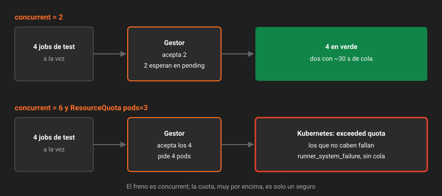

# Escalar con la cola

> Autoescalar un runner son dos cosas distintas que se suelen mezclar. Una es cuántos jobs acepta a la vez: eso lo decide `concurrent`, y cuando se llena los jobs esperan en GitLab sin romper nada. La otra es cuántas máquinas hay debajo: eso lo decide el clúster, o un plugin que crea máquinas virtuales. En tu laboratorio solo existe la primera. Esta teoría explica las dos y qué freno usar en cada caso.

---

## 🎯 Objetivos

- Explicar qué hace `concurrent` en el ejecutor Kubernetes y por qué es el freno correcto
- Saber por qué una `ResourceQuota` hace fallar los jobs en lugar de encolarlos
- Distinguir el autoescalado de pods del autoescalado de nodos
- Situar Docker Autoscaler y el ejecutor `instance` frente al ejecutor Kubernetes

---

## 1. Qué problema resuelve

Un runner fijo tiene dos maneras de equivocarse: pocos huecos y la cola crece en las horas punta, o muchos huecos y la máquina está vacía el resto del día. Escalar con la cola es que los huecos sigan a la demanda: muchos cuando hay jobs, cero cuando no hay.

---

## 2. Cómo funciona

### 2.1 Los pods ya escalan solos

Con el ejecutor Kubernetes, un job es un pod que nace y muere con él. Cuando no hay jobs, en el namespace solo queda el gestor (unos 50 MB). Esa es la mitad del autoescalado y no hay que configurarla.

El techo lo pone `concurrent` en el archivo de valores. Comprobado en el lab con el pipeline de prueba (cuatro `test` en paralelo):

| `concurrent` | Duración del pipeline | Cola de cada `test` |
|:--:|:--:|:--:|
| 6 | 44 s | 0-3 s |
| 2 | 74 s | dos a ~1 s, dos a ~30 s |

Con `concurrent = 2`, los dos `test` que no caben se quedan en `pending` en GitLab, y el gestor los recoge cuando se libera un hueco. Nadie falla.

### 2.2 Una cuota no es una cola

Kubernetes tiene su propio freno: la `ResourceQuota`, que limita cuántos pods (o cuánta memoria) caben en un namespace. Parece lo mismo que `concurrent`. No lo es:

```bash
kubectl -n gitlab-runner create quota ci --hard=pods=3
```

| Lo que pasa con 4 `test` y la cuota de 3 pods | |
|---|---|
| El gestor ocupa un pod, y el de `build`, que aún no se ha borrado, otro | Queda sitio para uno, o para ninguno si `build` tarda en irse |
| Los `test` que no caben piden pod al clúster | Kubernetes lo rechaza: `pods "runner-…" is forbidden: exceeded quota: ci, requested: pods=1, used: pods=3, limited: pods=3` |
| Esos jobs | **Fallan** con `runner_system_failure`. No vuelven a la cola. En dos pruebas en el lab fallaron tres de los cuatro `test`, y luego los cuatro |

El gestor no sabe de la cuota: acepta el job porque tiene hueco en `concurrent`, y el clúster le niega el pod. La regla: **`concurrent` por debajo de lo que la cuota y los nodos permiten**. La cuota se queda como red de seguridad, para que un error en `concurrent` no se coma el clúster, no como freno de uso diario.



### 2.3 Autoescalado de nodos

Cuando los pods piden más de lo que tienen los nodos, se quedan en `Pending` (teoría 04). En una nube, un componente del clúster ve esos pods y añade nodos:

| Pieza | Qué hace | En el laboratorio |
|---|---|---|
| Cluster Autoscaler, Karpenter o el autoescalado del proveedor | Ve pods en `Pending` y crea un nodo; quita los vacíos | No existe: los nodos de k3d son contenedores en tu máquina |
| `poll_timeout` del runner | Lo que el job espera a que llegue el nodo | 180 s por defecto. Un nodo nuevo en una nube tarda uno o dos minutos: súbelo si usas autoescalado de nodos |

En k3d, añadir un `agent` no da más sitio: todos los nodos comparten la memoria de tu máquina. Por eso la práctica escala con `concurrent` y no con nodos.

### 2.4 Sin Kubernetes: Docker Autoscaler e `instance`

| Ejecutor | Escala… | Tier |
|---|---|---|
| `kubernetes` | Pods en un clúster | Free |
| `docker-autoscaler` | Máquinas virtuales con Docker, por un plugin de *fleeting* (AWS, Google Cloud, Azure) | Free |
| `instance` | Máquinas virtuales enteras, un job por máquina, sin Docker | Free |
| `docker+machine` | Máquinas con Docker Machine | Free, **abandonado**: Docker Machine no tiene mantenimiento. No lo uses en una flota nueva |

Los tres primeros necesitan un proveedor que cree máquinas: no tienen sitio en un laboratorio de 16 GB, y por eso el bootcamp no los practica. Son la respuesta cuando no hay clúster o cuando el job necesita una máquina entera.

---

## 3. Antipatrones

| Antipatrón | Por qué duele | Qué hacer en su lugar |
|---|---|---|
| Frenar el uso con una `ResourceQuota` | Los jobs que no caben fallan en vez de esperar | `concurrent`; la cuota, por encima, como seguro |
| `concurrent` muy alto "porque el clúster escala" | Cientos de pods en `Pending` y jobs que fallan a los 180 s | `concurrent` acorde a lo que el autoescalador puede añadir en `poll_timeout` |
| Varios nodos en k3d para "escalar" | Comparten la misma memoria | `concurrent` |
| Docker Machine en una flota nueva | Sin mantenimiento | `docker-autoscaler` o `kubernetes` |

---

## 4. Trucos

- `queued_duration` de cada job (`GET /projects/:id/pipelines/:id/jobs`) es la medida de si `concurrent` se queda corto: si crece con la hora del día, falta techo.
- `kubectl -n gitlab-runner describe quota` enseña lo usado y lo permitido antes de que un job lo descubra fallando.

---

## 📚 Recursos Adicionales

- [Advanced configuration — `concurrent`, `limit`, `request_concurrency`](https://docs.gitlab.com/runner/configuration/advanced-configuration/)
- [Docker Autoscaler executor](https://docs.gitlab.com/runner/executors/docker_autoscaler/) y [Instance executor](https://docs.gitlab.com/runner/executors/instance/)
- [Resource Quotas](https://kubernetes.io/docs/concepts/policy/resource-quotas/)
- [Node autoscaling](https://kubernetes.io/docs/concepts/cluster-administration/node-autoscaling/)

---

## ✅ Checklist de Verificación

- [ ] Sé qué hace un job cuando `concurrent` está lleno
- [ ] Sé qué hace un job cuando la `ResourceQuota` está llena, y por qué es distinto
- [ ] Sé qué parte del autoescalado tengo en el laboratorio y cuál no
- [ ] Sé cuándo elegiría `docker-autoscaler` en vez de `kubernetes`
