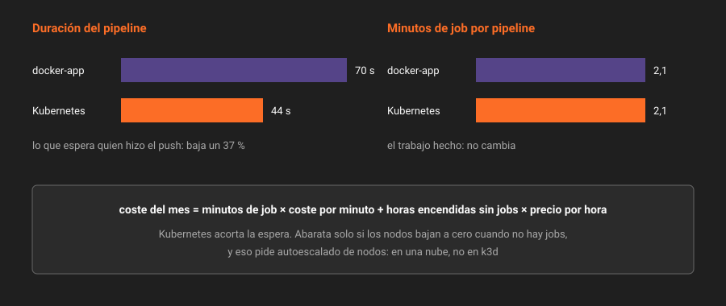

# FinOps de CI

> "El pipeline tarda 44 segundos" no dice cuánto cuesta. Un pipeline cuesta las máquinas que lo ejecutan, el tiempo que las tienes encendidas, y el tiempo de las personas que esperan su resultado. La API de GitLab da los tres números que hacen falta: duración, cola y minutos de job. Con un precio por minuto, sacados de tu propia línea base, pasan a ser euros.

---

## 🎯 Objetivos

- Distinguir duración del pipeline, cola y minutos de job, y sacarlos por API
- Calcular un coste por minuto de job a partir del precio de una máquina
- Calcular el coste de un pipeline y el de un mes de pipelines
- Saber qué ofrece GitLab de pago para esto y qué se usa en CE

---

## 1. Qué problema resuelve

Mover `app` a Kubernetes acorta el pipeline. ¿Lo abarata? Sin números, cada respuesta es una opinión. FinOps aplicado a CI es contestar con datos tres preguntas: cuánto trabajo hay, cuánto cuesta cada unidad de trabajo, y cuánto se paga por capacidad que no se usa.

---

## 2. Cómo funciona

### 2.1 Tres números por pipeline

| Número | De dónde sale | Qué mide |
|---|---|---|
| **Duración** | `duration` de `GET /projects/:id/pipelines/:id` | Lo que espera quien hizo el push, sin contar la cola inicial |
| **Cola** | `queued_duration` del pipeline y de cada job | Tiempo en `pending` esperando runner: es la señal de que falta capacidad |
| **Minutos de job** | La suma de `duration` de `GET /projects/:id/pipelines/:id/jobs`, entre 60 | El trabajo hecho: lo que ocupa máquina |

Medidos en el lab con el mismo pipeline, tres veces con cada runner:

| | `docker-app` | Kubernetes |
|---|:--:|:--:|
| Duración media | 70 s | 44 s |
| Minutos de job por pipeline | 2,0-2,2 | 2,0-2,2 |

La duración baja porque se trabaja en paralelo. Los minutos de job no bajan: el trabajo es el mismo.



> [!NOTE]
> `queued_duration` sale `null` cuando no hubo cola. Al sumar o hacer medias, `queued_duration // 0`.

### 2.2 Coste por minuto de job

Pagas máquinas por hora, no minutos de job. La conversión:

```
coste por minuto de job = precio de la máquina por hora / 60 / jobs que caben a la vez
```

Un ejemplo con cifras redondas, **que tienes que cambiar por las tuyas**:

| Dato | Valor de ejemplo | De dónde lo sacas tú |
|---|---|---|
| Máquina de 4 vCPU y 16 GB | 0,20 € por hora | La página de precios de tu proveedor, con el enlace en `docs/finops.md` |
| Jobs a la vez en esa máquina | 6 (`concurrent`) | Tu archivo de valores |
| Coste por minuto de job | 0,20 / 60 / 6 = 0,00056 € | — |
| Pipeline de 2,1 minutos de job | 0,0012 € | Tu línea base |

Si la máquina está encendida 24 horas para atender las 8 horas en que hay pushes, dos tercios de lo que pagas son capacidad vacía. Por eso la cifra completa tiene dos partes:

```
coste del mes = minutos de job del mes × coste por minuto de job  +  horas encendida sin jobs × precio por hora
```

El ejecutor Kubernetes con autoescalado de nodos ataca la segunda parte: sin jobs, sin nodos. Un runner fijo, con `docker-app`, la paga siempre.

### 2.3 Los minutos del mes

```bash
glab api "projects/<id>/pipelines?updated_after=2026-10-16T00:00:00Z&per_page=100" --paginate \
  | jq -s 'add | length'
```

Pipelines del último mes por la media de minutos de job de tu línea base es una estimación honrada. Para la cifra exacta, la suma de `duration` de los jobs de ese mes.

### 2.4 Lo que GitLab ofrece y lo que se usa en CE

| Feature | Tier | Sustituto en CE |
|---|---|---|
| Cuota de minutos de cómputo (*Compute quota*) para runners de instancia | Premium | `GET /projects/:id/jobs` y la suma de `duration` por runner |
| Panel de la flota de runners (*Runner fleet dashboard*) | Ultimate | La API de runners, y Prometheus y Grafana desde la Semana 21 |
| Analítica de CI/CD (*CI/CD analytics*): éxito y duración de pipelines | Free | — (está en CE: `Analyze → CI/CD analytics`) |

La cuota de minutos de pago no reduce lo que cuesta un pipeline: lo corta cuando se acaba. La gestión de costes empieza antes, midiendo.

---

## 3. La línea base

Una mejora sin línea base es una impresión. La de esta semana es `docs/linea-base-s16.json` en `app`:

```json
{
  "antes":   { "pipelines": [ { "id": 150, "estado": "success", "duracion": 72, "cola": 0, "runners": ["dind-app", "docker-app"], "jobs": 7, "minutos_de_job": 2.16 } ], "media_duracion": 70 },
  "despues": { "pipelines": [ { "id": 153, "estado": "success", "duracion": 45, "cola": 3, "runners": ["dind-app", "k8s-app"], "jobs": 7, "minutos_de_job": 2.2 } ], "media_duracion": 44 }
}
```

Tres pipelines de `main` con `docker-app` y tres con el runner de Kubernetes, uno detrás de otro y sin nada más en marcha. Tres, porque una medida sola puede caer con la caché fría o con el clúster bajando una imagen. Versionado, porque la Semana 21 fija sobre esas medias el umbral del SLO de duración de pipeline y la Semana 26 lo defiende.

---

## 4. Antipatrones

| Antipatrón | Por qué duele | Qué hacer en su lugar |
|---|---|---|
| Medir solo la duración del pipeline | Un pipeline más corto puede gastar más (más jobs en paralelo, imágenes más grandes) | Duración y minutos de job, siempre juntos |
| Un precio inventado | La cifra del ADR no la puede comprobar nadie | El precio público de un proveedor real, con enlace y fecha |
| Comparar una medida con caché fría y otra caliente | La diferencia es la caché, no el runner | Tres medidas seguidas en cada lado |
| Ignorar las horas encendidas sin jobs | En un runner fijo es la mayor parte de la factura | La segunda parte de la fórmula del apartado 2.2 |

---

## 5. Trucos

- `jq '[.[].duration // 0] | add / 60'` sobre la lista de jobs de un pipeline da sus minutos de job en una línea.
- `GET /runners/:id/jobs?per_page=100` con `jq 'group_by(.status)'` reparte el trabajo de un runner por estado: los `failed` también se pagan.

---

## 📚 Recursos Adicionales

- [Pipelines API](https://docs.gitlab.com/api/pipelines/) y [Jobs API](https://docs.gitlab.com/api/jobs/)
- [Compute minutes](https://docs.gitlab.com/ci/pipelines/compute_minutes/)
- [CI/CD analytics](https://docs.gitlab.com/user/analytics/ci_cd_analytics/)
- [FinOps Foundation — What is FinOps](https://www.finops.org/introduction/what-is-finops/)

---

## ✅ Checklist de Verificación

- [ ] Sé sacar duración, cola y minutos de job de un pipeline por API
- [ ] Sé calcular un coste por minuto de job a partir del precio de una máquina
- [ ] Sé qué parte de la factura ataca el autoescalado y cuál no
- [ ] Sé qué es de pago en GitLab para gestionar minutos y qué uso en CE
