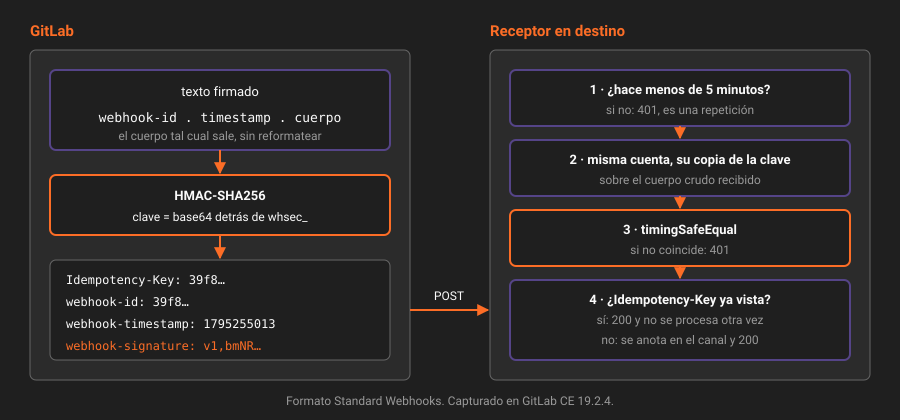

# Webhooks firmados

> El auditor pregunta: cada mañana mira cómo está todo. Un webhook es al revés: GitLab avisa en el momento en que algo pasa, con un `POST` a la URL que le digas. Sin sondear, sin retraso. Pero una URL que acepta `POST` la puede llamar cualquiera que la conozca, y GitLab, por defecto, no llama a nada de tu red. Esta teoría es la de que el aviso llegue, y de que quien lo recibe pueda demostrar que lo mandó GitLab.

---

## 🎯 Objetivos

- Elegir los eventos de un webhook y leer lo que llega: cabeceras y cuerpo
- Verificar la firma HMAC de un webhook y rechazar las repeticiones
- Distinguir el `signing_token` del `X-Gitlab-Token`, y saber por qué el segundo no basta
- Abrir la red local a un solo host, no a todos

---

## 1. Qué problema resuelve

Un pipeline de `main` falla a las 3:12. El auditor lo verá a las 6:00, si mira pipelines, que no mira. Un webhook de eventos de pipeline lo cuenta a las 3:12 al receptor, que lo anota en el canal.

Pero el receptor es una URL en `destino:8080`. Cualquier contenedor de la red, o cualquiera que la descubra, puede mandarle un `POST` con un JSON que diga "pipeline de `main` en verde". Si el receptor se lo cree, el canal miente. Y si alguien captura un aviso auténtico, puede reenviarlo mañana. El receptor tiene que poder decir: esto lo firmó GitLab, con una clave que solo conocemos los dos, y hace menos de cinco minutos.

---

## 2. Cómo funciona

### 2.1 Eventos

Cada webhook se suscribe a los eventos que elijas: `push_events`, `tag_push_events`, `merge_requests_events`, `pipeline_events`, `job_events`, `deployment_events`, `issues_events`, `releases_events` y unos cuantos más. Solo pide los que vas a usar: cada evento suscrito es una petición más.

Dos detalles que el receptor tiene que saber:

- **Pipelines, jobs y despliegues avisan en cada cambio de estado**: `pending`, `running`, `success`. El receptor de la práctica 02 solo anota los que han terminado.
- Los eventos de `push` admiten filtro de ramas (`push_events_branch_filter`), con `branch_filter_strategy` `wildcard`, `regex` o `all_branches`.

### 2.2 Lo que llega

Un `POST` con un JSON propio de cada evento y estas cabeceras (capturadas en el laboratorio, 19.2.4):

| Cabecera | Qué es |
|---|---|
| `X-Gitlab-Event` | El tipo: `Push Hook`, `Pipeline Hook`, `Deployment Hook`… |
| `X-Gitlab-Instance` | La URL de la instancia que lo manda |
| `X-Gitlab-Webhook-UUID` | Identifica esta petición concreta |
| `X-Gitlab-Event-UUID` | Identifica el evento; cambia si se reenvía (teoría 05) |
| `Idempotency-Key` | **No cambia** si se reenvía. Es la clave para no procesar dos veces |
| `webhook-id` | El mismo valor que `Idempotency-Key` |
| `webhook-timestamp` | Segundos desde 1970, en el momento del envío |
| `webhook-signature` | La firma: `v1,<base64>`. Solo si el webhook tiene `signing_token` |
| `X-Gitlab-Token` | El secreto en claro. Solo si el webhook tiene `token` |

### 2.3 La firma

Si el webhook tiene `signing_token`, GitLab firma cada envío siguiendo la especificación [Standard Webhooks](https://www.standardwebhooks.com/):



1. El `signing_token` tiene la forma `whsec_` seguido de una clave en base64. La clave es lo que va detrás de `whsec_`, decodificado.
2. El texto firmado es `webhook-id`, un punto, `webhook-timestamp`, un punto, y el cuerpo **tal cual llegó**, sin volver a serializar el JSON.
3. La firma es HMAC-SHA256 de ese texto con esa clave, en base64, precedida de `v1,`.

El receptor repite la cuenta y compara. Tres reglas que no se negocian:

- **Comparación de tiempo constante** (`timingSafeEqual`). Un `===` sobre la firma tarda más cuantos más caracteres acierta, y eso se puede medir.
- **El cuerpo crudo**. `JSON.parse` y `JSON.stringify` cambian espacios y orden: la firma deja de cuadrar.
- **Ventana de tiempo**. Una firma con un `webhook-timestamp` de hace más de cinco minutos se rechaza aunque sea auténtica: es una repetición.

La cabecera puede traer varias firmas separadas por espacios (lo prevé la especificación para rotar la clave): basta con que una cuadre.

### 2.4 `X-Gitlab-Token`, la opción antigua

El campo `token` del webhook viaja en claro en `X-Gitlab-Token`, igual en cada petición. Demuestra que quien llama conoce el secreto, pero no protege el cuerpo (alguien en medio puede cambiarlo y dejar la cabecera), ni caduca, ni impide repetir un envío capturado. El registro de entregas lo muestra como `[REDACTED]`, pero cualquier proxy o log intermedio lo ve. Con `signing_token` disponible en Free, no hay motivo para usar solo `token`.

### 2.5 La red local

Crea un webhook a `http://destino:8080/…` con la instalación por defecto:

```json
{"error":"Invalid url given"}
```

GitLab no llama por defecto a direcciones de la red local ni a `localhost`: un webhook es una forma de hacer que el servidor de GitLab haga peticiones a donde diga quien lo crea, y la red interna es donde están las bases de datos y los paneles sin contraseña (el ataque se llama SSRF). Dos ajustes de administración:

| Ajuste | Efecto |
|---|---|
| `allow_local_requests_from_web_hooks_and_services: true` | Cualquier webhook de cualquier proyecto puede llamar a cualquier host de tu red |
| `outbound_local_requests_whitelist: ["destino"]` | Solo `destino` queda permitido; el resto sigue bloqueado |

El primero es lo que sugieren muchos tutoriales. Este bootcamp usa el segundo: la lista tiene un host, el que tú elegiste.

### 2.6 Dónde se pueden crear webhooks

| Nivel | Quién | Tier |
|---|---|---|
| Proyecto | Maintainer del proyecto | Free |
| Grupo (todos los proyectos del grupo de una vez) | Owner | **Premium**. En CE, `POST /groups/:id/hooks` da `404`. Sustituto: un webhook por proyecto, creado por script |
| Sistema (eventos de toda la instancia: usuarios, proyectos creados…) | Administrador | Free. Semana 18 |

---

## 3. Cómo se configura

**Con la UI**: `Settings → Webhooks` del proyecto → *Add new webhook*. URL, *Signing token* (botón para generarlo), eventos. *Test* manda un evento de prueba.

**Con la API**:

```bash
curl -s --request POST "$API/projects/$P/hooks" -H "$H" -H 'Content-Type: application/json' \
  -d "$(jq -nc --arg k "$RECEPTOR_SIGNING_KEY" '{url: "http://destino:8080/receptor/webhook",
        name: "receptor", signing_token: $k, pipeline_events: true, deployment_events: true,
        push_events: false}')" | jq -c '{id, signing_token_present, token_present}'
# {"id":3,"signing_token_present":true,"token_present":false}
```

`push_events` viene a `true` por defecto: si no lo quieres, dilo. Y un `PUT` sobre el webhook exige `url` aunque no la cambies.

---

## 4. Antipatrones

| Antipatrón | Por qué duele | Qué hacer en su lugar |
|---|---|---|
| Receptor sin verificar nada | Cualquiera en la red escribe en tu canal | `signing_token` y verificación HMAC |
| Solo `X-Gitlab-Token` | Secreto en claro, cuerpo sin proteger, repetible | `signing_token` |
| Comparar la firma con `===` | Fuga por tiempo | `timingSafeEqual` |
| Verificar sobre `JSON.stringify(JSON.parse(cuerpo))` | La firma no cuadra nunca, o cuadra por casualidad | El cuerpo crudo |
| `allow_local_requests_from_web_hooks_and_services: true` | Todos los webhooks alcanzan toda tu red | `outbound_local_requests_whitelist` con un host |
| Receptor con la clave vacía | HMAC con clave vacía: cualquiera puede firmar | Sin clave configurada, rechazar todo |

---

## 5. Trucos

- `POST /projects/:id/hooks/:hook_id/test/push_events` manda un evento de prueba sin empujar nada: el mismo efecto que el botón *Test*.
- El tiempo de espera de GitLab por la respuesta es de 10 segundos (`gitlab_rails['webhook_timeout']` en `gitlab.rb`): un receptor que hace trabajo lento antes de contestar acumula errores.
- `X-Gitlab-Instance` deja a un receptor que atiende a varias instancias saber de cuál viene cada aviso.

---

## 📚 Recursos Adicionales

- [Webhooks](https://docs.gitlab.com/user/project/integrations/webhooks/) — eventos, firma, filtros de rama y registro de entregas
- [Webhook events](https://docs.gitlab.com/user/project/integrations/webhook_events/) — el JSON de cada evento
- [Standard Webhooks](https://www.standardwebhooks.com/) — la especificación de la firma que usa GitLab
- [Webhooks and insecure internal web services](https://docs.gitlab.com/security/webhooks/) — la red local, la lista de permitidos y por qué

---

## ✅ Checklist de Verificación

- [ ] Sabes qué texto exacto firma GitLab y con qué clave
- [ ] Tu instancia rechaza webhooks a la red local salvo a `destino`
- [ ] Los webhooks del receptor tienen `signing_token_present: true` y `token_present: false`
- [ ] Puedes explicar por qué `Idempotency-Key` y no `X-Gitlab-Event-UUID` sirve para deduplicar
