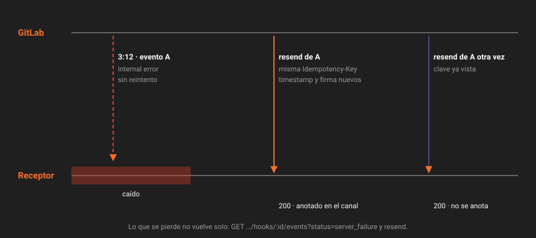

# Cuando la entrega falla

> Un webhook es un `POST` que sale una vez. Si el receptor está caído en ese momento, el aviso no llega, y nadie lo vuelve a intentar: en tu instalación, GitLab no reintenta y tampoco desactiva el webhook que falla siempre. Lo que sí hace es apuntar cada intento. Esta teoría es la de leer ese registro, recuperar lo perdido y que recuperarlo no duplique nada.

---

## 🎯 Objetivos

- Leer el registro de entregas de un webhook por API y filtrarlo por resultado
- Saber qué hace GitLab cuando una entrega falla en una instalación autohospedada, y qué no hace
- Reenviar una entrega sin que el receptor la procese dos veces
- Diseñar un receptor que conteste rápido y aguante repeticiones

---

## 1. Qué problema resuelve

`destino` se reinicia a las 3:10. A las 3:12 falla el pipeline de `main`. El webhook llama, nadie contesta, y a las 3:13 el receptor vuelve. El canal no dice nada del fallo, y por la mañana el equipo cree que la noche fue tranquila.

Hay que saber tres cosas: que se perdió algo, qué se perdió, y cómo traerlo sin que lo que sí llegó aparezca dos veces.

---

## 2. Cómo funciona

### 2.1 El registro de entregas

Cada intento queda apuntado: qué evento, a qué URL, qué cabeceras se mandaron, qué se contestó y cuánto tardó.

```bash
curl -s -H "$H" "$API/projects/$P/hooks/$HOOK/events?status=server_failure" \
  | jq -c '.[] | {id, trigger, response_status, created_at}'
# {"id":115,"trigger":"pipeline_hooks","response_status":"internal error","created_at":"2026-11-21T10:35:55Z"}
```

| `status=` | Qué entra |
|---|---|
| `successful` | Respuestas 2xx |
| `client_failure` | Respuestas 4xx: el receptor contestó y dijo que no (por ejemplo, un 401 de firma no válida) |
| `server_failure` | Respuestas 5xx y fallos de conexión. Un receptor caído aparece como `"response_status": "internal error"` |

Este endpoint pagina de 20 en 20 como máximo: `per_page=21` contesta `per_page does not have a valid value`. Con la UI: `Settings → Webhooks` → *Edit* del webhook → *Recent events*.

El registro es la única memoria de lo que pasó: guarda las cabeceras de la petición (el `X-Gitlab-Token` como `[REDACTED]`) y el cuerpo que se envió.

### 2.2 Lo que GitLab no hace aquí

| Lo que podrías esperar | En 19.2.4 autohospedado |
|---|---|
| Que reintente una entrega fallida | No. Un evento, un intento. Comprobado: con el receptor parado, un `push` deja una entrada `internal error` y ninguna más |
| Que desactive un webhook que falla siempre | No por defecto. La lógica existe (tras 4 fallos seguidos lo aparta un tiempo creciente, y tras 40 lo desactiva), pero está detrás de la marca de función `auto_disabling_web_hooks`, que en autohospedado viene **apagada**. Comprobado: seis `500` seguidos y `alert_status` sigue en `executable` |
| Que te avise de que falla | No. El registro está, pero nadie lo mira si no lo miras tú |

`alert_status` (`executable`, `temporarily_disabled`, `disabled`) y `disabled_until` aparecen en el webhook por API: con la marca apagada, el primero será siempre `executable`. Activar la marca es una decisión de administración de la instancia (Semana 18), no de un proyecto.

Consecuencia: si el receptor cae, **lo que se pierde se pierde hasta que tú lo reenvíes**. El auditor de cada mañana es la red de seguridad: lo que el canal no contó, el auditor lo ve igual.

### 2.3 Reenviar

```bash
curl -s --request POST "$API/projects/$P/hooks/$HOOK/events/115/resend" -H "$H"
# {"response_status":200}
```

El reenvío manda el mismo cuerpo a la misma URL. Lo que cambia y lo que no:

| Cabecera | En el reenvío |
|---|---|
| `Idempotency-Key` y `webhook-id` | **Igual** que el original |
| `webhook-timestamp` | Nuevo: la hora del reenvío |
| `webhook-signature` | Nueva: firma el timestamp nuevo |
| `X-Gitlab-Event-UUID`, `X-Gitlab-Webhook-UUID` | Nuevos |

Por eso un reenvío de hace tres días pasa la ventana de cinco minutos de la firma (lleva hora nueva), y por eso el receptor deduplica por `Idempotency-Key`, no por el UUID del evento.

Una condición: **la URL del webhook no puede haber cambiado**. Si la cambias, el reenvío contesta `The hook URL has changed. This log entry cannot be retried.` Arregla el receptor, no muevas el webhook.

### 2.4 Un receptor que aguanta



| Regla | Por qué |
|---|---|
| **Contesta rápido** | GitLab espera 10 segundos. Lo lento (llamar a otra API, escribir mucho) va después de contestar, o en una cola |
| **Contesta 200 a lo que ya has visto** | Un duplicado no es un error: si contestas 4xx, el registro se llena de falsos fallos |
| **4xx solo para lo que nunca será válido** | Firma mala, ruta inexistente. Reenviarlo no lo arreglará |
| **5xx para lo que podría funcionar luego** | Un fallo propio. Así aparece en `server_failure` y sabes qué reenviar |
| **Guarda lo que importa, no todo** | Los pipelines avisan en cada cambio de estado; anota solo los terminados |

El receptor de la práctica 02 deduplica en memoria: un conjunto de las claves vistas. Es una decisión con techo conocido: un redespliegue del receptor lo vacía, y un reenvío posterior de algo ya procesado se procesaría otra vez. Para anotar en un canal, una línea repetida no hace daño; para algo que cobra o despliega, la clave se guarda en disco o en una base de datos.

---

## 3. Cómo se configura

No hay nada que activar: el registro existe en todo webhook. Lo que se configura es la rutina:

- Después de cualquier caída del receptor, `status=server_failure` y reenviar lo que haya.
- En el manual de `ci/automatizacion`, los dos comandos, con `$HOOK` de cada proyecto (proyecto de la semana).

---

## 4. Antipatrones

| Antipatrón | Por qué duele | Qué hacer en su lugar |
|---|---|---|
| Dar por hecho que GitLab reintenta | Aquí no lo hace: lo perdido no vuelve solo | Mirar `server_failure` tras cualquier caída |
| Cambiar la URL del webhook para "arreglar" una caída | Los reenvíos de antes del cambio quedan bloqueados | Arreglar el receptor en la misma URL |
| Deduplicar por `X-Gitlab-Event-UUID` | Cambia en el reenvío: el duplicado pasa | `Idempotency-Key` |
| Contestar 409 a un duplicado | Aparece como `client_failure` y parece un error | 200 |
| Hacer el trabajo lento antes de contestar | A los 10 segundos GitLab corta y apunta un fallo, aunque el trabajo termine | Contestar y luego trabajar |
| Activar `auto_disabling_web_hooks` sin vigilar el registro | Un webhook apartado deja de avisar, y sin alerta nadie se entera | Primero el seguimiento del registro; luego, si acaso, la marca |

---

## 5. Trucos

- `GET /projects/:id/hooks/:hook_id/events?status=client_failure` encuentra en segundos un `signing_token` desacompasado: todas las entregas recientes con 401.
- `execution_duration` de cada entrada dice cuánto tarda tu receptor en contestar, medido por GitLab: si se acerca a 10, el receptor tiene un problema.
- El registro guarda `request_data`: el cuerpo que se mandó, ya leído como JSON. Sirve para escribir el test de un caso que falló, pero no para repetir la entrega a mano: al volver a serializarlo no queda byte a byte igual y la firma no cuadra. Para repetir, `resend`.

---

## 📚 Recursos Adicionales

- [Webhooks: troubleshooting](https://docs.gitlab.com/user/project/integrations/webhooks/#troubleshooting) — el registro, el reenvío y la desactivación automática
- [Project webhooks API](https://docs.gitlab.com/api/project_webhooks/) — `events`, `resend` y `test`
- [Feature flags in self-managed](https://docs.gitlab.com/administration/feature_flags/) — qué es una marca de función de operación y cómo se activa

---

## ✅ Checklist de Verificación

- [ ] Has visto una entrega `internal error` en tu registro y la has reenviado
- [ ] Sabes por qué un reenvío pasa la ventana de tiempo de la firma
- [ ] Tu receptor contesta 200 a un duplicado y no lo anota dos veces
- [ ] Sabes qué hace `auto_disabling_web_hooks` y por qué en tu instancia no actúa
