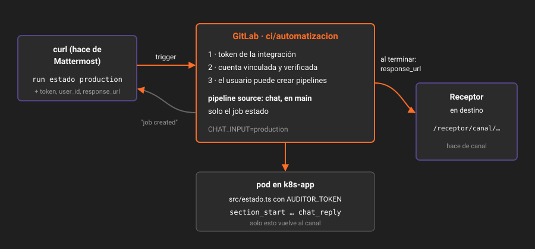

# ChatOps

> A las 3:12 el canal dice que el pipeline de `main` ha fallado. La siguiente pregunta es siempre la misma: "¿qué hay ahora en producción?". Abrir GitLab, buscar `infra/entornos`, entrar en *Environments*… o escribir `/gitlab plataforma run estado production` en el mismo canal y que la respuesta aparezca ahí, a la vista de todos. Eso es ChatOps en GitLab: un comando de chat que lanza un job, y la salida del job que vuelve al chat.

---

## 🎯 Objetivos

- Explicar el recorrido de un comando: del chat a un pipeline `chat` y de vuelta al canal
- Configurar la integración de slash commands de Mattermost y entender sus dos confirmaciones
- Escribir un job que solo corre desde el chat y elegir qué parte de su salida vuelve
- Saber qué puede hacer cada usuario del chat y por qué

---

## 1. Qué problema resuelve

Tres cosas que un canal de operaciones necesita y que un enlace a GitLab no da:

- **Contexto compartido**: la pregunta y la respuesta quedan en el canal, donde estaba la alerta. Quien llega después ve qué se miró y qué salió.
- **Operaciones repetibles**: `run estado` ejecuta siempre el mismo script versionado, no "lo que cada uno mira en la UI".
- **Trazabilidad**: cada comando es un pipeline de GitLab, con autor, log y fecha.

---

## 2. Cómo funciona

### 2.1 El recorrido



1. Alguien escribe `/gitlab <proyecto> run estado production` en Mattermost.
2. Mattermost hace un `POST` a `/api/v4/projects/:id/integrations/mattermost_slash_commands/trigger` con un formulario: el `token` de la integración, el texto (`run estado production`), quién lo escribió (`user_id`, `user_name`, `team_id`), en qué canal (`channel_id`, `channel_name`) y un `response_url` donde contestar.
3. GitLab comprueba el token, busca qué usuario de GitLab es esa persona del chat, y si puede crear pipelines en el proyecto.
4. Crea un pipeline con `source: chat` en la rama por defecto, con **solo** el job que se llama como el comando: `estado`.
5. Contesta enseguida: `Your ChatOps job #401 has been created!`
6. Cuando el job termina, GitLab hace un `POST` al `response_url` con el resultado y la salida.

En este bootcamp no hay Mattermost. El paso 2 lo das tú con `curl`, con exactamente el formulario que mandaría Mattermost, y el `response_url` apunta al receptor de la práctica 02, que hace de canal. Lo que GitLab hace es idéntico: si mañana tu organización usa Mattermost, la configuración de GitLab no cambia.

### 2.2 Las dos confirmaciones

El primer comando de una persona no lanza nada. GitLab contesta con un enlace:

> `:wave: Hi there! Before I do anything for you, please connect your GitLab account.`

El enlace (`/-/user_settings/integration_accounts/new?token=…`) se abre en el navegador, con la sesión de GitLab, y **vincula** esa cuenta del chat con tu usuario de GitLab. Desde ahí, lo que esa persona pida por chat lo pide como tú, con tus permisos.

El segundo comando tampoco: GitLab pide **verificar** que la petición viene del chat que dice venir, con otro enlace a `/<proyecto>/-/integrations/slash_commands?…`. Confirmas en el navegador y GitLab avisa al `response_url`: `You've successfully verified!`. La verificación se guarda con el token de la integración: si regeneras el token, todos vuelven a verificar.

Las dos se hacen una vez por persona. Las dos se hacen en la web, porque las dos prueban algo que un `POST` no puede probar: que quien escribe en el chat tiene también la sesión de GitLab.

### 2.3 Qué puede hacer cada uno

| Comprobación | Si falla |
|---|---|
| El `token` del formulario es el de la integración | `404 Integration Not Found` |
| La cuenta del chat está vinculada | El enlace de vincular |
| La petición está verificada | El enlace de verificar |
| El usuario vinculado puede crear pipelines en el proyecto (Developer o más) | No se lanza nada |
| Existe un job con ese nombre que acepta `source: chat` | `The command could not be scheduled. Make sure that your project has a .gitlab-ci.yml that defines a job with the name "noexiste"` |

El pipeline corre en `main` con el usuario vinculado como autor. Si `main` está protegida, recibe las variables protegidas: `AUDITOR_TOKEN` llega a `run auditar`. Por eso el job de chat solo debe hacer lo que estés dispuesto a que haga cualquier Developer del proyecto que tenga chat.

### 2.4 El job

```yaml
estado:
  stage: operar
  script:
    - node --experimental-strip-types src/estado.ts
  rules:
    # Solo desde el chat: ni en un push ni en una programación.
    - if: $CI_PIPELINE_SOURCE == "chat"
```

Sin esa regla, `estado` correría también en cada push. Con ella, el job solo existe cuando alguien lo pide. GitLab añade tres variables:

| Variable | Valor en `run estado production` |
|---|---|
| `CHAT_INPUT` | `production`: lo que va detrás del nombre del job |
| `CHAT_CHANNEL` | El `channel_id` del chat |
| `CHAT_USER_ID` | El `user_id` del chat de quien lo pidió |

### 2.5 Lo que vuelve al canal

Por defecto, GitLab devuelve el final del log del job: comandos, avisos de `npm`, ruido. Lo que vaya entre dos marcas de sección llamadas `chat_reply` es **lo único** que vuelve:

```js
console.log(`section_start:${Math.floor(Date.now() / 1000)}:chat_reply\r\x1b[0K`);
console.log('production: app 3f2a1c9 → production (2026-11-21T03:05:12Z)');
console.log(`section_end:${Math.floor(Date.now() / 1000)}:chat_reply\r\x1b[0K`);
```

Cada marca, en su propia línea. Si el texto va en la misma línea que `section_start`, la respuesta llega vacía. El runner antepone su marca de hora a cada línea, y así llega también al canal.

Lo que recibe el `response_url` es un JSON con formato de Mattermost:

```json
{"response_type":"in_channel","attachments":[{"color":"#00c100",
  "text":"ChatOps job started by [Administrator](…) completed successfully",
  "fields":[{"title":"ID","value":"[#401](…)"},{"title":"Name","value":"estado"},
            {"title":"Output","value":"```shell\n… production: app 3f2a1c9 …\n```"}]}]}
```

Si el job falla, al canal solo llega `ChatOps job started by … failed!`, **sin** el campo `Output`, aunque el job escribiera su `chat_reply`. El detalle hay que ir a buscarlo al job o a su artefacto: un job de chat que puede fallar tiene que dejar su resultado en un artefacto con `when: always`.

---

## 3. Cómo se configura

**Con la UI**: `Settings → Integrations → Mattermost slash commands` del proyecto. GitLab muestra los datos para crear el comando en Mattermost (URL, método, nombre); el *Token* lo genera Mattermost y se pega aquí. Sin Mattermost, el token lo generas tú.

**Con la API**:

```bash
curl -s --request PUT "$API/projects/$PA/integrations/mattermost-slash-commands" -H "$H" \
  --data "token=$SLASH_TOKEN" | jq -c '{active, title}'
# {"active":true,"title":"Mattermost slash commands"}
```

En 19.2.4, `mattermost_slash_commands` es la única integración de slash commands disponible en la instancia. Las de notificaciones (Slack, Mattermost, Discord, Microsoft Teams, Telegram, Webex, Google Chat) mandan avisos al chat, pero no reciben comandos.

---

## 4. Antipatrones

| Antipatrón | Por qué duele | Qué hacer en su lugar |
|---|---|---|
| Job de chat sin `rules` de `source: chat` | Corre en cada push | `if: $CI_PIPELINE_SOURCE == "chat"` |
| Un job de chat que despliega o borra | Cualquier Developer con chat lo hace, sin revisión | Comandos de lectura; lo que cambia, por merge request |
| Volcar el log entero al canal | Ruido, y lo que el log tenga de sensible queda en el chat | `chat_reply` con solo la respuesta |
| `CHAT_INPUT` directo a un `sh -c` | Inyección de comandos desde el chat | Tratarlo como texto: compararlo, nunca ejecutarlo |
| Compartir el token de la integración | Quien lo tenga lanza jobs en nombre de los usuarios vinculados | Guardarlo como cualquier secreto, y regenerarlo si sale |

---

## 5. Trucos

- `help` como texto (sin `run`) devuelve la lista de comandos: además de `run`, `issue show|new|search|move|close|comment` y `deploy <entorno> to <entorno>`, que lanza el job manual de despliegue del segundo entorno. Los de `issue` no pasan por CI: actúan directamente con tu usuario.
- `env | grep ^CHAT_` en un job de chat enseña las tres variables tal como llegan.
- Un `response_url` que empieza por `https://hooks.slack.com/` hace que GitLab conteste con formato de Slack; cualquier otro, con el de Mattermost.

---

## 📚 Recursos Adicionales

- [GitLab ChatOps](https://docs.gitlab.com/ci/chatops/) — jobs `chat`, `CHAT_INPUT` y `chat_reply`
- [Mattermost slash commands](https://docs.gitlab.com/user/project/integrations/mattermost_slash_commands/) — la integración y su configuración en Mattermost
- [Mattermost: slash commands](https://developers.mattermost.com/integrate/slash-commands/custom/) — el formulario que manda Mattermost, campo a campo

---

## ✅ Checklist de Verificación

- [ ] Has vinculado tu cuenta y verificado la petición, en el navegador
- [ ] `run auditar` y `run estado` han contestado en el canal
- [ ] Tus jobs de chat no aparecen en los pipelines de push
- [ ] Sabes qué usuario de GitLab ejecuta un comando del chat y qué variables recibe
