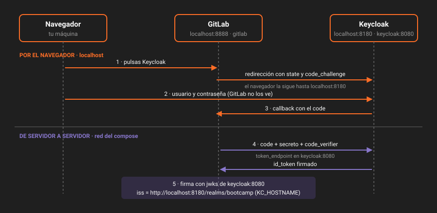

# OIDC en GitLab

> Cada cuenta de tu instancia tiene su propia contraseña, que vive en la base de datos de GitLab y que nadie más controla. Cuando alguien se va de la organización, alguien tiene que acordarse de bloquearlo también aquí. Con OpenID Connect, GitLab deja de guardar contraseñas y pregunta a un proveedor de identidad quién es cada uno. Esta teoría explica qué viaja en ese intercambio y qué decide GitLab con la respuesta.

---

## 🎯 Objetivos

- Recorrer el flujo de código de autorización con PKCE, paso a paso, entre navegador, GitLab y proveedor
- Configurar el proveedor `openid_connect` de OmniAuth y saber qué hace cada clave
- Decidir qué pasa con quien ya tenía cuenta (vincular) y con quien no (crear, y bloquear hasta aprobar)
- Quitar la contraseña a quien ya entra por SSO

---

## 1. Qué problema resuelve

| Sin proveedor de identidad | Con OIDC |
|---|---|
| Una contraseña por herramienta, cada una con su política | Una identidad, con la política del proveedor (longitud, 2FA, bloqueo por intentos) |
| La baja de una persona hay que repetirla en cada herramienta | Se desactiva en el proveedor y deja de poder entrar en todas |
| GitLab guarda y protege contraseñas | GitLab guarda una referencia (`extern_uid`) y nunca ve la contraseña |

OIDC es una capa de identidad sobre OAuth 2.0: el proveedor no solo autoriza, también **dice quién es** el usuario en un `id_token` firmado. GitLab CE lo trae de serie con OmniAuth. **Free.** Lo de pago está alrededor: la sincronización de grupos desde SAML y el SSO por grupo son Premium; el sustituto de este bootcamp es dar los roles a mano o por API (Semana 03) y dejar a OIDC solo la identidad.

---

## 2. Cómo funciona

### 2.1 El flujo de código con PKCE



1. Pulsas **Keycloak** en la página de login. GitLab genera un `state` (contra CSRF) y un `code_verifier` aleatorio, y te redirige al `authorization_endpoint` del proveedor con el `code_challenge` (el SHA-256 del verificador).
2. El proveedor te pide usuario y contraseña. GitLab no los ve nunca.
3. El proveedor te redirige al `redirect_uri` de GitLab (`/users/auth/openid_connect/callback`) con un `code` de un solo uso.
4. GitLab cambia el `code` por tokens en el `token_endpoint`, **desde el servidor**, autenticándose con el secreto del cliente y enviando el `code_verifier`. Si alguien robó el `code` en el paso 3, sin el verificador no le sirve: eso es PKCE.
5. GitLab valida la firma del `id_token` con las claves del `jwks_uri`, comprueba que el emisor (`iss`) es el que espera y lee los claims: `sub`, `email`, `preferred_username`.

Los pasos 1-3 pasan **por tu navegador**; el 4 y el 5, **de servidor a servidor**. En el laboratorio esa diferencia importa, y es todo el contenido de la teoría 04.

### 2.2 Qué decide GitLab con la respuesta

| Situación | Clave de `gitlab.rb` | Resultado |
|---|---|---|
| Ya existe una identidad `openid_connect` con ese `sub` | — | Entra como ese usuario |
| Existe un usuario con el mismo email, sin identidad | `omniauth_auto_link_user` | Se vincula: se le añade la identidad y entra |
| No existe nadie | `omniauth_allow_single_sign_on` | Se crea el usuario |
| …y además | `omniauth_block_auto_created_users` | El usuario nace en `blocked_pending_approval` hasta que un admin lo apruebe |

`uid_field` dice qué claim identifica al usuario. Usa `sub`: es estable y el proveedor no lo deja cambiar. `preferred_username` o el email pueden cambiar, y si cambian, GitLab ve a otra persona.

> [!WARNING]
> Vincular por email solo es seguro si el proveedor **verifica** los emails. Si cualquiera puede ponerse en Keycloak el email de `root`, `omniauth_auto_link_user` le entrega la cuenta de `root`. En la práctica 02, los usuarios de Keycloak los crea el admin con `emailVerified=true`, y el registro propio del realm está apagado.

### 2.3 El SSO sin contraseña

Vincular no quita nada: el usuario vinculado sigue pudiendo entrar con su contraseña de GitLab, y esa contraseña ya no la gobierna el proveedor. El ajuste `disable_password_authentication_for_users_with_sso_identities` cierra ese hueco: quien tiene una identidad SSO **solo** entra por SSO. `root`, que no tiene identidad, sigue entrando con contraseña y 2FA: es tu acceso de emergencia si Keycloak cae.

---

## 3. Cómo se configura

En el laboratorio, la configuración va en el `GITLAB_OMNIBUS_CONFIG` de `docker-compose.yml` y se activa con `OIDC_ENABLED=true` en `.env`. Lo esencial:

```ruby
gitlab_rails['omniauth_enabled'] = true
gitlab_rails['omniauth_allow_single_sign_on'] = ['openid_connect']
gitlab_rails['omniauth_block_auto_created_users'] = true
gitlab_rails['omniauth_auto_link_user'] = ['openid_connect']
gitlab_rails['omniauth_providers'] = [{
  name: 'openid_connect', label: 'Keycloak',
  args: {
    name: 'openid_connect',
    scope: ['openid', 'profile', 'email'],
    response_type: 'code',
    issuer: 'http://localhost:8180/realms/bootcamp',
    discovery: false,           # teoría 04: los endpoints van escritos a mano
    pkce: true,
    uid_field: 'sub',
    client_options: { identifier: 'gitlab', secret: '<SECRETO>', redirect_uri: '...' }
  }
}]
```

El secreto no va escrito en el compose: viene de `OIDC_CLIENT_SECRET` en `.env`, que no se versiona.

El ajuste del SSO sin contraseña sí es de base de datos:

```bash
curl -s --request PUT "$API/application/settings" -H "$H" \
  --data disable_password_authentication_for_users_with_sso_identities=true \
  | jq .disable_password_authentication_for_users_with_sso_identities
# true
```

Y quién entra por dónde, como admin:

```bash
curl -s -H "$H" "$API/users?per_page=100" \
  | jq -c '.[] | select(.identities | length > 0) | {username, state, p: [.identities[].provider]}'
# {"username":"revisor-biblioteca","state":"active","p":["openid_connect"]}
```

---

## 4. Antipatrones

| Antipatrón | Por qué duele | Qué hacer en su lugar |
|---|---|---|
| `uid_field: 'email'` | Un cambio de email en el proveedor crea un usuario nuevo y deja huérfano el viejo | `sub` |
| Vincular por email con emails sin verificar | Quien controle el email en el proveedor se queda con la cuenta | Emails verificados y registro propio del proveedor apagado |
| Crear usuarios por SSO sin bloquearlos | Cualquiera con cuenta en el proveedor entra en tu GitLab | `omniauth_block_auto_created_users` y aprobar a mano |
| Quitar la contraseña también a `root` | Si el proveedor cae, nadie puede entrar a arreglarlo | `root` sin identidad SSO, con contraseña larga y 2FA |
| `response_type: 'id_token'` (flujo implícito) | Los tokens viajan por el navegador | Código de autorización con PKCE |

---

## 5. Trucos

- `GET /users?extern_uid=<sub>&provider=openid_connect` encuentra al usuario de GitLab a partir del `sub` que ves en Keycloak.
- La identidad se ve en la ficha del usuario: `Admin → Users → <usuario> → Identities`. Desde ahí se borra, si un vínculo se hizo mal.
- Si el login vuelve a la página de inicio sin error y sin sesión, mira `docker compose exec gitlab tail -n 20 /var/log/gitlab/gitlab-rails/application_json.log`: el motivo (usuario bloqueado, emisor que no coincide) suele estar ahí.

---

## 📚 Recursos Adicionales

- [Use OpenID Connect as an authentication provider](https://docs.gitlab.com/administration/auth/oidc/) — todas las claves de `args` y `client_options`
- [Integrate your server with OmniAuth](https://docs.gitlab.com/integration/omniauth/) — `auto_link_user`, `block_auto_created_users`, `allow_single_sign_on`
- [RFC 7636 — PKCE](https://datatracker.ietf.org/doc/html/rfc7636) — por qué el `code` robado no basta

---

## ✅ Checklist de Verificación

- [ ] Sabes qué pasos del flujo van por el navegador y cuáles de servidor a servidor
- [ ] `uid_field` es `sub` en tu configuración
- [ ] Dos usuarios de laboratorio tienen la identidad `openid_connect` y están activos
- [ ] Un usuario nuevo de Keycloak está en `blocked_pending_approval`
- [ ] Un usuario vinculado ya no entra con contraseña; `root` sí
