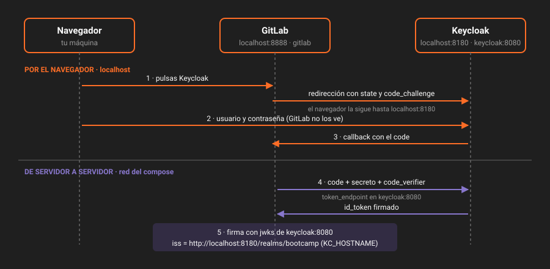

# Keycloak como proveedor

> La teoría 03 contó el intercambio entre GitLab y un proveedor de identidad cualquiera. Este archivo pone nombre al proveedor: Keycloak, libre y autohospedado como tu GitLab. Y resuelve el problema que tiene cualquier laboratorio en Docker con OIDC: el navegador y GitLab no llegan a Keycloak por la misma dirección, pero el token tiene que decir la misma.

---

## 🎯 Objetivos

- Nombrar las piezas de Keycloak que usa GitLab: realm, cliente, usuario y secreto
- Crear el realm, el cliente y los usuarios con `kcadm.sh`, sin clics
- Explicar por qué el laboratorio escribe los endpoints a mano y qué fija `KC_HOSTNAME`
- Saber qué tiene el perfil `sso` de laboratorio y qué le faltaría para producción

---

## 1. Qué problema resuelve

Keycloak es un servidor de identidad: guarda usuarios (o los lee de un LDAP), aplica la política de contraseñas, 2FA y bloqueo por intentos, y emite tokens OIDC y aserciones SAML a las aplicaciones que confían en él. Para el bootcamp tiene tres ventajas: es libre (Apache 2.0), corre en un contenedor y es lo que encontrarás en muchas organizaciones que no quieren depender de un proveedor en la nube.

La versión fijada es **26.8.2**, pinneada por digest en el compose. Es la última publicada, una excepción a la regla de no fijar la última: la 26.8.1 tiene un XSS en la página de login (CVE-2026-107889) y un robo de sesión con `id_token_hint` en el logout (CVE-2026-107124), los dos en el flujo que usa esta semana. El motivo está en [stack-versions](../../../docs/stack-versions.md).

---

## 2. Cómo funciona

### 2.1 Las piezas

| Pieza | Qué es | En el laboratorio |
|---|---|---|
| **Realm** | Un espacio aislado de usuarios, clientes y política. `master` es solo para administrar Keycloak | `bootcamp` |
| **Cliente** | Una aplicación que confía en el realm | `gitlab`, confidencial, con flujo estándar (código) y PKCE `S256` |
| **Secreto del cliente** | La contraseña con la que GitLab se presenta en el `token_endpoint` | Lo genera Keycloak; va a `OIDC_CLIENT_SECRET` en `.env` |
| **URI de redirección** | Las únicas direcciones a las que Keycloak devuelve el `code` | `http://localhost:8888/users/auth/openid_connect/callback`, exacta |
| **Usuario** | Una identidad con su `sub` (un UUID) | Los de laboratorio, con su email ya verificado |

La URI de redirección exacta es una defensa, no un trámite: con un comodín (`http://localhost:8888/*`), una página del propio GitLab que redirija a donde le digan basta para llevarse el `code` a otro sitio.

### 2.2 Dos URL y un solo emisor



Tu navegador llega a Keycloak por `http://localhost:8180`, el puerto publicado. GitLab, dentro de su contenedor, no: para él `localhost` es él mismo, y a Keycloak llega por la red del compose como `http://keycloak:8080`.

Con `discovery: true`, GitLab leería `/.well-known/openid-configuration` en la URL del emisor y usaría los endpoints que le diga. Cualquiera de las dos opciones rompe algo:

| El emisor es | El navegador | GitLab |
|---|---|---|
| `http://keycloak:8080/...` | No resuelve `keycloak`: el login no abre | Funciona |
| `http://localhost:8180/...` con discovery | Funciona | Intenta descubrir en su propio `localhost:8180`: conexión rechazada |

La salida es **escribir los endpoints a mano** (`discovery: false`): el de autorización con `localhost:8180`, porque lo abre el navegador; el de token, `userinfo` y `jwks` con `keycloak:8080`, porque los llama GitLab.

Queda el emisor. El `id_token` lleva un claim `iss` y GitLab lo compara con su `issuer`. Keycloak pone en `iss` la URL por la que **le llegó la petición**… salvo que se la fijes. `KC_HOSTNAME=http://localhost:8180` hace que el emisor sea siempre ese, también cuando GitLab pide el token por `keycloak:8080`. Y `KC_HOSTNAME_BACKCHANNEL_DYNAMIC=true` deja que las llamadas de servidor sigan entrando por la dirección interna.

```bash
curl -s http://localhost:8180/realms/bootcamp/.well-known/openid-configuration \
  | jq -c '{issuer, token_endpoint}'
# {"issuer":"http://localhost:8180/realms/bootcamp","token_endpoint":"http://localhost:8180/realms/bootcamp/protocol/openid-connect/token"}
```

En producción no hay dos redes: Keycloak tiene un nombre DNS y un certificado, GitLab y el navegador lo alcanzan por el mismo, y `discovery: true` funciona tal cual.

---

## 3. Cómo se configura

`kcadm.sh` es la CLI de administración. Vive dentro del contenedor y se autentica contra el realm `master`:

```bash
kc() { docker exec keycloak /opt/keycloak/bin/kcadm.sh "$@"; }
docker exec -it keycloak /opt/keycloak/bin/kcadm.sh config credentials \
  --server http://localhost:8080 --realm master --user admin
# Enter password:
# Logging into http://localhost:8080 as user admin of realm master
```

Sin `--password`: la contraseña escrita como argumento se ve en `ps` mientras dura la llamada, igual que un token en la línea de `curl`. Con `-it`, `kcadm.sh` la pide por consola. La sesión queda guardada dentro del contenedor y la función `kc` la reutiliza.

Es una función y no una variable porque zsh no parte `$K` en palabras: `K="docker exec ..."; $K` busca un programa que se llame así entero.

Crear el realm con protección contra fuerza bruta, y el cliente:

```bash
kc create realms -s realm=bootcamp -s enabled=true -s bruteForceProtected=true
# Created new realm with id 'bootcamp'

kc create clients -r bootcamp -s clientId=gitlab -s publicClient=false \
  -s standardFlowEnabled=true -s directAccessGrantsEnabled=false \
  -s 'redirectUris=["http://localhost:8888/users/auth/openid_connect/callback"]' \
  -s 'attributes={"pkce.code.challenge.method":"S256"}' -i
# 20276f83-...  (el id interno del cliente)
```

`directAccessGrantsEnabled=false` apaga el flujo de contraseña directa: nadie puede pedir un token enviando usuario y contraseña al endpoint, que es justo lo que OIDC quiere evitar.

**Con la UI**: `http://localhost:8180/admin`, el desplegable de realms → *Create realm*; luego *Clients → Create client*, con *Client authentication* encendido y solo *Standard flow* marcado.

---

## 4. Antipatrones

| Antipatrón | Por qué duele | Qué hacer en su lugar |
|---|---|---|
| Usar el realm `master` para las aplicaciones | Sus usuarios administran Keycloak entero | Un realm por organización o entorno |
| Redirección con comodín | Cualquier redirección abierta del cliente se lleva el `code` | La URI exacta del callback |
| `start-dev` en producción | Base de datos H2 en un archivo, HTTP sin TLS, cachés de desarrollo | `start` con PostgreSQL, TLS y `KC_HOSTNAME` público |
| Cliente público para GitLab | Cualquiera que conozca el `clientId` se hace pasar por GitLab | Cliente confidencial con secreto, y PKCE además |
| El secreto del cliente en el compose | Acaba en el repositorio | `.env`, que no se versiona, o un gestor de secretos |

---

## 5. Trucos

- `kc get clients/<id>/client-secret -r bootcamp | jq -r .value` devuelve el secreto sin abrir la consola.
- `kc get users -r bootcamp -q username=dev-prueba | jq -r '.[0].id'` da el `sub` que GitLab guardará como `extern_uid`.
- Keycloak tarda en arrancar más que en contestar: `curl -sf http://localhost:8180/realms/master` dentro de un `until` es una espera honesta.

---

## 📚 Recursos Adicionales

- [Keycloak Server Administration Guide](https://www.keycloak.org/docs/latest/server_admin/) — realms, clientes y `kcadm.sh`
- [Configuring the hostname (v2)](https://www.keycloak.org/server/hostname) — `KC_HOSTNAME` y el backchannel dinámico
- [Running Keycloak in a container](https://www.keycloak.org/server/containers) — qué cambia de `start-dev` a `start`

---

## ✅ Checklist de Verificación

- [ ] El emisor del discovery de `bootcamp` es `http://localhost:8180/realms/bootcamp`
- [ ] El cliente `gitlab` es confidencial, sin flujo de contraseña directa y con la URI de redirección exacta
- [ ] Sabes por qué el endpoint de autorización lleva `localhost:8180` y el de token `keycloak:8080`
- [ ] Puedes decir tres cosas que `start-dev` no te da en producción
