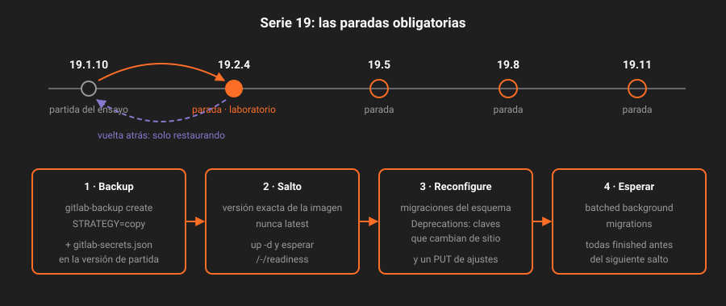

# Actualizar sin perder datos

> GitLab publica una versión menor cada mes y parches de seguridad varias veces al mes. Una instancia que no se actualiza acumula CVE; una que se actualiza a ciegas puede quedarse a medio migrar un lunes por la mañana. Actualizar bien no es un comando, es un procedimiento: qué versión, por qué camino, con qué copia, qué comprobar después, y nada de eso se improvisa en producción. Se ensaya.

---

## 🎯 Objetivos

- Calcular el camino de actualización entre dos versiones con sus paradas obligatorias
- Hacer un backup que sirva para volver, con los dos archivos que no van dentro
- Saber qué son las migraciones en segundo plano y por qué bloquean el siguiente salto
- Leer las claves deprecadas del `reconfigure` y moverlas a su sitio nuevo
- Explicar por qué no hay vuelta atrás sin restaurar, y por qué eso obliga a ensayar

---

## 1. Qué problema resuelve

Una actualización de GitLab cambia tres cosas a la vez:

| Qué cambia | Cuándo | Qué puede salir mal |
|---|---|---|
| El código | Al arrancar la imagen nueva | Poco: la imagen está probada |
| El esquema de la base de datos | Migraciones normales, durante el `reconfigure` | Una migración que falla deja el arranque a medias |
| Los datos | Migraciones en segundo plano, durante horas o días después | Saltar otra versión antes de que terminen corrompe o bloquea la siguiente |

Y una cuarta, que no hace GitLab: tu configuración. Las claves de `gitlab.rb` cambian de nombre, y los valores que una versión vieja guardó en la base de datos pueden no cumplir lo que la nueva espera. Eso solo lo ves con **tus** datos: por eso se ensaya con una copia de tu instancia, no con una limpia.

---

## 2. Cómo funciona

### 2.1 Paradas obligatorias

No se puede saltar de cualquier versión a cualquier otra. GitLab marca **paradas obligatorias** (*required upgrade stops*): versiones por las que hay que pasar, porque contienen migraciones que las siguientes dan por hechas. En la serie 19 son **19.2, 19.5, 19.8 y 19.11** ([stack-versions](../../../docs/stack-versions.md)). En cada parada se recomienda el último parche publicado de esa menor: trae las correcciones de las propias migraciones.



| Desde | Hasta | Camino |
|---|---|---|
| 19.1.10 | 19.2.4 | Directo: 19.2 es la siguiente parada |
| 19.2.4 | 19.5.x | Directo |
| 19.1.10 | 19.5.x | 19.1.10 → 19.2.4 → 19.5.x, esperando las migraciones entre medias |

La herramienta [Upgrade Path](https://gitlab-com.gitlab.io/support/toolbox/upgrade-path/) calcula el camino para cualquier par de versiones. Úsala siempre: las paradas cambian, y la lista de esta tabla también.

### 2.2 El backup que sirve para volver

`gitlab-backup create` guarda la base de datos, los repositorios, los artefactos, los paquetes y los uploads en un `.tar` con la versión en el nombre: `<marca>_2026_11_24_19.1.10_gitlab_backup.tar`. Dos cosas **no** van dentro, y lo dice al terminar:

| Archivo | Por qué importa |
|---|---|
| `/etc/gitlab/gitlab-secrets.json` | Las claves con que se cifran las variables de CI, los tokens de los runners y los secretos 2FA. Sin él, el backup restaura datos que no se pueden descifrar |
| `/etc/gitlab/gitlab.rb` | La configuración. En el laboratorio está en el compose, que ya versionas |

Un backup se restaura **solo en la misma versión** que lo hizo. Por eso se hace justo antes del salto, en la versión de partida.

### 2.3 Migraciones en segundo plano

Las migraciones que tocan tablas grandes no se hacen al arrancar: GitLab las parte en lotes (*batched background migrations*) que Sidekiq procesa poco a poco, con la instancia en marcha. Se ven en `Admin → Monitoring → Background migrations` o con la API:

```bash
curl -s -H "$H" "$API/admin/batched_background_migrations" | jq -r '.[] | "\(.status) \(.job_class_name)"'
```

La regla: **antes del siguiente salto, todas en `finished`**. Una que esté en `active` o `paused` es trabajo que la versión siguiente da por hecho. En una instancia grande pueden tardar días: es la razón de que dos paradas seguidas no se hagan el mismo día.

### 2.4 Lo que cambia de sitio

Cada versión depreca claves de `gitlab.rb`. Una clave deprecada sigue funcionando un tiempo; una eliminada se ignora en silencio (teoría 01). El `reconfigure` las lista al final de su salida, bajo `Deprecations:`:

```
Deprecations:

nginx['client_max_body_size'] has been deprecated. Please use gitlab_rails['nginx']['client_max_body_size'] instead.
```

Lo que el `reconfigure` no ve es lo que está guardado en la base de datos. Un ajuste de `application/settings` con una forma que la versión nueva ya no admite no rompe el arranque: rompe el **siguiente `PUT`**. El ensayo de la práctica 04 encuentra uno así.

### 2.5 Sin vuelta atrás

Una vez que las migraciones de 19.2 han corrido, la base de datos ya no sirve para 19.1. No existe "bajar la versión de la imagen": la única vuelta atrás es **restaurar el backup** en 19.1.10, con su `gitlab-secrets.json`, y perder lo que se hizo desde entonces. Eso convierte la actualización en una decisión de una sola dirección, y es el argumento del ensayo:

1. Una copia de la instancia en la versión de partida, con datos que se parezcan a los de verdad.
2. Backup y secretos, como en producción.
3. El salto, cronometrado.
4. Comprobaciones: salud, datos, una variable cifrada que se descifra, migraciones terminadas, un ajuste que se guarda.
5. El informe: lo que tardó, lo que se encontró y cómo se arregló.

La actualización real sigue el informe. Si el informe no basta para hacerla, el ensayo no ha terminado.

---

## 3. Cómo se configura

En el laboratorio, la versión de cada GitLab es una variable del compose. El ensayo (perfil `ensayo`) usa `ENSAYO_VERSION`:

```bash
# Backup en la versión de partida, sin parar el servicio
docker compose --profile ensayo exec gitlab-ensayo gitlab-backup create STRATEGY=copy
# Los secretos, que no van dentro
docker compose --profile ensayo cp gitlab-ensayo:/etc/gitlab/gitlab-secrets.json ~/bc-s18/ensayo/

# El salto: cambiar la versión y recrear
sed -i 's/^ENSAYO_VERSION=.*/ENSAYO_VERSION=19.2.4-ce.0/' .env
docker compose --profile ensayo up -d gitlab-ensayo
```

`STRATEGY=copy` copia los archivos antes de empaquetarlos, para que un push a mitad del backup no lo deje incoherente.

En producción con Omnibus en el host, el salto es instalar el paquete de la versión exacta. En Docker, como aquí, cambiar la etiqueta: **nunca** `latest`, que convierte cualquier `pull` en un salto que nadie ha calculado.

---

## 4. Antipatrones

| Antipatrón | Por qué duele | Qué hacer en su lugar |
|---|---|---|
| Saltarse una parada obligatoria | Migraciones que faltan; el arranque falla o los datos quedan incoherentes | Upgrade Path antes de cada actualización |
| Backup sin `gitlab-secrets.json` | Restaura, pero las variables de CI y los 2FA no se descifran | Copiar los secretos junto al `.tar`, y fuera del servidor |
| Dos saltos el mismo día | El segundo empieza con migraciones del primero sin terminar | Todas en `finished` antes de seguir |
| Ensayar con una instancia vacía | Los problemas salen de los datos viejos, y una vacía no los tiene | Ensayo con datos sembrados o con una copia restaurada |
| "Si falla, bajamos la imagen" | La base de datos ya está migrada; 19.1 no arranca con ella | La vuelta atrás es restaurar, y hay que saber cuánto tarda (Semana 22) |
| Ignorar `Deprecations:` | La clave funciona hasta que una versión la elimina, y entonces se ignora sin avisar | Moverla en la misma actualización que la avisa |

---

## 5. Trucos

- `ls /var/opt/gitlab/backups/` dentro del contenedor: la versión de cada backup va en su nombre, y es la versión en la que tienes que restaurarlo.
- `curl -s "$URL/api/v4/version" -H "$H" | jq -r .version` antes y después del salto, en el informe: es la prueba de que el salto ocurrió.
- Las notas de cada versión tienen una sección *Upgrade notes* con lo que puede romperse. Léela de cada versión del camino, no solo de la última.
- El tiempo del backup del ensayo, multiplicado por el tamaño de producción, es una primera estimación de la ventana de mantenimiento.

---

## 📚 Recursos Adicionales

- [Upgrade GitLab](https://docs.gitlab.com/update/) — el procedimiento y las comprobaciones previas
- [Upgrade paths](https://docs.gitlab.com/update/upgrade_paths/) — las paradas obligatorias y por qué existen
- [Background migrations](https://docs.gitlab.com/update/background_migrations/) — cómo verlas, reintentarlas y por qué esperar
- [Back up GitLab](https://docs.gitlab.com/administration/backup_restore/backup_gitlab/) — qué incluye, qué no, y `STRATEGY=copy`

---

## ✅ Checklist de Verificación

- [ ] Sabes calcular el camino de 19.1.10 a 19.5 con sus paradas
- [ ] Sabes qué dos archivos no van en el backup y qué pasa si pierdes uno
- [ ] Sabes por qué no se hace el siguiente salto con migraciones en `active`
- [ ] Puedes explicar por qué la vuelta atrás es restaurar y no bajar la versión
- [ ] Sabes dónde buscar las claves que una versión ha deprecado
