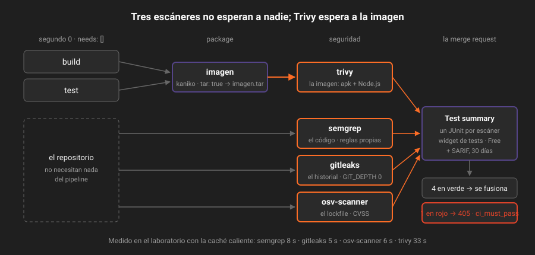

# El pipeline como superficie

> Hasta la Semana 18 el pipeline comprobaba que el código compila, que los tests pasan y que la imagen arranca. Ninguna de esas tres cosas dice si el código ejecuta lo que le mande un usuario, si alguien dejó una contraseña en un commit de hace un mes, si una dependencia tiene una CVE publicada ayer o si la imagen base trae una librería del sistema rota. Cada una de esas preguntas tiene su escáner, y ninguno contesta las otras tres.

---

## 🎯 Objetivos

- Distinguir las cuatro clases de escáner por **lo que leen**: código, historial, lockfile e imagen
- Explicar por qué un escáner no sustituye a otro, con un hallazgo que solo uno de ellos encuentra
- Saber qué da GitLab CE gratis en seguridad, qué es Ultimate y por qué este bootcamp usa las herramientas directamente
- Situar los escáneres en el pipeline de `app` sin alargarlo

---

## 1. Qué problema resuelve

Un día cualquiera en `app`:

1. Alguien añade una función que calcula una fórmula que llega en una petición, con `eval`. Los tests pasan: la fórmula del test es `2 + 2`.
2. En otra merge request, alguien pega la contraseña de la base de datos para probar en local, se da cuenta y la borra en el commit siguiente. La diff final de la MR no la enseña.
3. Una dependencia que lleva meses en el `package-lock.json` recibe hoy una CVE con CVSS 8,1. Nadie ha tocado ese archivo.
4. La imagen base de la Semana 13 trae `musl` con un desbordamiento de enteros publicado después de que la fijaras.

El revisor humano, con suerte, ve el primero. El segundo no está en la diff. El tercero y el cuarto no están en ningún cambio: están en lo que ya había.

---

## 2. Cómo funciona

### 2.1 Las cuatro clases

| Clase | Qué lee | Qué encuentra | Herramienta de esta semana | Licencia |
|---|---|---|---|---|
| **SAST** (análisis estático) | El código fuente, sin ejecutarlo | Patrones peligrosos: `eval`, comandos con shell, TLS sin verificar | [Semgrep](https://semgrep.dev/) `1.185.0` | LGPL-2.1 |
| **Secretos** | El **historial** de Git, commit a commit | Claves, contraseñas y tokens, aunque ya no estén en la rama | [Gitleaks](https://github.com/gitleaks/gitleaks) `8.30.0` | MIT |
| **Dependencias** (SCA) | El lockfile: lo que `npm ci` va a instalar | Versiones con vulnerabilidades publicadas en [OSV](https://osv.dev/) | [OSV-Scanner](https://github.com/google/osv-scanner) `2.7.0` | Apache-2.0 |
| **Imagen** | Las capas de la imagen que se despliega | Paquetes del sistema (`apk`) y del lenguaje que **van dentro** | [Trivy](https://trivy.dev/) `0.76.2` | Apache-2.0 |

Lo que importa es la columna "Qué lee". Cada escáner mira un objeto distinto, y por eso los cuatro no se solapan:

- Semgrep no sabe qué versión de `lodash` usas. OSV-Scanner no sabe qué haces con ella.
- Gitleaks lee commits; Semgrep lee la rama tal como está. La contraseña borrada en el commit siguiente solo la ve Gitleaks.
- OSV-Scanner lee lo que **declaras** en el lockfile; Trivy, lo que **hay** en la imagen. Una dependencia declarada que no se copia a la imagen la ve OSV y no Trivy. El `npm` que trae la imagen base de Node, con sus propias dependencias vulnerables, lo ve Trivy y no OSV: no está en tu lockfile.

Ese último par es el que más se discute ("¿para qué dos escáneres de vulnerabilidades?"), y la práctica 03 lo demuestra con tu propia imagen.

### 2.2 Dónde van en el pipeline



Tres de los cuatro no necesitan nada del pipeline: leen el repositorio. Con `needs: []` (Semana 11) arrancan en el segundo cero, en paralelo con `build` y `test`. Trivy es el único que espera: necesita la imagen, y la imagen la construye `imagen` en `package`. El stage `seguridad` existe para que la UI los agrupe; el orden real lo deciden los `needs`.

El coste en tiempo, medido en el laboratorio con la caché caliente: Semgrep 8 s, Gitleaks 5 s, OSV-Scanner 6 s, Trivy 33 s. Los tres primeros terminan antes que `test`. Trivy añade su medio minuto después de `imagen`.

### 2.3 Lo que GitLab CE da gratis

GitLab trae plantillas de seguridad, y **varias son Free**. Comprobado en la documentación de 19.2.4 y con `ci/lint` en la instancia el 2026-11-24:

| Plantilla | Motor por dentro | Tier | Qué deja en CE |
|---|---|---|---|
| `Jobs/SAST.gitlab-ci.yml` | Semgrep, con reglas gestionadas por GitLab | **Free** | Un `gl-sast-report.json` descargable |
| `Jobs/Secret-Detection.gitlab-ci.yml` | Gitleaks | **Free** | Un JSON descargable |
| `Jobs/Container-Scanning.gitlab-ci.yml` | Trivy | **Free** | Un JSON descargable y un SBOM CycloneDX |
| `Jobs/Dependency-Scanning.gitlab-ci.yml` | Gemnasium | **Ultimate** | Nada: sus `rules` exigen `$GITLAB_FEATURES =~ /dependency_scanning/` y en CE el job no se crea |
| DAST | ZAP | **Ultimate** | — |

Y lo que convierte esos JSON en algo que se usa es **Ultimate**: los hallazgos nuevos en la merge request, el informe de vulnerabilidades del proyecto, el Security Dashboard, personalizar las reglas de SAST, la lista de excepciones de Container Scanning y la protección de secretos en el push.

### 2.4 Por qué las herramientas directamente

Las plantillas Free usan los mismos motores. Este bootcamp no las usa por cuatro razones, todas visibles en su YAML:

| Plantilla de GitLab en CE | El componente de esta semana |
|---|---|
| Todos sus jobs llevan `allow_failure: true`: encuentran y **no paran nada** | Cada escáner falla el job desde un umbral, y la fusión exige el pipeline en verde |
| Imágenes por versión mayor (`semgrep:6`, `container-scanning:8`) desde `registry.gitlab.com`: cambian sin que nadie lo decida | Cada imagen fijada por digest (Semana 13) |
| El informe es un JSON que en CE no se pinta en ningún sitio | JUnit, que el widget de tests de la MR sí pinta en Free (teoría 06) |
| Las reglas de SAST son las de GitLab; personalizarlas es Ultimate | Las reglas son tuyas, versionadas en el componente (teoría 02) |

Cuándo compensa Ultimate: cuando hay un equipo de seguridad que hace triaje de cientos de hallazgos en decenas de proyectos. El informe de vulnerabilidades con estados (detectado, confirmado, descartado), el historial por hallazgo y las políticas de aprobación son trabajo que no se replica con cuatro JUnit. Para un equipo que quiere que **nada roto entre en `main`**, los cuatro JUnit y la puerta bastan.

---

## 3. Cómo se configura

No se configura aquí: es el componente de la práctica 02. Lo que sí se decide ahora es qué entra en el gate y qué no.

✅ Bloquean la fusión: los cuatro, desde el umbral `alta` (CVSS 7 o `HIGH` en Trivy) y cualquier secreto.

❌ No entra esta semana: DAST (necesita la aplicación desplegada y sus dueños, y es Ultimate en GitLab), fuzzing y análisis de licencias. Este último es responsabilidad del SBOM de la Semana 20.

Para ver el estado del pipeline de seguridad de `app` en cualquier momento:

```bash
# Los jobs del stage seguridad en el último pipeline de main, con su estado.
glab api "projects/:id/pipelines?ref=main&per_page=1" | jq '.[0].id' \
  | xargs -I{} glab api "projects/:id/pipelines/{}/jobs" \
  | jq -r '.[] | select(.stage=="seguridad") | "\(.name)\t\(.status)"'
# semgrep      success
# gitleaks     success
# osv-scanner  success
# trivy        success
```

Con la UI: `Build → Pipelines`, el último de `main`, columna `seguridad`.

---

## 4. Antipatrones

| Antipatrón | Por qué duele | Qué hacer en su lugar |
|---|---|---|
| Un solo escáner "que lo hace todo" | Cada herramienta lee un objeto; la que lee imágenes no ve el historial | Uno por clase, cada uno con su informe |
| Escanear solo en `main` | El hallazgo llega cuando ya está fusionado: ahora es una regresión, no una revisión | En la merge request, que es donde cuesta menos arreglarlo |
| Escáneres con `allow_failure: true` "para no molestar" | Un aviso que no para nada se deja de leer en una semana | Que fallen desde un umbral, y excepciones con fecha (teoría 07) |
| Escanear la imagen de otro tag que la que se despliega | Escaneas una y despliegas otra | El mismo artefacto: el tarball del pipeline (teoría 05) |
| Ignorar los hallazgos de lo que "ya estaba" | Las CVE se publican sobre código viejo; lo que había es justo lo que falla | El escaneo de `main` en cada fusión |

---

## 5. Trucos

- `GET /templates/gitlab_ci_ymls` lista 71 plantillas en 19.2.4, pero ninguna de las de seguridad (`Jobs/SAST` y compañía no aparecen). Para ver su contenido real, mételas en un `include` y llama a `POST /projects/:id/ci/lint` con `include_merged_yaml=true`: ahí aparecen los `allow_failure: true` y los `$GITLAB_FEATURES`.
- Los cuatro escáneres de esta semana tienen imagen oficial. Ejecutados en tu máquina con el mismo digest que el job, dan el mismo resultado: es la forma de no esperar al pipeline (práctica 01).

---

## 📚 Recursos Adicionales

- [Application security en GitLab](https://docs.gitlab.com/user/application_security/) — qué hace cada escáner y en qué tier
- [SAST: features por tier](https://docs.gitlab.com/user/application_security/sast/#features) — la tabla Free frente a Ultimate
- [OWASP DevSecOps Guideline](https://owasp.org/www-project-devsecops-guideline/) — dónde va cada clase de escaneo en el ciclo

---

## ✅ Checklist de Verificación

- [ ] Sabes qué lee cada uno de los cuatro escáneres y das un hallazgo que solo él encuentra
- [ ] Sabes qué plantillas de seguridad son Free en CE y qué dejan
- [ ] Puedes explicar por qué el job de Dependency Scanning no aparece en tu pipeline aunque incluyas su plantilla
- [ ] Sabes por qué Trivy espera a `imagen` y los otros tres no esperan a nadie
