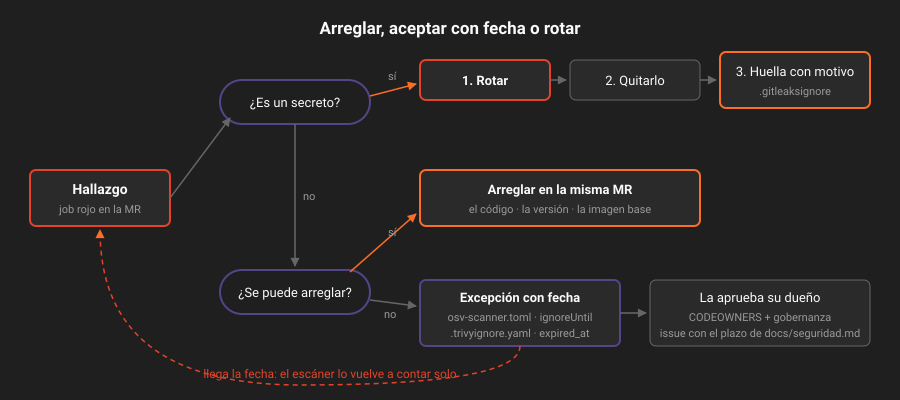

# Informes, umbrales y la puerta

> Un escáner que encuentra y nadie lee es decoración. Para que un hallazgo pare una fusión hacen falta tres cosas: que el revisor lo vea donde ya está mirando, que el job falle solo cuando importa, y que un job fallido impida fusionar. En CE las tres son gratis, y ninguna viene puesta.

---

## 🎯 Objetivos

- Llevar los hallazgos de los cuatro escáneres al widget de tests de la merge request con JUnit
- Explicar qué guarda el SARIF y por qué se archiva aunque CE no lo pinte
- Definir un umbral común para cuatro herramientas con escalas distintas
- Cerrar la puerta: por qué `allow_failure` deshace todo lo anterior, y qué devuelve la API al intentar fusionar en rojo

---

## 1. Qué problema resuelve

En CE, el widget de seguridad de la merge request es Ultimate (teoría 01). Sin él, un escáner que falla deja al revisor un job rojo y un log de 400 líneas. Lo abrirá una vez. A la tercera, alguien pondrá `allow_failure: true` "mientras lo miramos", y el escáner habrá dejado de existir.

Hace falta un sitio que el revisor ya mire, que diga qué falló en una línea, y que distinga lo que esta MR ha roto de lo que ya estaba roto.

---

## 2. Cómo funciona

### 2.1 JUnit: el widget que ya tienes

El widget de tests de la merge request (`artifacts:reports:junit`) es **Free**. La Semana 09 lo usó para `node:test`. Lee cualquier XML en formato JUnit, venga de donde venga: no sabe ni le importa que el "test" sea una CVE.

| Escáner | Cómo escribe JUnit |
|---|---|
| Semgrep | `--junit-xml-output=semgrep.junit.xml`. Un caso por hallazgo, con archivo y línea |
| Gitleaks | `--report-format junit`. Un caso por secreto, con commit, archivo y línea |
| Trivy | `trivy convert --format template --template @/contrib/junit.tpl`. Un caso por paquete y CVE |
| OSV-Scanner | No lo escribe: el componente traduce su tabla con `awk` (teoría 04) |

Cada job es una *suite* con su nombre: `semgrep`, `gitleaks`, `osv-scanner`, `trivy`. Un escáner limpio deja una suite con **cero** casos, y eso también es información: el widget dice que se ejecutó.

Y el widget hace algo que parece del tier de pago: **compara con la rama de destino**. Separa *newly failed* (fallaba aquí y no en `main`), *existing failures* (fallaba en los dos) y *resolved* (fallaba en `main` y aquí ya no). Si `main` está en verde, cada fallo de la MR es nuevo, y es justo lo que el revisor quiere saber.

Por API, lo mismo que ve el widget:

```bash
# Los hallazgos de un pipeline, uno por línea.
glab api "projects/:id/pipelines/<id>/test_report" \
  | jq -r '.test_suites[] | .name as $s | .test_cases[] | select(.status == "failed") | "\($s)\t\(.classname)\t\(.name)"'
# semgrep      src/prestamos.ts   plataforma.eval-con-datos
# osv-scanner  lodash@4.17.20     [CVSS 8.1] GHSA-r5fr-rjxr-66jc
```

Los límites del informe JUnit en 19.2.4: 30 MB por archivo y 100 MB por job. Un escaneo de imagen con miles de hallazgos `LOW` se acercaría; por eso el JUnit de Trivy lleva solo lo que llega al umbral.

### 2.2 SARIF: el inventario

SARIF (*Static Analysis Results Interchange Format*, OASIS) es el formato estándar de resultados de análisis: los cuatro escáneres lo escriben, y lleva más que el JUnit (la regla completa, la severidad original, las huellas, todos los hallazgos y no solo los del umbral).

CE no lo pinta. El componente lo guarda como artefacto de 30 días por dos razones: es la prueba de lo que se escaneó en cada commit, y es lo que lee cualquier herramienta de triaje que llegue después (incluida la de Ultimate si un día la hay). El JUnit es para el revisor de hoy; el SARIF, para el auditor de dentro de un mes.

`artifacts:reports:sast` y `secret_detection` existen en Free, pero esperan el JSON propio de GitLab, no SARIF; en CE solo los guardan para descargarlos. No aportan nada que el artefacto SARIF no aporte.

### 2.3 Un umbral, cuatro escalas

Cada herramienta mide la gravedad a su manera:

| Escáner | Su escala | `critica` | `alta` (por defecto) | `media` |
|---|---|---|---|---|
| Semgrep | La `severity` de cada regla | Bloquea | Bloquea | Bloquea |
| Gitleaks | Ninguna: un secreto es un secreto | Bloquea | Bloquea | Bloquea |
| OSV-Scanner | CVSS 0-10 | ≥ 9,0 | ≥ 7,0 | ≥ 4,0 |
| Trivy | `LOW` … `CRITICAL` | `CRITICAL` | `HIGH`, `CRITICAL` | `MEDIUM`, `HIGH`, `CRITICAL` |

El componente recibe **un** input, `umbral`, con tres valores (`options`, Semana 12), y lo traduce en un `before_script` común a `SEVERIDADES` y `CVSS_MIN`. Las reglas de Semgrep y Gitleaks bloquean siempre: las de Semgrep son pocas y propias (si una no merece bloquear, no debería estar), y un secreto no tiene grados.

¿Por qué `alta` y no `media` por defecto? Porque el primer día de un escáner decide si el equipo lo respeta. Con `media`, la imagen de `app` tendría hoy siete hallazgos `MEDIUM` sin nada que hacer salvo esperar a la siguiente base de Alpine: el pipeline estaría rojo por algo que nadie puede arreglar esta tarde. El umbral es un acuerdo; el plazo para lo que queda debajo va en `docs/seguridad.md` (teoría 07).

### 2.4 La puerta



El job falla. ¿Y qué? Tres ajustes juntos convierten un job rojo en una fusión imposible, y los tres son Free:

| Pieza | Dónde | Qué hace |
|---|---|---|
| Sin `allow_failure` | El componente | El job rojo pone el pipeline en rojo |
| `only_allow_merge_if_pipeline_succeeds` | `app`, desde la Semana 09 | Sin pipeline en verde, no hay fusión |
| `allow_merge_on_skipped_pipeline: false` | `app`, desde la Semana 09 | Un pipeline saltado no cuenta como verde |

Con la puerta cerrada, la merge request se queda en `detailed_merge_status: "ci_must_pass"`, y la API lo confirma (comprobado en 19.2.4):

```bash
glab api --method PUT "projects/:id/merge_requests/<iid>/merge" -f sha=<sha>
# {"message":"405 Method Not Allowed"}
```

Sin `sha`, 19.2.4 responde antes `400` con `SHA must be provided when merging`: el `405` es el de la puerta, con el `sha` de la cabeza de la MR.

`allow_failure: true` en un escáner rompe la primera pieza en silencio: el job sale naranja, el pipeline verde, y la fusión pasa. La plantilla de GitLab lo trae así en todos sus jobs. El check `cuatro-escaneres-bloquean` comprueba con `ci/lint` que ninguno de los cuatro lo tiene.

---

## 3. Cómo se configura

En cada job del componente, el mismo bloque:

```yaml
  artifacts:
    when: always          # también, y sobre todo, cuando el job falla
    expire_in: 30 days
    paths: [semgrep.sarif]
    reports:
      junit: semgrep.junit.xml
```

`when: always` es lo que hace que el informe exista justo cuando importa: por defecto, los artefactos de un job fallido no se suben, y el widget quedaría vacío en la única MR en la que tiene algo que decir.

Con la UI: en la merge request, el panel *Test summary* (`N failed`) bajo el estado del pipeline; cada caso enseña su mensaje y, si el JUnit trae `file`, el archivo.

---

## 4. Antipatrones

| Antipatrón | Por qué duele | Qué hacer en su lugar |
|---|---|---|
| `allow_failure: true` en un escáner | El pipeline pasa con el escáner en rojo; la puerta no se entera | Que falle, y excepciones con fecha |
| Artefactos sin `when: always` | El informe desaparece en los jobs que fallan | `when: always` en los cuatro |
| Un umbral distinto en cada proyecto "según convenga" | Nadie sabe qué significa un pipeline verde | Un umbral por defecto en el componente, y cambiarlo se escribe y se revisa |
| Mirar solo el log | 400 líneas para encontrar una CVE | El widget y `test_report` |
| JUnit con todos los `LOW` | Cientos de casos, el límite de 30 MB, y el revisor deja de mirar | Solo lo que llega al umbral; el resto, en el SARIF |

---

## 5. Trucos

- *Copy failed tests* en el panel de tests copia los nombres de los casos fallidos separados por espacios: con Trivy, una lista de CVE lista para pegar en un issue.
- `GET /projects/:id/pipelines/<id>/test_report_summary` da solo los totales por suite: suficiente para un panel o para ChatOps (Semana 17).
- En GraphQL, `pipeline { testReportSummary { testSuites { nodes { name failedCount } } } }` es lo que usan los checks de esta semana.

---

## 📚 Recursos Adicionales

- [Unit test reports](https://docs.gitlab.com/ci/testing/unit_test_reports/) — el widget, la comparación con la rama de destino y los límites
- [`artifacts:reports`](https://docs.gitlab.com/ci/yaml/artifacts_reports/) — qué informe espera qué formato y en qué tier
- [SARIF 2.1.0](https://docs.oasis-open.org/sarif/sarif/v2.1.0/sarif-v2.1.0.html) — la especificación de OASIS

---

## ✅ Checklist de Verificación

- [ ] Sabes qué diferencia hay entre el JUnit y el SARIF del mismo escaneo, y para quién es cada uno
- [ ] Puedes traducir el umbral `alta` a cada una de las cuatro escalas
- [ ] Sabes las tres piezas de la puerta y cuál rompe `allow_failure`
- [ ] Has visto un `405` al intentar fusionar con un escáner en rojo
