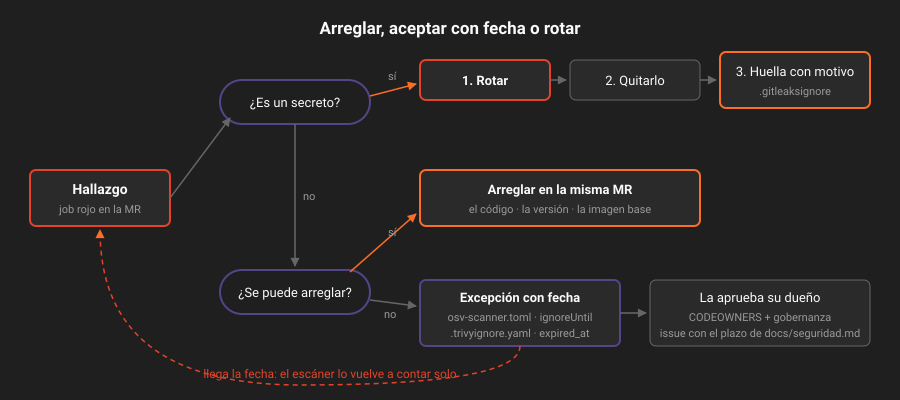

# Excepciones que caducan

> Un escáner que bloquea sin salida acaba desactivado. Un escáner con salida fácil acaba ignorado. Entre los dos está la excepción: una decisión escrita, con motivo, con dueño y con fecha de caducidad, que pasa por la misma revisión que el código. Esta teoría es la que decide si los cuatro escáneres siguen encendidos dentro de seis meses.

---

## 🎯 Objetivos

- Decidir qué hacer con un hallazgo: arreglarlo, aceptarlo con fecha o rotar el secreto
- Escribir una excepción en el archivo de cada escáner, con motivo y caducidad
- Dar dueño a los archivos de excepción con `CODEOWNERS` y el job `gobernanza`
- Escribir los plazos de corrección de lo que queda bajo el umbral

---

## 1. Qué problema resuelve

El pipeline de una merge request urgente se pone rojo por una CVE en una dependencia que la MR no ha tocado. Hay tres reacciones posibles, y dos son malas:

- ❌ `allow_failure: true` en el escáner. Arregla esta MR y apaga el escáner para todas las siguientes.
- ❌ Una línea en el archivo de excepciones, sin motivo, empujada por quien tiene prisa. Arregla esta MR y deja la CVE aceptada para siempre, sin que nadie sepa por qué.
- ✅ Una excepción con fecha, que revisa otra persona, y un issue para arreglarla antes de esa fecha.

La tercera tarda diez minutos más. Es el precio de que el escáner siga encendido.

---

## 2. Cómo funciona

### 2.1 Las tres salidas



| Hallazgo | Salida normal | Cuándo otra |
|---|---|---|
| Código (Semgrep) | Arreglar el código | Falso positivo demostrable: `nosemgrep` con motivo en la misma línea |
| Secreto (Gitleaks) | **Rotar**, quitarlo, y la huella en `.gitleaksignore` | No hay otra: ver teoría 03 |
| Dependencia (OSV-Scanner) | Subir la versión | Sin versión arreglada, o la función afectada no se usa: excepción con fecha |
| Imagen (Trivy) | Cambiar de base o quitar lo que sobra | Sin arreglo en la distribución: excepción con fecha |

Arreglar es siempre la primera opción. Una excepción no dice "esto no es un problema": dice "sabemos que es un problema, esto es lo que hemos decidido y hasta cuándo".

### 2.2 Los cuatro archivos

Cada herramienta tiene el suyo, en la raíz de `app`:

| Escáner | Archivo | Motivo | Caducidad |
|---|---|---|---|
| Semgrep | Comentario en la línea: `// nosemgrep: eval-con-datos -- <motivo>` | En el comentario | No tiene: la revisión de la línea es la caducidad |
| Gitleaks | `.gitleaksignore` | Comentario `#` encima de la huella | No la necesita: la huella es de un commit concreto, y el secreto ya está rotado |
| OSV-Scanner | `osv-scanner.toml` | `reason = "…"` | `ignoreUntil = 2026-12-24` |
| Trivy | `.trivyignore.yaml` | `statement: …` | `expired_at: 2026-12-24` |

```yaml
# .trivyignore.yaml
vulnerabilities:
  - id: CVE-2026-107891
    statement: musl de la base. Sin imagen de Node con el arreglo a fecha de hoy; issue #<iid>. Revisado por @revisor-biblioteca.
    expired_at: 2026-12-24
```

Comprobado en el laboratorio con las dos herramientas: con la fecha en el futuro, el hallazgo desaparece del informe; con la fecha pasada, vuelve, y el job vuelve a fallar. **La caducidad la aplica el escáner**, no una persona que se acuerde.

`.trivyignore` (sin extensión) también existe, pero es una lista de identificadores sin fecha ni motivo. El componente solo lee `.trivyignore.yaml`, y lo pasa con `--ignorefile` si existe.

### 2.3 Quién decide

Una excepción cambia el comportamiento del gate. Tiene que pasar, como mínimo, por la misma revisión que el `.gitlab-ci.yml`. La Semana 07 lo dejó resuelto en CE: `CODEOWNERS` dice quién es dueño de cada ruta, y el job `gobernanza` falla si una MR toca una ruta sin la aprobación de su dueño. Tres líneas más:

```text
# Las excepciones de seguridad no las aprueba quien las necesita
/.gitleaksignore      @revisor-biblioteca
/osv-scanner.toml     @revisor-biblioteca
/.trivyignore.yaml    @revisor-biblioteca
```

Las tres rutas aparecen aunque `osv-scanner.toml` y `.trivyignore.yaml` no existan todavía: el día que alguien los cree, ya tienen dueño. Y tienen que estar en `main` **antes** de la primera excepción: `gobernanza` lee el `CODEOWNERS` de la rama de destino, no el de la MR, para que una MR no pueda nombrarse dueña de lo que toca. En Premium, GitLab exigiría esa aprobación por sí solo (*Code Owners approval*); en CE la exige `gobernanza`.

Y `nosemgrep` vive en código, así que lo cubre la regla de `/src/` que ya tienes.

### 2.4 Plazos

Lo que queda **bajo** el umbral no para el pipeline, pero no desaparece. Sin un plazo escrito, un `MEDIUM` se queda para siempre. Los plazos son la otra mitad del umbral, y van en `docs/seguridad.md`:

| Gravedad | Plazo para arreglar | Si no se puede |
|---|---|---|
| Crítica (CVSS ≥ 9, `CRITICAL`) | Bloquea. Mismo día | Excepción de 7 días como mucho |
| Alta (≥ 7, `HIGH`) | Bloquea. Antes de fusionar | Excepción de 30 días como mucho |
| Media (≥ 4, `MEDIUM`) | 30 días, con issue | Siguiente imagen base o siguiente versión |
| Baja | Con la siguiente actualización | — |

Las cifras son un punto de partida razonable, no una norma: lo que importa es que estén escritas y que quien revise una excepción pueda comprobar si cumple. Una excepción de 90 días para una crítica no pasa la revisión porque `docs/seguridad.md` dice 7.

---

## 3. Cómo se configura

Un hallazgo de `osv-scanner` en una MR, de principio a fin:

```bash
# 1. ¿Qué es y dónde está arreglado?
glab api "projects/:id/pipelines/<id>/test_report" \
  | jq -r '.test_suites[] | select(.name=="osv-scanner") | .test_cases[] | select(.status=="failed") | .system_output // .name'

# 2. ¿Se puede subir? npm dice por qué camino llega.
npm ls lodash

# 3. Si no: la excepción, con fecha y motivo, en la misma MR, y un issue para quitarla.
cat >> osv-scanner.toml <<'EOF'
[[IgnoredVulns]]
id = "GHSA-…"
ignoreUntil = 2026-12-24
reason = "<por qué no aplica o por qué no se puede subir>. Issue #<iid>."
EOF
```

La MR no se fusiona hasta que el dueño de `osv-scanner.toml` la aprueba y `gobernanza` lo ve.

---

## 4. Antipatrones

| Antipatrón | Por qué duele | Qué hacer en su lugar |
|---|---|---|
| Excepción sin fecha | Aceptada para siempre por alguien que ya no está | `ignoreUntil` / `expired_at`, y el plazo de `docs/seguridad.md` |
| Excepción sin motivo | Nadie puede revisarla, ni renovarla con criterio | El motivo y el issue, en la misma entrada |
| La aprueba quien la necesita | La excepción es el camino más corto para que pase el pipeline | `CODEOWNERS` y `gobernanza` |
| Renovar la fecha cada mes sin mirar | Una excepción permanente con más pasos | Cada renovación es otra MR, con el estado actual del aviso |
| Ignorar el paquete entero | Las CVE futuras de ese paquete también pasan | Un identificador por entrada |

---

## 5. Trucos

- `grep -h "ignoreUntil\|expired_at" osv-scanner.toml .trivyignore.yaml | sort -k3` lista las excepciones por fecha: las primeras son las que van a romper el pipeline.
- OSV-Scanner avisa `has unused ignores` cuando una entrada ya no se aplica (caducada, o la dependencia ya no está): es la señal de que se puede borrar.
- El auditor de la Semana 17 puede leer esos dos archivos por API (`repository/files`) y avisar por el chat de las excepciones que caducan en siete días.

---

## 📚 Recursos Adicionales

- [OSV-Scanner: configuration](https://google.github.io/osv-scanner/configuration/) — `IgnoredVulns`, `ignoreUntil` y `reason`
- [Trivy: filtering](https://trivy.dev/docs/v0.76/guide/configuration/filtering/) — `.trivyignore.yaml`, `statement` y `expired_at`
- [Semgrep: ignoring findings](https://semgrep.dev/docs/ignoring-files-folders-code) — `nosemgrep` y `.semgrepignore`

---

## ✅ Checklist de Verificación

- [ ] Sabes qué salida tiene cada clase de hallazgo y por qué un secreto no tiene excepción sin rotación
- [ ] Sabes qué archivo usa cada escáner y cuál de ellos aplica la caducidad solo
- [ ] Tu `CODEOWNERS` da dueño a los tres archivos de excepción
- [ ] Puedes decir qué plazo tiene un `MEDIUM` en tu `docs/seguridad.md`
